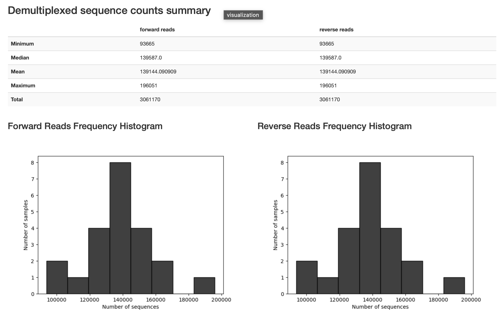
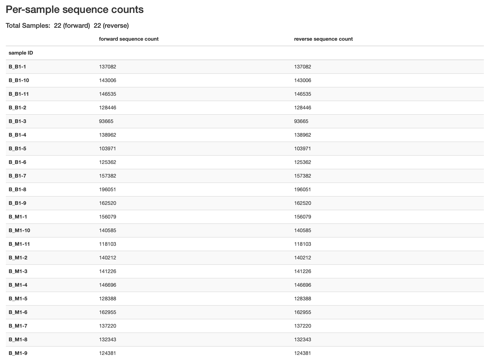
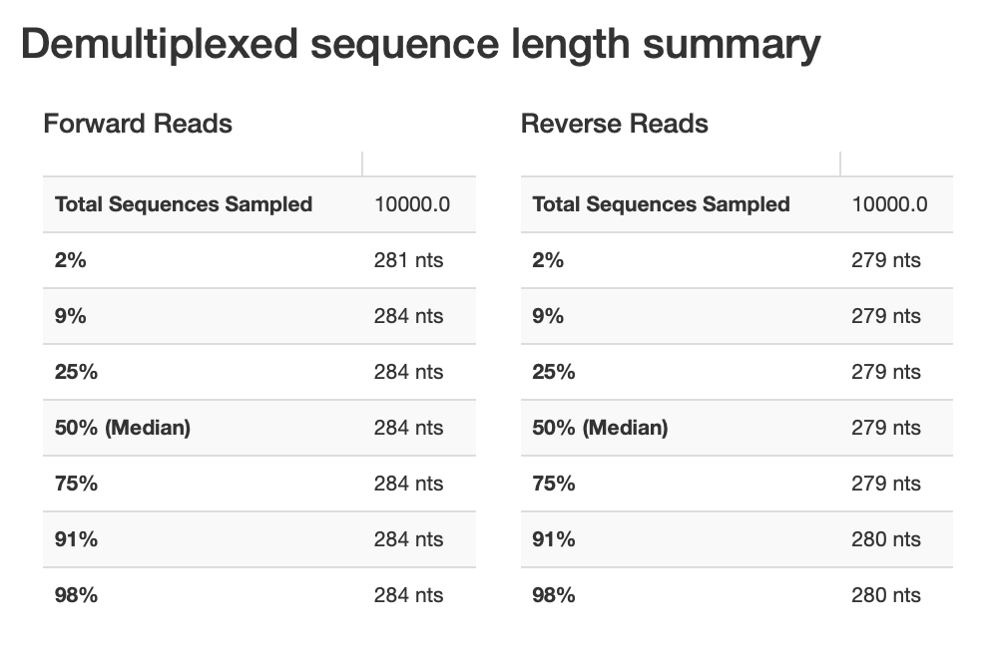
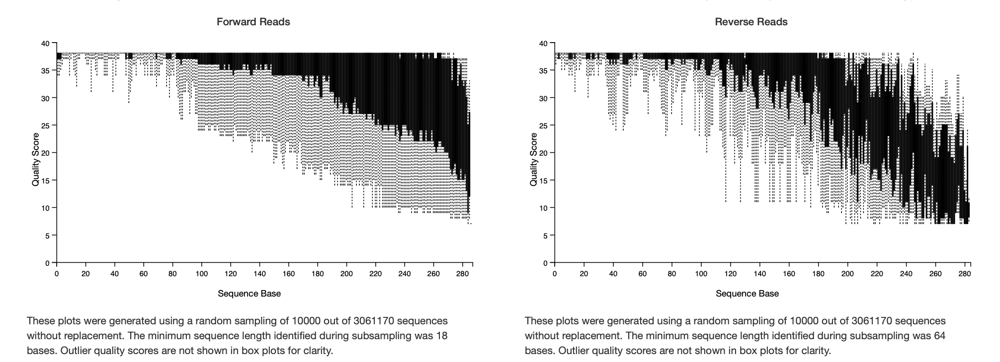
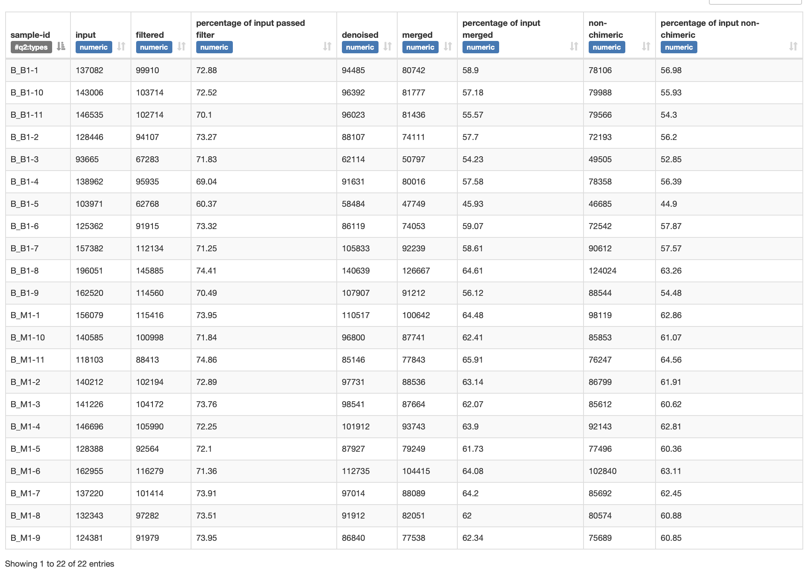

# Primer Trimming and DADA2 Denoising

**Date:** 2026-07-22
**Stage:** primer and spacer removal (cutadapt); per-batch denoising (DADA2)
**Cohort:** six batches (GB1–GB3, GJ1–GJ3), 16S and ITS2
**Script:** `modules/02_cutadapt_trimming.sh`, `modules/03_dada2_denoise.sh`
**Input:** `01_imported/demux_16S_<batch>.qza`, `01_imported/demux_ITS_<batch>.qza`
**Output:** `02_trimmed_16S/`, `02_trimmed_ITS/`, `03_denoised_16S/{table,repseq,stats}_16S_<batch>.qza`, `03_denoised_ITS/{table,repseq,stats}_ITS_<batch>.qza`

---

## 1. Primer and spacer removal

The amplicon constructs carry a 0–3 nt N spacer in front of the locus-specific primer. The primers were passed to `qiime cutadapt trim-paired` as 5′ adapters (`--p-front-f`, `--p-front-r`), so each primer and any bases before it, including the spacer, are removed.

```bash
qiime cutadapt trim-paired \
  --i-demultiplexed-sequences "01_imported/demux_16S_${batch}.qza" \
  --p-front-f CCTACGGGNGGCWGCAG \
  --p-front-r GACTACHVGGGTATCTAATCC \
  --p-error-rate 0.15 \
  --p-match-adapter-wildcards \
  --p-match-read-wildcards \
  --p-discard-untrimmed \
  --p-cores 10 \
  --o-trimmed-sequences "02_trimmed_16S/trimmed_16S_${batch}.qza"
```

ITS2 used the same settings with `--p-front-f GCATCGATGAAGAACGCAGC` (ITS3) and `--p-front-r TCCTCCGCTTATTGATATGC` (ITS4), writing to `02_trimmed_ITS/`. A `qiime demux summarize` visualization was made for every trimmed artifact.

* The two wildcard options let IUPAC codes (N, W, H, V) match in both primer and read.
* An error rate of 0.15 allows 2 mismatches in the 17-nt 341F primer and 3 in the 21-nt 805R primer.
* `--p-discard-untrimmed` removes read pairs in which the primer was not found.

---

## 2. Reads after trimming (16S, batch GB1)





* 22 libraries: 11 GB soil-treated (`B1`) and 11 controls (`M1`).
* 3,061,170 read pairs in total; mean 139,144 per library; range 93,665 (`B_B1-3`) to 196,051 (`B_B1-8`).



* Median read length after trimming was 284 nt (forward) and 279–280 nt (reverse). This is consistent with removal of the 17-nt and 21-nt primers and their spacers.

---

## 3. DADA2 settings



* **16S quality:** forward-read quality stays high to about cycle 260 and drops near the end of the read. Reverse-read quality declines from about cycle 180–200.
* **16S truncation:** `--p-trunc-len-f 260 --p-trunc-len-r 200`. After truncation the two reads cover 260 + 200 = 460 nt. With an insert of about 400–425 nt after primer removal, the expected overlap is about 35–60 nt; DADA2's default minimum overlap is 12 nt.
* **Expected errors:** `--p-max-ee-f 2.0 --p-max-ee-r 3.0`, where EE = Σ 10^(−Q/10) over the read. The reverse limit is higher because reverse-read quality is lower.
* **ITS2:** no truncation (`--p-trunc-len-f 0 --p-trunc-len-r 0`), because ITS2 length differs between fungal taxa and a fixed truncation length would remove short or long amplicons. Reads are filtered by the same expected-error limits only.
* DADA2 was run separately for each batch, so that each batch has its own error model.

```bash
qiime dada2 denoise-paired \
  --i-demultiplexed-seqs "02_trimmed_16S/trimmed_16S_${batch}.qza" \
  --p-trunc-len-f 260 \
  --p-trunc-len-r 200 \
  --p-max-ee-f 2.0 \
  --p-max-ee-r 3.0 \
  --p-n-threads 10 \
  --o-table "03_denoised_16S/table_16S_${batch}.qza" \
  --o-representative-sequences "03_denoised_16S/repseq_16S_${batch}.qza" \
  --o-denoising-stats "03_denoised_16S/stats_16S_${batch}.qza"
```

| Assay | Truncation (F / R) | Max EE (F / R) | Threads |
| :--- | :--- | :--- | ---: |
| 16S | 260 / 200 | 2.0 / 3.0 | 10 |
| ITS2 | 0 / 0 (none) | 2.0 / 3.0 | 8 |

All 6 bacterial and 6 fungal batches were trimmed and denoised with these settings. Denoising statistics were tabulated with `qiime metadata tabulate` (`stats_*_<batch>.qzv`).

---

## 4. Read tracking (16S, batch GB1)



Selected libraries (percentages are of input reads):

| Sample | Input | Passed filter | Denoised | Merged | Non-chimeric |
| :--- | ---: | ---: | ---: | ---: | ---: |
| B_B1-1 | 137,082 | 99,910 (72.88%) | 94,485 | 80,742 (58.90%) | 78,106 (56.98%) |
| B_B1-8 | 196,051 | 145,885 (74.41%) | 140,639 | 126,667 (64.61%) | 124,024 (63.26%) |
| B_B1-3 | 93,665 | 67,283 (71.83%) | 62,114 | 50,797 (54.23%) | 49,505 (52.85%) |
| B_B1-5 | 103,971 | 62,768 (60.37%) | 58,484 | 47,749 (45.93%) | 46,685 (44.90%) |
| B_M1-1 | 156,079 | 115,416 (73.95%) | 110,517 | 100,642 (64.48%) | 98,119 (62.86%) |
| B_M1-11 | 118,103 | 88,413 (74.86%) | 85,146 | 77,843 (65.91%) | 76,247 (64.56%) |

Across all 22 libraries in Figure 005:

* Passed filter: 60.4–74.9% of input reads (median 72.7%).
* Merged: 45.9–65.9% (median 61.9%).
* Non-chimeric: 44.9–64.6% (median 60.5%).
* Chimera removal took out 1.5–3.3% of the merged reads (median 2.2%).
* `B_B1-5` had the lowest retention at each step.
