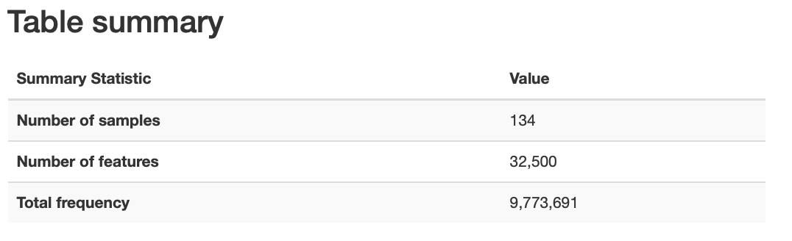
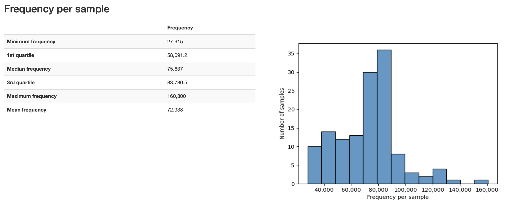
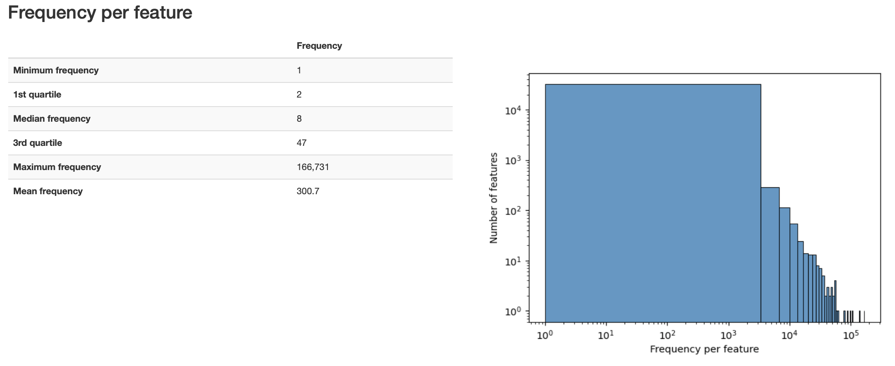

# Batch Merging, Phylogeny, Taxonomic Filtering and Metadata

**Date:** 2026-07-23
**Stage:** merging of per-batch tables; 16S tree; taxonomic classification and filtering; sample metadata; standard-only tables
**Cohort:** six batches; full set N = 134, standard set N = 127 (16S and ITS2)
**Script:** `modules/04_merge_and_decontam.sh`, `modules/05_phylogeny_and_diversity.sh` (tree), `modules/make_metadata.py`
**Input:** `03_denoised_16S/*`, `03_denoised_ITS/*`, `classifiers/*`
**Output:** `04_merged_16S/*`, `04_merged_ITS/*`, `06_phylo_16S/*`, `05_taxonomy_16S/*`, `05_taxonomy_ITS/*`, `metadata_P_generation.tsv`

---

## 1. Merging the batches

For each assay, the six per-batch feature tables and representative-sequence sets were combined with `qiime feature-table merge` and `qiime feature-table merge-seqs`. DADA2 ASVs are exact sequences with MD5-hash IDs, so an ASV found in several batches has the same ID everywhere and its counts are combined.

```bash
qiime feature-table merge \
  --i-tables 03_denoised_16S/table_16S_GB1.qza 03_denoised_16S/table_16S_GB2.qza 03_denoised_16S/table_16S_GB3.qza \
             03_denoised_16S/table_16S_GJ1.qza 03_denoised_16S/table_16S_GJ2.qza 03_denoised_16S/table_16S_GJ3.qza \
  --o-merged-table 04_merged_16S/table_16S_merged.qza
qiime feature-table merge-seqs \
  --i-data 03_denoised_16S/repseq_16S_GB1.qza ... 03_denoised_16S/repseq_16S_GJ3.qza \
  --o-merged-data 04_merged_16S/repseq_16S_merged.qza
```

The ITS2 commands are the same with `_ITS_` file names.

---

## 2. 16S phylogeny

```bash
qiime phylogeny align-to-tree-mafft-fasttree \
  --i-sequences 04_merged_16S/repseq_16S_merged.qza \
  --p-n-threads 4 \
  --o-alignment 06_phylo_16S/aligned_repseq_16S.qza \
  --o-masked-alignment 06_phylo_16S/masked_aligned_repseq_16S.qza \
  --o-tree 06_phylo_16S/unrooted_tree_16S.qza \
  --o-rooted-tree 06_phylo_16S/rooted_tree_16S.qza
```

This pipeline aligns the ASVs with MAFFT, masks highly variable alignment columns, builds an approximately maximum-likelihood tree with FastTree and roots it at the midpoint. The rooted tree is used for Faith's PD and UniFrac.

No tree was built for ITS2. ITS2 sequences differ greatly in length and cannot be aligned reliably across fungal phyla, so ITS2 analyses use only non-phylogenetic distances (Bray–Curtis, Jaccard).

---

## 3. Taxonomic classification and filtering

| Assay | Reference | Classifier file |
| :--- | :--- | :--- |
| 16S | SILVA 138, 99% OTUs, full-length 16S | `silva-138-99-nb-classifier.qza` (naive Bayes, scikit-learn 1.4.2 build, data.qiime2.org) |
| ITS2 | UNITE v10, 99%, release 04.04.2024 | `unite_ver10_99_04.04.2024-Q2-2024.5.qza` (from github.com/colinbrislawn/unite-train) |

```bash
qiime feature-classifier classify-sklearn \
  --i-classifier classifiers/silva-138-99-nb-classifier.qza \
  --i-reads 04_merged_16S/repseq_16S_merged.qza \
  --p-n-jobs 8 \
  --o-classification 05_taxonomy_16S/taxonomy_16S.qza

qiime taxa filter-table \
  --i-table 04_merged_16S/table_16S_merged.qza \
  --i-taxonomy 05_taxonomy_16S/taxonomy_16S.qza \
  --p-exclude mitochondria,chloroplast,Archaea,Eukaryota,Cyanobacteria,Rickettsiales,Rickettsiellales,Unassigned \
  --o-filtered-table 05_taxonomy_16S/table_16S_clean.qza

qiime taxa filter-table \
  --i-table 04_merged_ITS/table_ITS_merged.qza \
  --i-taxonomy 05_taxonomy_ITS/taxonomy_ITS.qza \
  --p-include k__Fungi \
  --o-filtered-table 05_taxonomy_ITS/table_ITS_clean.qza
```

The ITS2 classification used the UNITE classifier with `--p-n-jobs 4`.

Reasons for the 16S exclusions:

* `mitochondria`, `chloroplast`: organelle sequences, mostly from the host plant.
* `Archaea`, `Eukaryota`: outside the scope of the bacterial survey.
* `Cyanobacteria`: removed as a whole together with chloroplasts. This also removes any true cyanobacteria.
* `Rickettsiales`, `Rickettsiellales`: obligate intracellular lineages; Rickettsiales are closely related to mitochondria.
* `Unassigned`: not classified at domain level.

For ITS2, only features assigned to `k__Fungi` were kept. This removes plant and other non-fungal sequences amplified by ITS3/ITS4.

---

## 4. Sample metadata (`metadata_P_generation.tsv`)

`modules/make_metadata.py` reads the sample IDs from both clean tables and derives each column from the sample code:

| Column | Values | Rule |
| :--- | :--- | :--- |
| `Domain` | `Bacteria`, `Fungi` | `B_` or `F_` prefix |
| `Sample_Type` | `Standard`, `Extra_Sample` | `Extra_Sample` if the code ends in `x` or `y` |
| `Treatment_Group` | `GB_Control`, `GB_Treatment`, `GJ_Control`, `GJ_Treatment` (`*_Extra` for x/y samples) | code prefix `M`, `B`, `jM`, `J` |
| `Target_Soil` | `Gijang_B`, `Gyeongju`, `Base_Soil` | from treatment |
| `Inoculum` | `GB_Soil_Suspension`, `GJ_Soil_Suspension`, `MES_Buffer_Alone` | from treatment |
| `Sequencing_Batch` | `B1`, `B3`, `B4`, `M1`, `M3`, `M4`, `J2`, `J3`, `J4`, `jM2`, `jM3`, `jM4`, `GJ3_Extra` | code prefix (letters + set number) |
| `Generation` | `P` | constant |

Despite its name, `Sequencing_Batch` holds the sample set (for example `B1` or `M1`), not the batch folder. Each batch folder contains one treated set and one control set: GB1 = `B1` + `M1`, GB2 = `B3` + `M3`, GB3 = `B4` + `M4`, GJ1 = `J2` + `jM2`, GJ2 = `J3` + `jM3`, GJ3 = `J4` + `jM4` + the x/y samples. All seven x/y codes start with `J`, so the script labels them `GJ_Treatment_Extra` and assigns them to `GJ3_Extra`.

---

## 5. The x/y samples: full and standard tables

Seven GJ3 libraries have codes ending in `x` or `y` (`J2x`, `J2y`, `J5x`, `J5y`, `J7x`, `J8x`, `J13x`). The harvest records suggested that these tubes were mislabelled, possibly with controls marked `x` and treated samples marked `y`. Because their group could not be confirmed, two versions of each table were made:

| Table | Filter | Samples per assay | Use |
| :--- | :--- | ---: | :--- |
| `table_*_clean.qza` ("full") | taxonomy filter only | 134 | sensitivity checks; inspection of the x/y samples |
| `table_*_standard.qza` ("standard") | taxonomy filter + `[Sample_Type]='Standard'` | 127 | main comparisons in the six-batch analyses |

```bash
qiime feature-table filter-samples \
  --i-table 05_taxonomy_16S/table_16S_clean.qza \
  --m-metadata-file metadata_P_generation.tsv \
  --p-where "[Sample_Type]='Standard'" \
  --o-filtered-table 05_taxonomy_16S/table_16S_standard.qza
```

The same filter was applied to `table_ITS_clean.qza`. Both sets were later replaced by the five-batch set (N = 110; see 2026-07-29_01).

| Assay | Table | Content | Used for |
| :--- | :--- | :--- | :--- |
| 16S | `04_merged_16S/table_16S_merged.qza` | merged, unfiltered | QC summary (Section 6) |
| 16S | `05_taxonomy_16S/table_16S_clean.qza` | taxonomy-filtered, N = 134 | full-set analyses |
| 16S | `05_taxonomy_16S/table_16S_standard.qza` | taxonomy-filtered, N = 127 | standard-set analyses |
| ITS2 | `04_merged_ITS/table_ITS_merged.qza` | merged, unfiltered | QC summary |
| ITS2 | `05_taxonomy_ITS/table_ITS_clean.qza` | `k__Fungi` only, N = 134 | full-set analyses |
| ITS2 | `05_taxonomy_ITS/table_ITS_standard.qza` | `k__Fungi` only, N = 127 | standard-set analyses |

---

## 6. Merged 16S table (before taxonomic filtering)



* 134 libraries, 32,500 ASVs, 9,773,691 reads.



* Reads per library: mean 72,938, median 75,637, interquartile range 58,091–83,781, minimum 27,915, maximum 160,800.
* The distribution has its main peak at about 70,000–90,000 reads and a lower shoulder at 30,000–70,000 reads.
* The smallest library (27,915 reads) set the upper limit for the 16S rarefaction depth (27,000 reads; see 2026-07-23_02).



* Reads per ASV across all libraries: median 8 (quartiles 2 and 47), mean 300.7, maximum 166,731. Most ASVs are rare.
