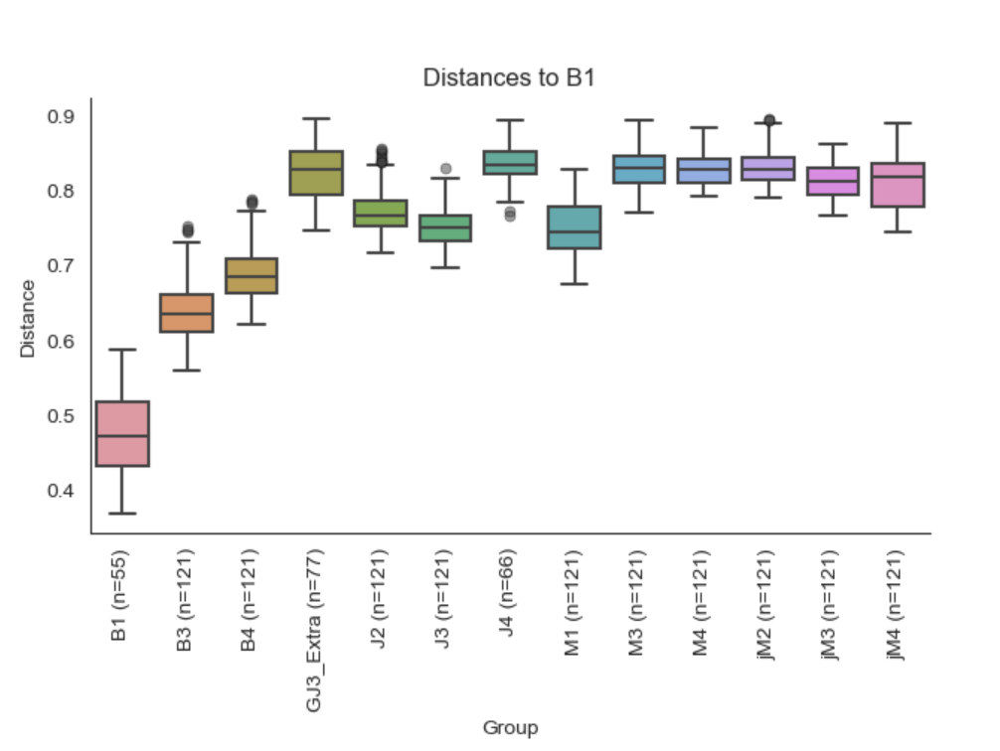
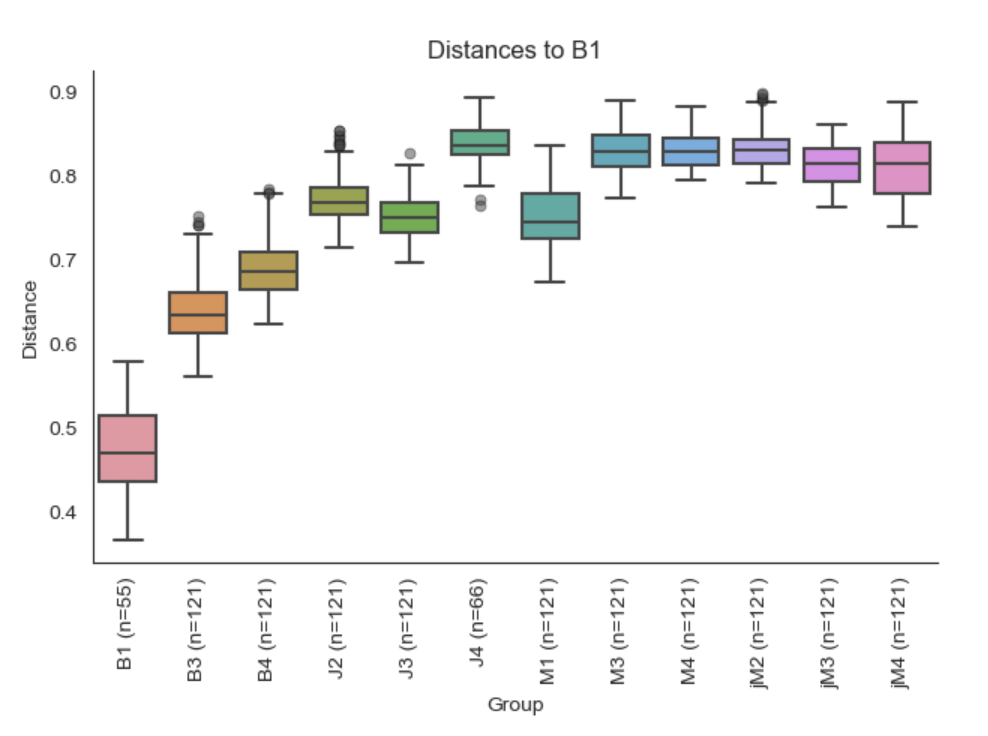
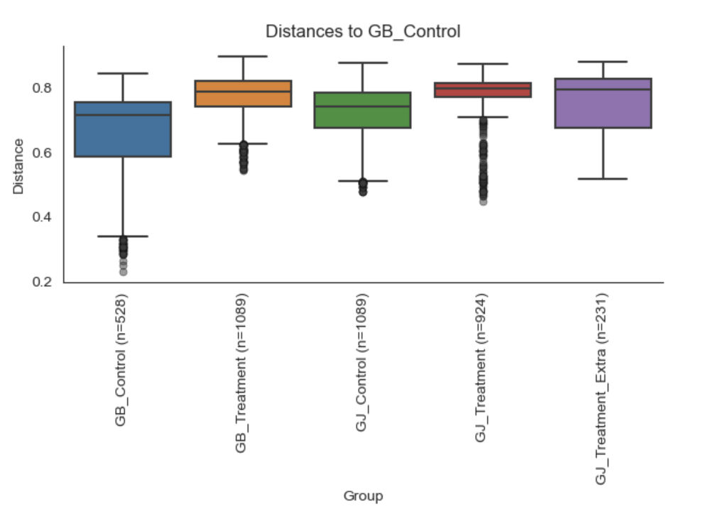
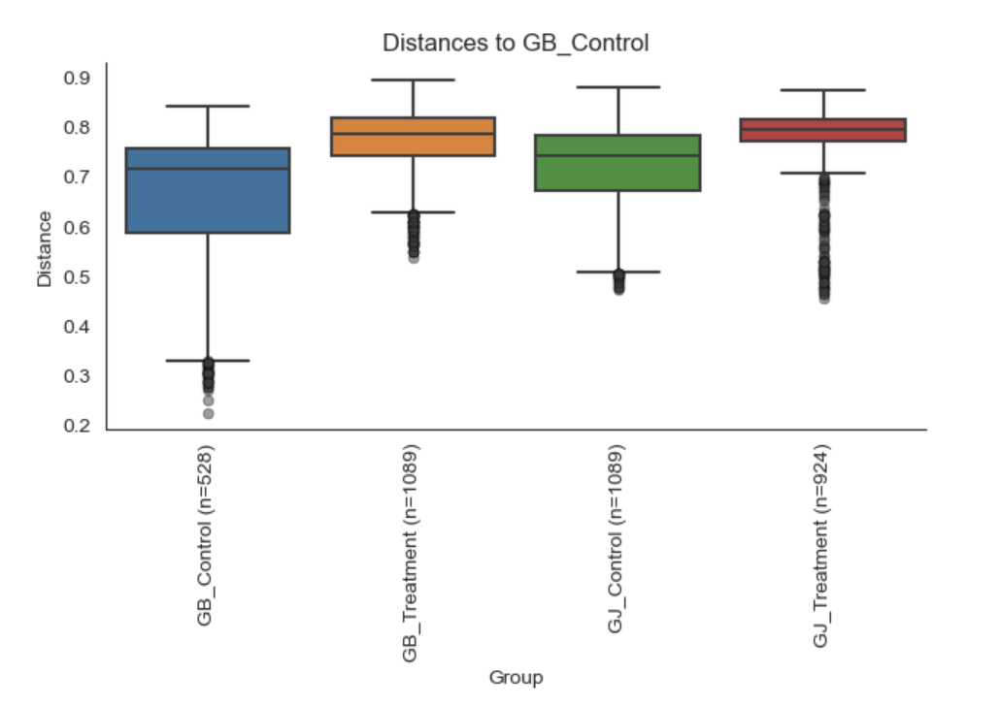

# Core Diversity Metrics and Bray–Curtis Group Comparisons

**Date:** 2026-07-23
**Stage:** rarefaction and core diversity metrics; QIIME 2 PERMANOVA by treatment group and by sample set; inspection of the x/y samples
**Cohort:** six batches; full set N = 134, standard set N = 127 (original labels)
**Script:** `modules/05_phylogeny_and_diversity.sh`
**Input:** `05_taxonomy_16S/table_16S_clean.qza`, `05_taxonomy_16S/table_16S_standard.qza`, `06_phylo_16S/rooted_tree_16S.qza`, `05_taxonomy_ITS/table_ITS_clean.qza`, `05_taxonomy_ITS/table_ITS_standard.qza`, `metadata_P_generation.tsv`
**Output:** `07_diversity_16S/full/*`, `07_diversity_16S/standard/*`, `07_diversity_ITS/full/*`, `07_diversity_ITS/standard/*`, `07_diversity_16S/permanova_audit/*`, `07_diversity_ITS/PERMANOVA_ITS_*.qzv`, `07_diversity_ITS/batch_audit/*`

---

## 1. Rarefaction and core metrics

```bash
qiime diversity core-metrics-phylogenetic \
  --i-phylogeny 06_phylo_16S/rooted_tree_16S.qza \
  --i-table 05_taxonomy_16S/table_16S_clean.qza \
  --p-sampling-depth 27000 \
  --m-metadata-file metadata_P_generation.tsv \
  --output-dir 07_diversity_16S/full

qiime diversity core-metrics \
  --i-table 05_taxonomy_ITS/table_ITS_clean.qza \
  --p-sampling-depth 8600 \
  --m-metadata-file metadata_P_generation.tsv \
  --output-dir 07_diversity_ITS/full
```

The same commands were run on the standard tables (output folders `standard/`).

* **16S depth, 27,000 reads:** just below the smallest library in the merged table (27,915 reads; 2026-07-23_01). All 134 libraries were retained (group sizes in Figures 017 and 029 add up to 134).
* **ITS2 depth, 8,600 reads:** the logs do not record how this depth was chosen or how many ITS2 libraries were retained.
* **16S outputs:** observed features, Shannon, Pielou's evenness and Faith's PD; Bray–Curtis, Jaccard, unweighted and weighted UniFrac distances, with PCoA results and Emperor plots.
* **ITS2 outputs:** observed features, Shannon and Pielou's evenness; Bray–Curtis and Jaccard distances. No phylogenetic metrics, because no ITS2 tree was built.

Rarefaction removes differences in library size before diversity estimation. Presence/absence metrics (Jaccard, unweighted UniFrac) are the most sensitive to library size.

---

## 2. PERMANOVA in QIIME 2

`qiime diversity beta-group-significance` (PERMANOVA, 999 permutations by default) was run on the Bray–Curtis matrices of the full and standard sets, with two grouping columns:

* `Treatment_Group` (`GB_Control`, `GB_Treatment`, `GJ_Control`, `GJ_Treatment`, and `*_Extra` for the x/y samples);
* `Sequencing_Batch`, which holds the sample set (`B1`, `M1`, …, `GJ3_Extra`; see 2026-07-23_01).

```bash
qiime diversity beta-group-significance \
  --i-distance-matrix 07_diversity_16S/full/bray_curtis_distance_matrix.qza \
  --m-metadata-file metadata_P_generation.tsv \
  --m-metadata-column Treatment_Group \
  --o-visualization 07_diversity_16S/permanova_audit/PERMANOVA_treatment_full.qzv
```

The figures below are the distance box plots from these visualizations; *n* is the number of sample pairs. Medians are read from the plots.

---

## 3. The x/y samples

.png)

.png)

* **By sample set (Figure 010).** Within the seven x/y samples the median distance is about 0.54 (*n* = 21). They are closest to the other GJ3 sets, `J4` (median about 0.51, *n* = 42, minimum about 0.33) and `jM4` (about 0.50, *n* = 77, minimum about 0.32). Distances to all other sets are higher (medians about 0.63–0.83; lowest to `M4`, highest to `B1`).
* **By treatment group (Figure 013).** Distances from the x/y samples to the GB groups are high (medians about 0.79–0.80, *n* = 231 each). Distances to `GJ_Control` (*n* = 231) and `GJ_Treatment` (*n* = 196) are lower and spread widely, with lower whiskers near 0.32–0.36.

These patterns are consistent with the x/y samples being GJ3 samples from both the treated and the control set, rather than a separate kind of sample. Because their group could not be assigned from the records, they were kept out of the standard set (N = 127) and analysed only in the full set (N = 134).

---

## 4. Differences between sample sets





* Within `B1` (GB soil, set 1): median about 0.47 (*n* = 55).
* To the other GB-treated sets: `B3` about 0.63 and `B4` about 0.68 (*n* = 121 each).
* To the GJ-treated sets: `J2` about 0.77, `J3` about 0.75, `J4` about 0.84 (*n* = 66).
* To the control sets: `M1`, from the same batch folder as `B1`, about 0.75; `M3`, `M4`, `jM2`, `jM3` and `jM4` about 0.81–0.83.
* The standard-set plot (Figure 011) is the same except that `GJ3_Extra` is absent.

GB-treated sets are more similar to each other than to the GJ-treated or control sets. However, distances between GB-treated sets (about 0.63–0.68) are clearly larger than those within `B1` (0.47). This points to variation between sets or batches. The later LinDA models (2026-07-25_01, 2026-08-24_01) did not include a set or batch term.

---

## 5. Distances to GB_Control





* Within `GB_Control`: median about 0.71 (*n* = 528).
* To `GB_Treatment`: about 0.79 (*n* = 1,089); to `GJ_Control`: about 0.75 (*n* = 1,089); to `GJ_Treatment`: about 0.80 (*n* = 924); to `GJ_Treatment_Extra`: about 0.80 (*n* = 231).
* `GJ_Treatment` has a tail of low distances to `GB_Control` (about 0.45–0.70). The tail remains in the standard set (Figure 014), so it is not caused by the x/y samples. Some samples labelled `GJ_Treatment` therefore look like controls. This was the first indication that labels in GJ set 4 (`J4`, `jM4`) might also be wrong; it was examined in 2026-07-24_02.

---

## 6. Summary of outputs

| Assay | Set | Depth | Distance matrices | PERMANOVA groupings (Bray–Curtis) |
| :--- | :--- | ---: | :--- | :--- |
| 16S | full (N = 134) | 27,000 | Bray–Curtis, Jaccard, unweighted and weighted UniFrac | `Treatment_Group`, `Sequencing_Batch` |
| 16S | standard (N = 127) | 27,000 | same | same |
| ITS2 | full (N = 134) | 8,600 | Bray–Curtis, Jaccard | same |
| ITS2 | standard (N = 127) | 8,600 | same | same |
