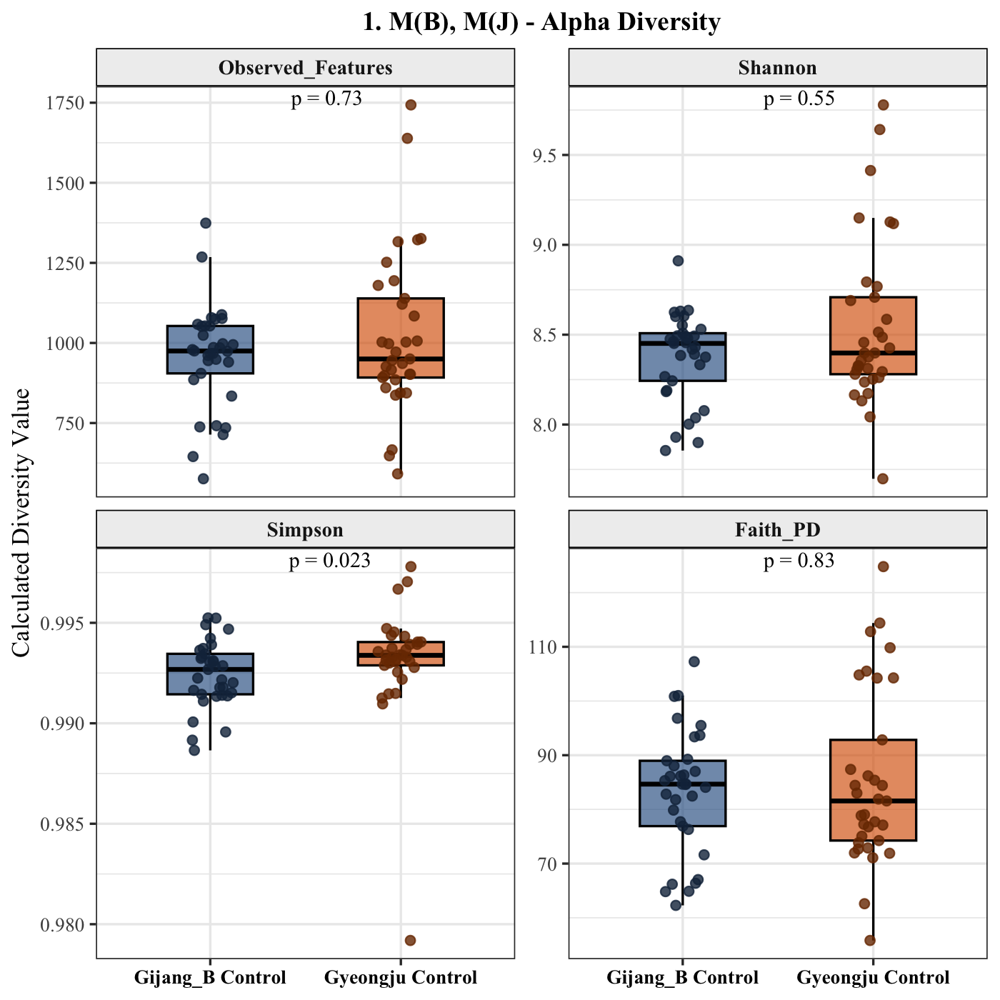
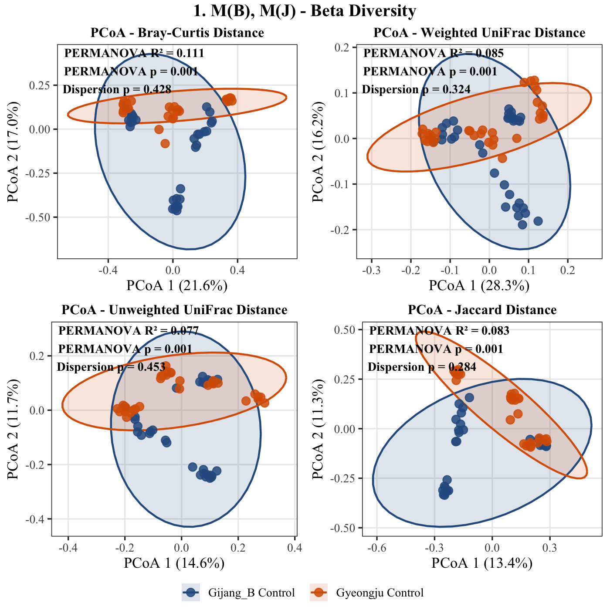
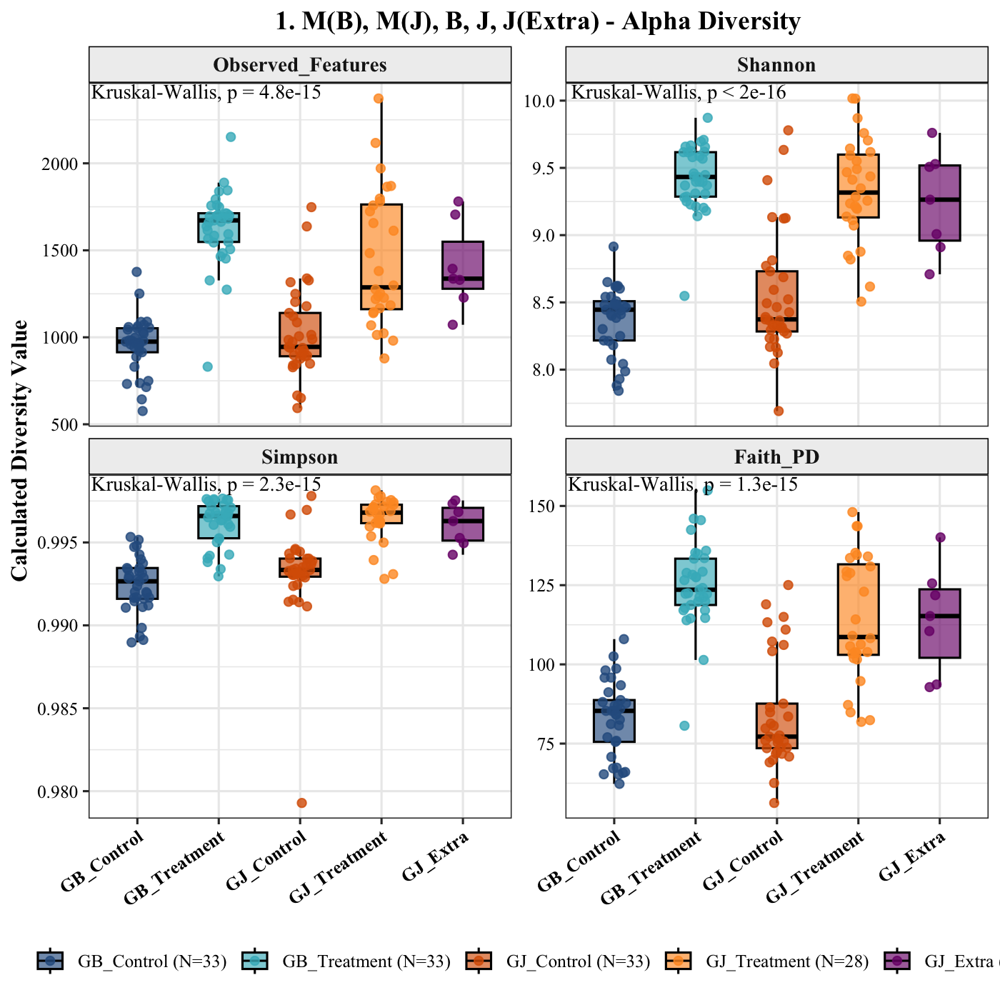
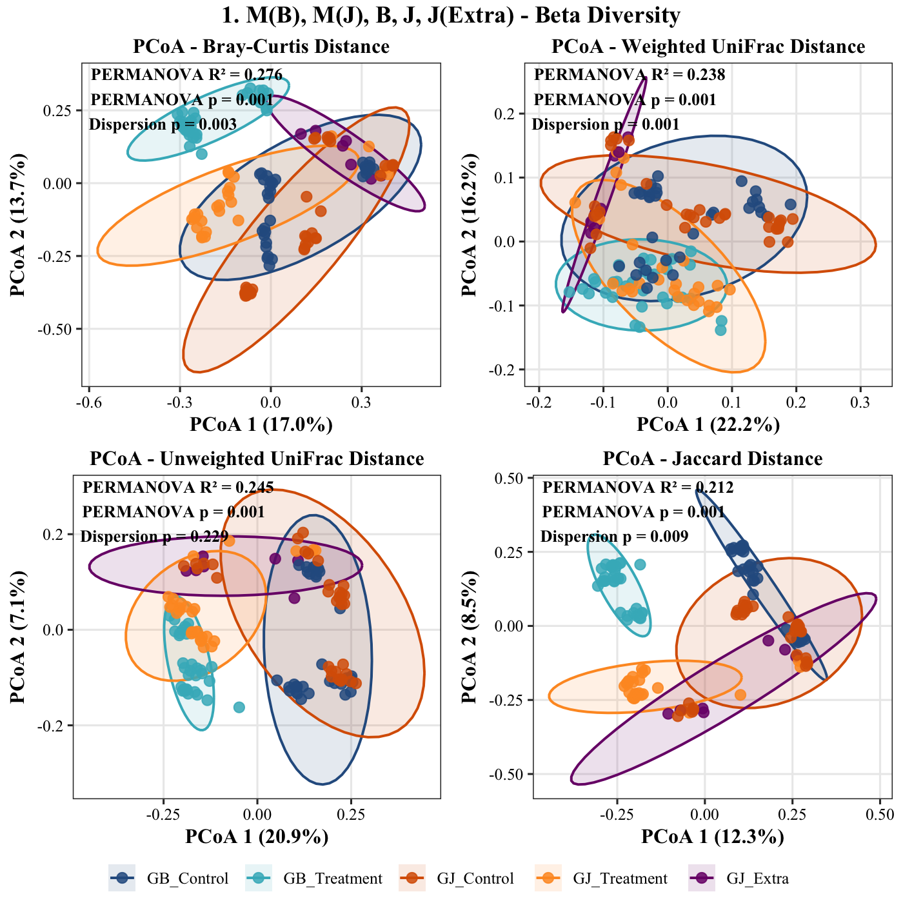
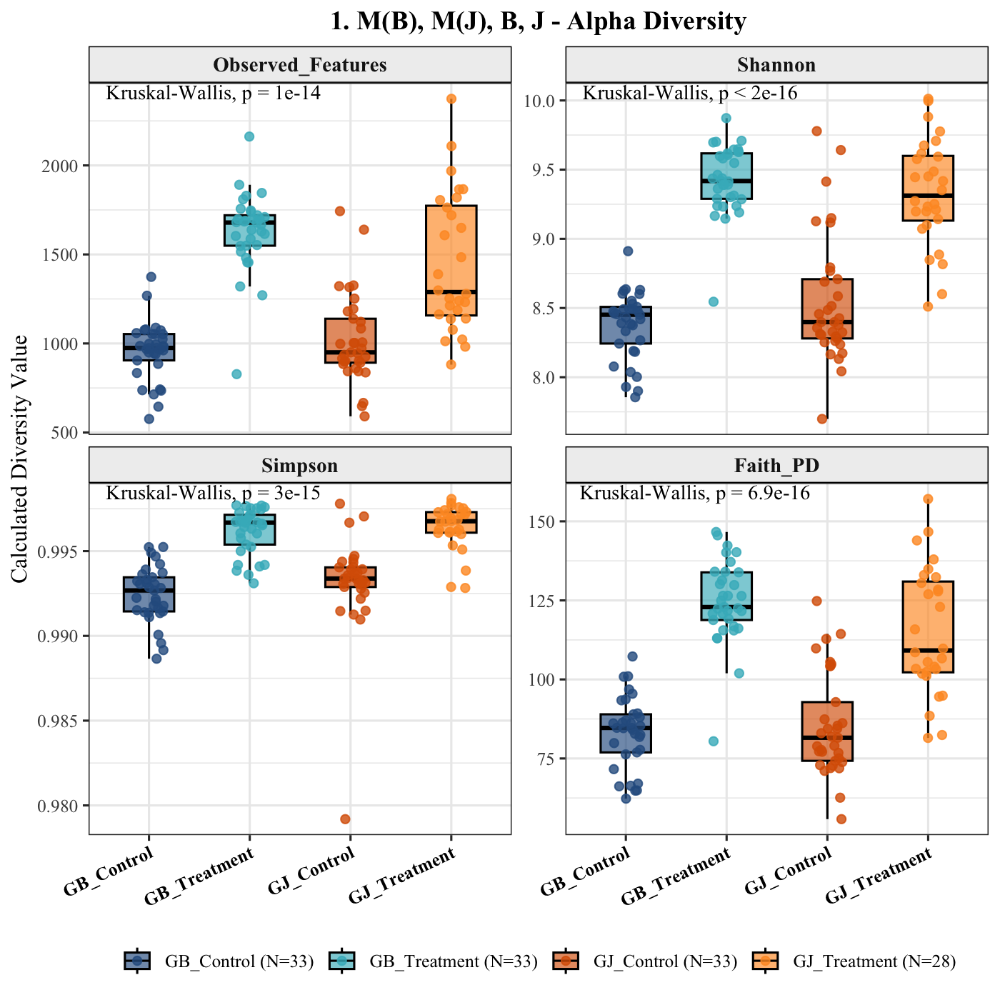
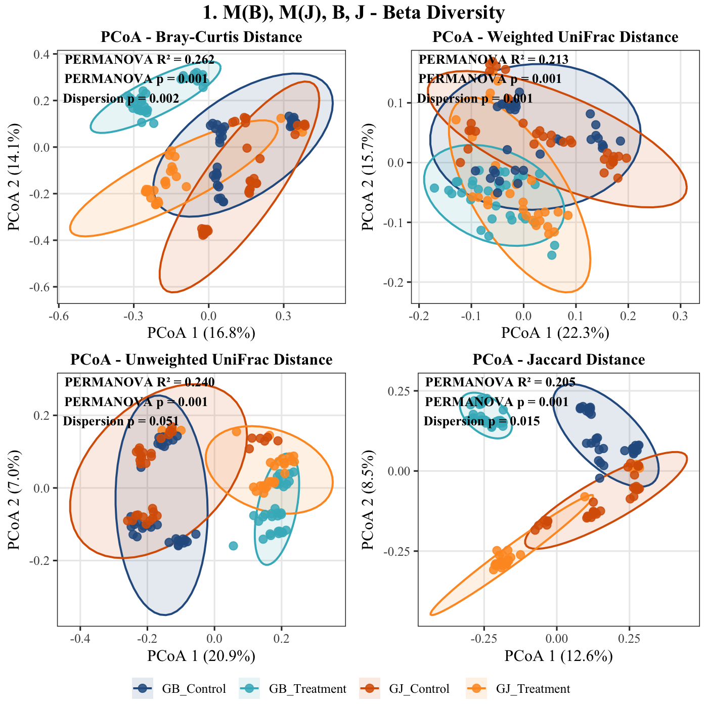
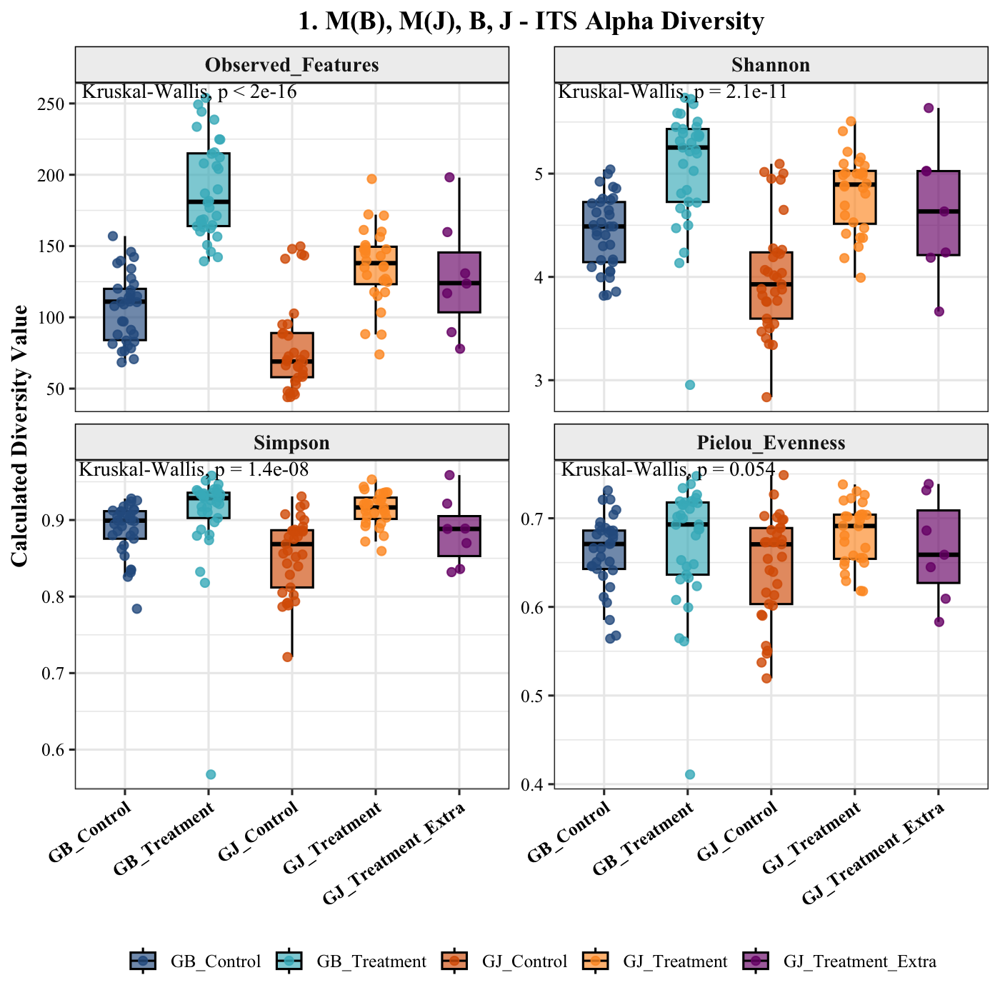
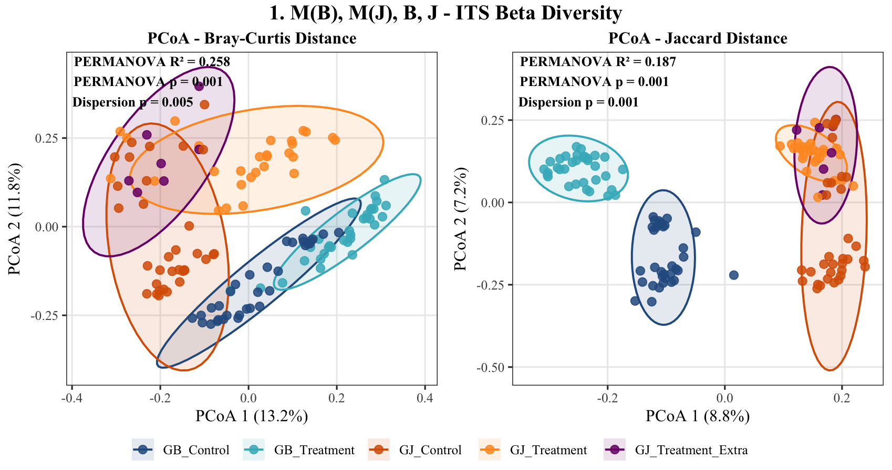

# Alpha and Beta Diversity in R (Six-Batch Set)

**Date:** 2026-07-24
**Stage:** alpha and beta diversity; comparison of the two control groups; full vs standard set; ITS2
**Cohort:** six batches, original labels. Standard set N = 127 (`GB_Control` 33, `GB_Treatment` 33, `GJ_Control` 33, `GJ_Treatment` 28); full set N = 134 (standard + 7 x/y samples)
**Script:** `modules/06_alpha_beta_diversity.R`
**Platform:** R 4.6.1 (`aarch64-apple-darwin23`)
**Input:** `07_diversity_16S/standard/*`, `07_diversity_16S/full/*`, `07_diversity_ITS/full/*`, `metadata_P_generation.tsv`

---

## 1. Methods

* QIIME 2 artifacts were read with `qiime2R::read_qza()`.
* **Alpha diversity.** Observed features, Shannon and Faith's PD were taken from the QIIME 2 vectors. Simpson was computed on the rarefied table with `vegan::diversity(index = "simpson")`, which returns the Gini–Simpson index (1 − Σ p²); higher values mean lower dominance. ITS2 used observed features, Shannon, Simpson and Pielou's evenness.
* **Tests.** Kruskal–Wallis test across groups (`rstatix::kruskal_test`) with pairwise Wilcoxon tests, FDR-adjusted (`rstatix::wilcox_test`). Two-group comparisons used the Wilcoxon rank-sum test.
* **Beta diversity.** PCoA with `cmdscale(k = 2)` on each distance matrix after subsetting to the samples analysed. PERMANOVA with `vegan::adonis2(dist ~ Treatment_Group, permutations = 999)` after `set.seed(42)`. Homogeneity of dispersion with `betadisper()` and `permutest()` (999 permutations). Ellipses are 95% ellipses from `stat_ellipse()` with its default settings (multivariate t-distribution).

---

## 2. GB_Control vs GJ_Control (standard set)

The Gijang B (GB) and Gyeongju (GJ) experiments were grown at different times, each with its own control group (peat plug + MES buffer). This section tests whether the two control groups can be pooled.

* Observed features (p = 0.73), Shannon (p = 0.55) and Faith's PD (p = 0.83) did not differ (Wilcoxon rank-sum test, 33 vs 33).
* Simpson differed (p = 0.023): `GJ_Control` had slightly higher Gini–Simpson values, i.e. slightly lower dominance.

| Distance | PERMANOVA R² | p | Dispersion p |
| :--- | ---: | ---: | ---: |
| Bray–Curtis | 0.111 | 0.001 | 0.428 |
| Weighted UniFrac | 0.085 | 0.001 | 0.324 |
| Unweighted UniFrac | 0.077 | 0.001 | 0.453 |
| Jaccard | 0.083 | 0.001 | 0.284 |

The two control groups have similar alpha diversity but different community composition (R² 0.08–0.11), with similar dispersion. They were therefore not pooled. Each treatment was compared with its own control: `GB_Treatment` vs `GB_Control` and `GJ_Treatment` vs `GJ_Control`.

---

## 3. 16S, full set (N = 134, including the x/y samples)

* Kruskal–Wallis: observed features p = 4.8 × 10⁻¹⁵, Shannon p < 2 × 10⁻¹⁶, Simpson p = 2.3 × 10⁻¹⁵, Faith's PD p = 1.3 × 10⁻¹⁵.
* Soil-treated groups had more observed features than controls (medians about 1,670 for `GB_Treatment` and 1,290 for `GJ_Treatment`, compared with about 950–980 for the controls).
* The x/y group (`GJ_Extra`, n = 7) had a median of about 1,340 observed features and a wide spread, between `GJ_Control` and `GJ_Treatment`.

| Distance | PERMANOVA R² | p | Dispersion p |
| :--- | ---: | ---: | ---: |
| Bray–Curtis | 0.276 | 0.001 | 0.003 |
| Weighted UniFrac | 0.238 | 0.001 | 0.001 |
| Unweighted UniFrac | 0.245 | 0.001 | 0.229 |
| Jaccard | 0.212 | 0.001 | 0.009 |

In the unweighted UniFrac and Jaccard plots, the `GJ_Extra` ellipse spans both `GJ_Control` and `GJ_Treatment`. This is consistent with the x/y samples including both treated and control samples.

---

## 4. 16S, standard set (N = 127)

* Kruskal–Wallis: observed features p = 1 × 10⁻¹⁴, Shannon p < 2 × 10⁻¹⁶, Simpson p = 3 × 10⁻¹⁵, Faith's PD p = 6.9 × 10⁻¹⁶.
* Median observed features: about 970 (`GB_Control`) vs 1,700 (`GB_Treatment`), and about 950 (`GJ_Control`) vs 1,300 (`GJ_Treatment`).
* Median Faith's PD: about 85 vs 123 (GB) and about 82 vs 110 (GJ).

| Distance | PERMANOVA R² | p | Dispersion p |
| :--- | ---: | ---: | ---: |
| Bray–Curtis | 0.262 | 0.001 | 0.002 |
| Weighted UniFrac | 0.213 | 0.001 | 0.001 |
| Unweighted UniFrac | 0.240 | 0.001 | 0.051 |
| Jaccard | 0.205 | 0.001 | 0.015 |

* PCoA 1 explains 12.6–22.3% and PCoA 2 7.0–15.7% of the variation, depending on the metric.
* In Bray–Curtis and unweighted UniFrac, PCoA 1 separates soil-treated from control samples. The two control groups overlap.
* Dispersion differed between groups for most metrics (dispersion p ≤ 0.015, except unweighted UniFrac, p = 0.051), so part of the PERMANOVA signal may reflect differences in spread.

---

## 5. ITS2, full set (N = 134)

* Kruskal–Wallis: observed features p < 2 × 10⁻¹⁶, Shannon p = 2.1 × 10⁻¹¹, Simpson p = 1.4 × 10⁻⁸, Pielou's evenness p = 0.054.
* Median observed fungal ASVs: about 110 (`GB_Control`) and 180 (`GB_Treatment`); about 70 (`GJ_Control`) and 140 (`GJ_Treatment`).
* Median Shannon in the GB groups: about 4.4 (control) and 5.3 (treated).
* Evenness did not differ clearly between groups (p = 0.054). The higher diversity of treated samples therefore comes mainly from more ASVs rather than from a more even distribution.

| Distance | PERMANOVA R² | p | Dispersion p |
| :--- | ---: | ---: | ---: |
| Bray–Curtis | 0.258 | 0.001 | 0.005 |
| Jaccard | 0.187 | 0.001 | 0.001 |

* PCoA 1 explains 13.2% (Bray–Curtis) and 8.8% (Jaccard) of the variation.
* In the Jaccard plot, all GB samples (control and treated) lie on the negative side of PCoA 1 and all GJ samples (control, treated and x/y) on the positive side. The two control groups, which received no soil, also separate. This axis therefore reflects the GB vs GJ experiment (cultivation time) as well as the soil inoculum.
* Within each experiment, the control and treated groups separate along PCoA 2.
* The x/y samples overlap both `GJ_Control` and `GJ_Treatment`, as in the 16S data.

ITS2 was analysed only in this six-batch full set. For the final five-batch set (N = 110), ITS2 was processed up to the core diversity metrics only (2026-07-29_01).
