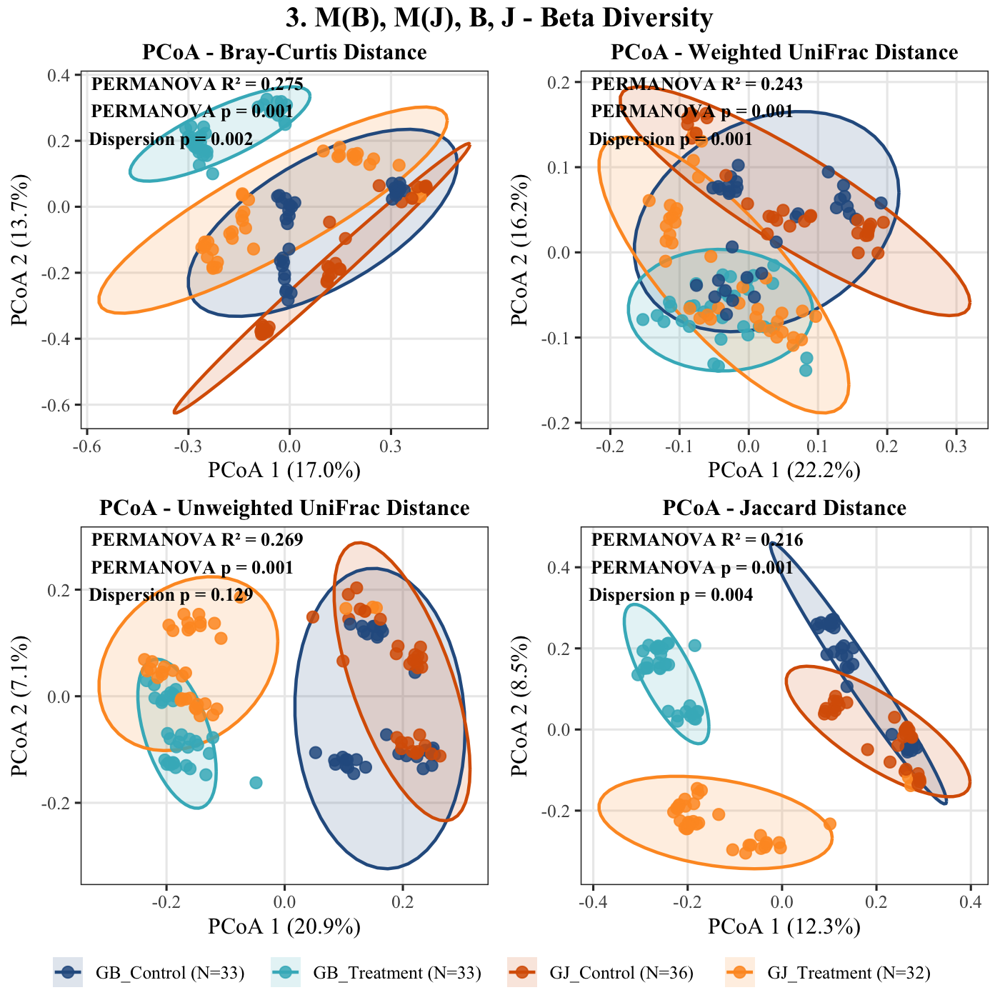
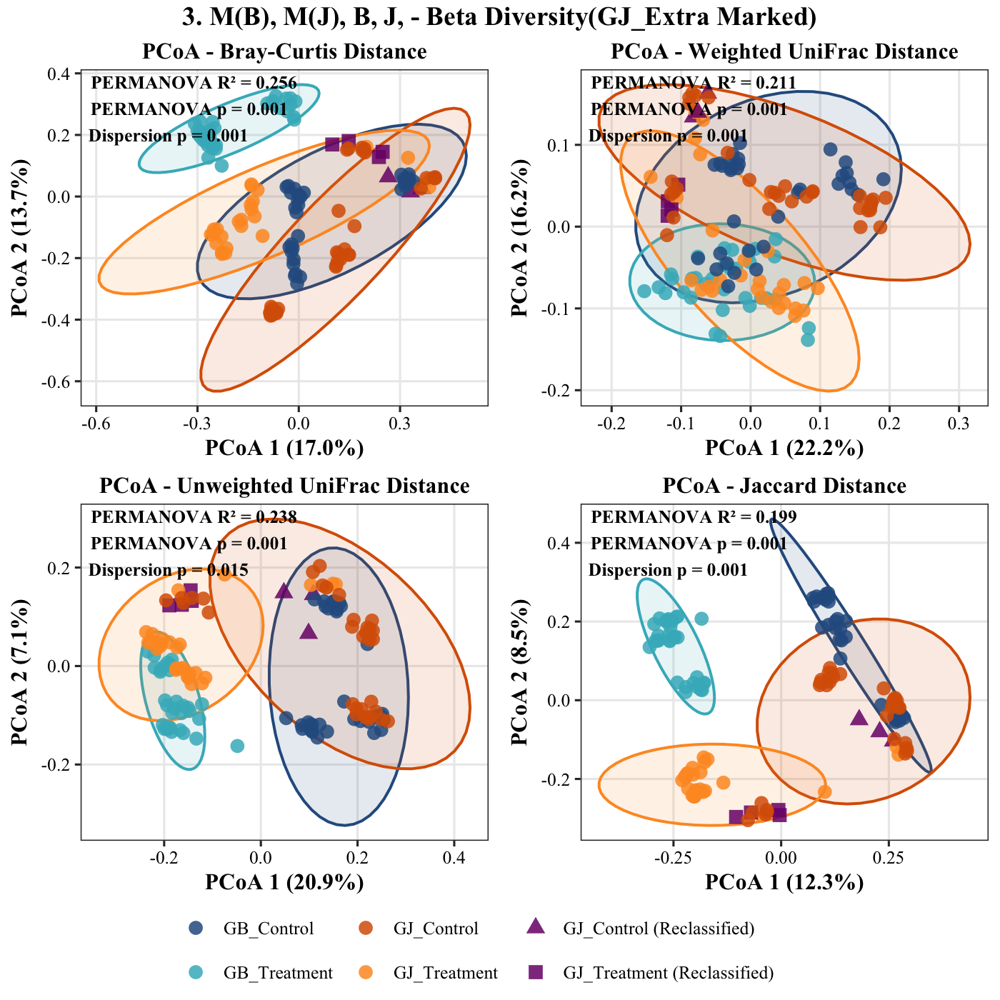
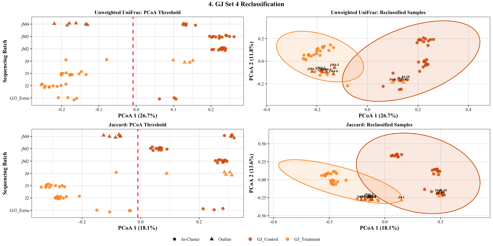
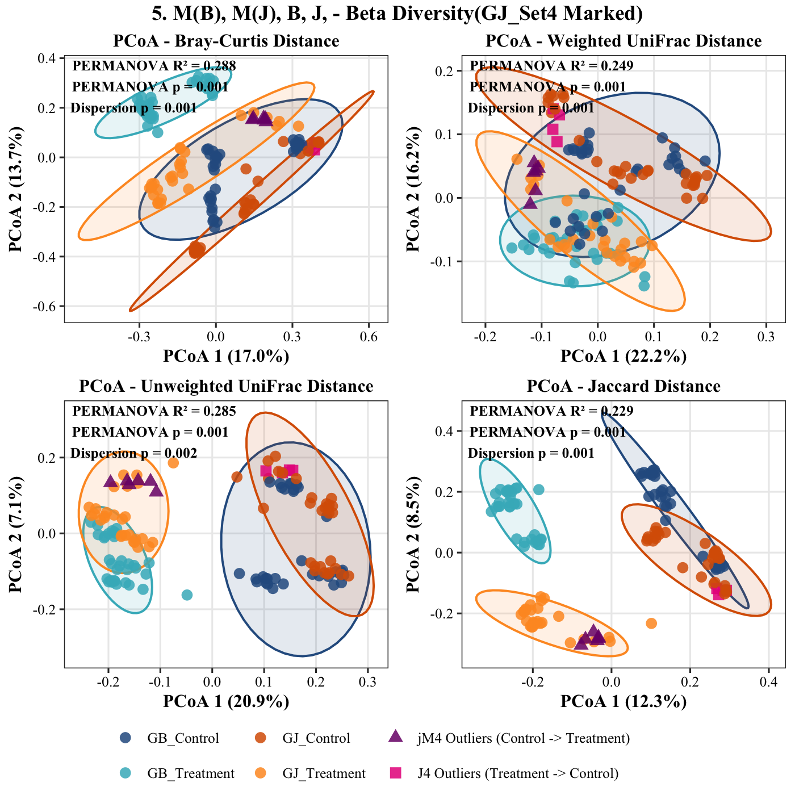
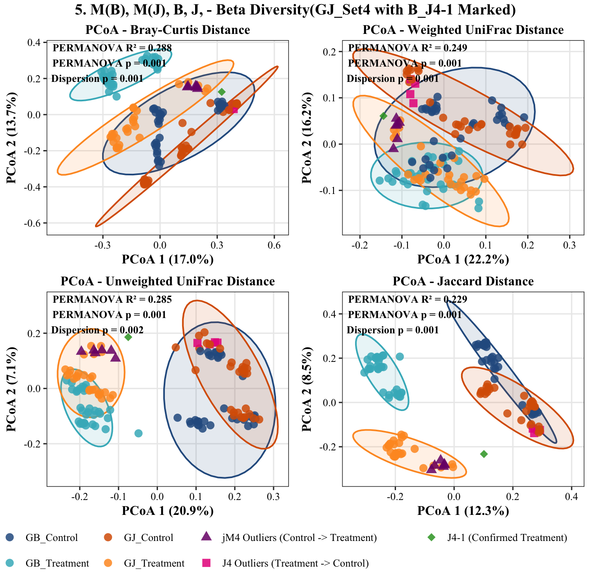
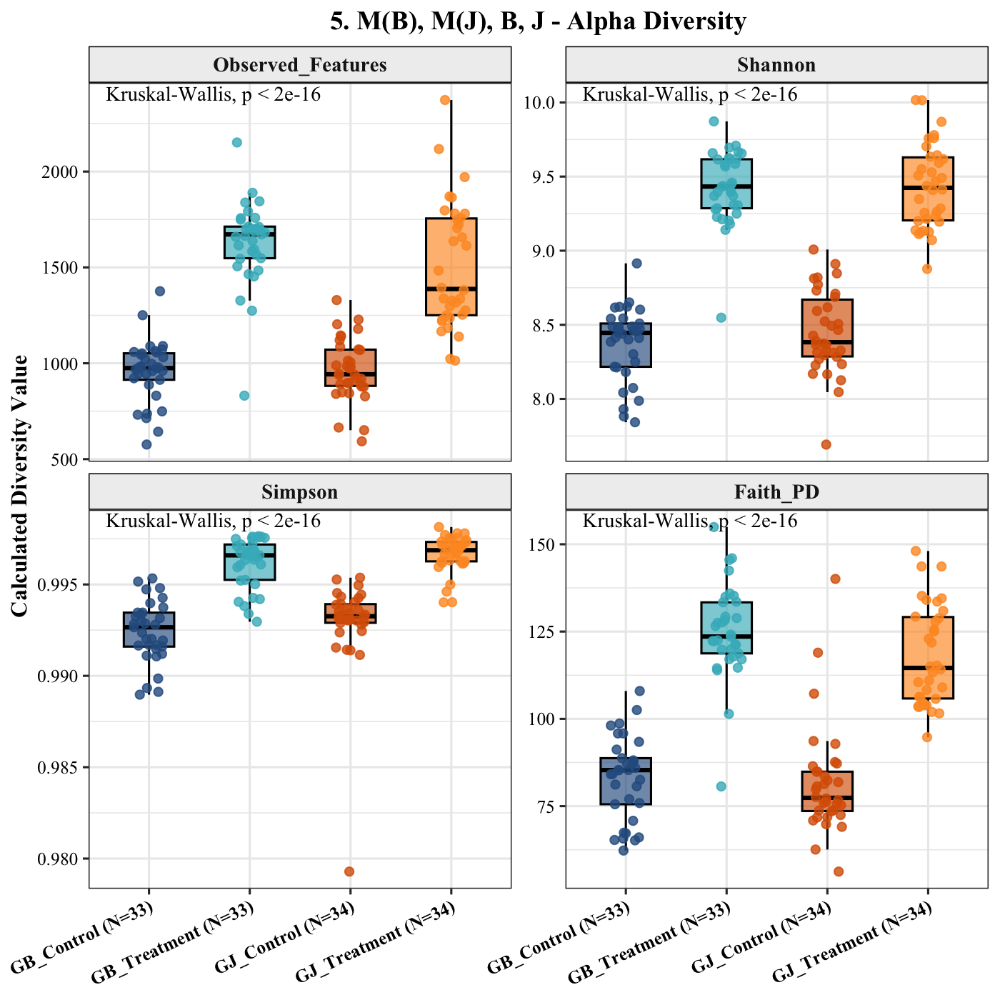
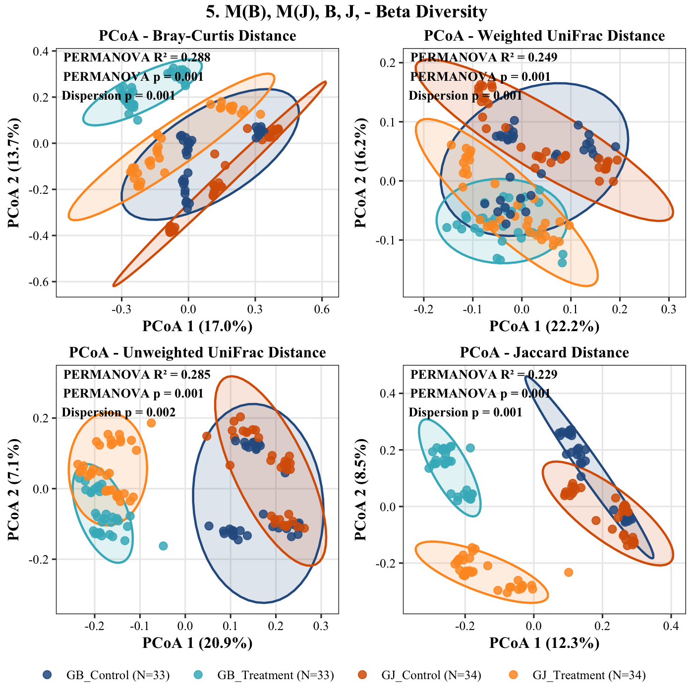

# Reassignment of GJ3 Sample Labels from PCoA (Exploratory)

**Date:** 2026-07-24
**Stage:** PCoA-threshold reassignment of the x/y samples and of set-4 outliers; diversity after reassignment
**Cohort:** six batches, full set (N = 134); GJ samples only for the reassignment step
**Script:** `modules/07_sample_reclassification.R`
**Platform:** R 4.6.1 (`aarch64-apple-darwin23`)
**Input:** `07_diversity_16S/full/*`, `metadata_P_generation.tsv`
**Output:** `metadata_P_generation_corrected_extra.tsv`, `metadata_P_generation_corrected_final.tsv`

> **Status.** This reassignment was exploratory. The new labels were derived from the same distance matrices that were then used to test group differences, so the PERMANOVA results after reassignment are circular. All GJ3 samples were later removed (final set N = 110; 2026-07-29_01), so no reassigned label is used in the final results.

---

## 1. Method

1. PCoA (`cmdscale`, k = 2) of the unweighted UniFrac and Jaccard distances among GJ samples only (`GJ_Control`, `GJ_Treatment` and the x/y samples).
2. A threshold on PCoA 1 at the midpoint between the group means: θ = (mean PCoA 1 of `GJ_Control` + mean PCoA 1 of `GJ_Treatment`) / 2.
3. A sample lying on the other side of θ from its labelled group was flagged. Labels were changed only when unweighted UniFrac and Jaccard agreed.

The method assumes that a mislabelled sample clusters with its true group. The threshold is computed from labelled groups that may themselves contain mislabelled samples.

The label changes were made by sample code, so they were applied to both the 16S (`B_`) and the ITS2 (`F_`) samples, based on the 16S ordinations only.

---

## 2. Stage 1: the seven x/y samples

_Reclassification.png)

PCoA 1 explains 26.7% (unweighted UniFrac) and 18.1% (Jaccard) of the variation among GJ samples.

* `J2y`, `J5y`, `J7x` and `J8x` lie on the `GJ_Treatment` side in both metrics and were assigned to `GJ_Treatment`.
* `J2x`, `J5x` and `J13x` lie on the `GJ_Control` side in both metrics and were assigned to `GJ_Control`.
* In the Jaccard ordination, `J2y` and `J5y` lie close to the threshold.

The two lists are hard-coded in the script (`extra_to_treatment`, `extra_to_control`). They were written to `metadata_P_generation_corrected_extra.tsv`, with `Sample_Type` changed to `Standard`.





After stage 1, `GJ_Control` had 36 samples and `GJ_Treatment` 32. The design had 11 plants per set and three sets per group (33). This imbalance, and the control-like `GJ_Treatment` samples seen in 2026-07-23_02 (Figure 014), suggested that labels in GJ set 4 (`J4`, `jM4`) might also be wrong.

---

## 3. Stage 2: set 4 (J4, jM4)

The same rule was applied to all GJ samples after stage 1 (`extract_all_gj_outliers()`).



Console output (PCoA 1 scores from unweighted UniFrac):

```text
======================================================================
          GJ SET 4 OUTLIER SAMPLE NAME VERIFICATION REPORT            
======================================================================

--- 1. GJ_Control Outliers (jM4 Set, N = 6 ) ---
  sample-id      PCoA1 Sequencing_Batch Generation
1   B_jM4-2 -0.1846844              jM4          P
2   B_jM4-3 -0.1303587              jM4          P
3   B_jM4-4 -0.1788205              jM4          P
4   B_jM4-5 -0.1611927              jM4          P
5   B_jM4-6 -0.1348104              jM4          P
6   B_jM4-7 -0.2192077              jM4          P

--- 2. GJ_Treatment Outliers (J4 Set, N = 4 ) ---
  sample-id      PCoA1 Sequencing_Batch Generation
1   B_J4-10 0.15105450               J4          P
2    B_J4-3 0.12931789               J4          P
3    B_J4-4 0.09897859               J4          P
4    B_J4-6 0.14290620               J4          P

======================================================================
                     METRIC CONCORDANCE ANALYSIS                      
======================================================================
[GJ_Control]  : 100% MATCH CONFIRMED across Unweighted UniFrac & Jaccard.
               Samples to reclassify (Control -> Treatment):
               B_jM4-2, B_jM4-3, B_jM4-4, B_jM4-5, B_jM4-6, B_jM4-7

[GJ_Treatment]: MISMATCH DETECTED between metrics!
======================================================================
```

* **jM4 → `GJ_Treatment` (6 samples).** `B_jM4-2` to `B_jM4-7` lie on the treatment side (PCoA 1 between −0.130 and −0.219). Both metrics flagged the same six samples.
* **J4 → `GJ_Control` (4 samples).** `B_J4-3`, `B_J4-4`, `B_J4-6` and `B_J4-10` lie on the control side (PCoA 1 between +0.099 and +0.151).
* **`B_J4-1`.** The two metrics did not give the same J4 list: Jaccard also flagged `B_J4-1`, which lies near the threshold. In the Bray–Curtis, weighted UniFrac and unweighted UniFrac plots (Figures 027 and 028; `B_J4-1` is the green diamond), it lies within the `GJ_Treatment` 95% ellipse. It was therefore kept in `GJ_Treatment`, and only the four J4 samples flagged by both metrics were moved.





All changes were written to `metadata_P_generation_corrected_final.tsv`, which keeps the original values in `Treatment_Group_Original` and `Sample_Type_Original` and records each change in `Reclassification_Note`.

---

## 4. Diversity after reassignment

Group sizes: `GB_Control` 33, `GB_Treatment` 33, `GJ_Control` 34 (36 − 6 + 4), `GJ_Treatment` 34 (32 + 6 − 4); total 134.



* Kruskal–Wallis p < 2 × 10⁻¹⁶ for observed features, Shannon, Simpson and Faith's PD.
* Median observed features: about 975 (`GB_Control`), 1,670 (`GB_Treatment`), 945 (`GJ_Control`) and 1,390 (`GJ_Treatment`).



| Distance | PERMANOVA R² | p | Dispersion p |
| :--- | ---: | ---: | ---: |
| Bray–Curtis | 0.288 | 0.001 | 0.001 |
| Weighted UniFrac | 0.249 | 0.001 | 0.001 |
| Unweighted UniFrac | 0.285 | 0.001 | 0.002 |
| Jaccard | 0.229 | 0.001 | 0.001 |

R² is higher than in the standard set (0.205–0.262; 2026-07-24_01). This is expected, because samples were moved to the side of PCoA 1 where their new group lies, using the same distances. The increase is not independent evidence that the new labels are correct. The two control groups still overlap, and `GB_Treatment` and `GJ_Treatment` overlap in the UniFrac plots.

---

## 5. Label changes

| Sample | Set | Original group | New group | Basis |
| :--- | :--- | :--- | :--- | :--- |
| `B_J2x` | GJ3 x/y | `GJ_Treatment_Extra` | `GJ_Control` | stage 1, both metrics (Figure 023) |
| `B_J5x` | GJ3 x/y | `GJ_Treatment_Extra` | `GJ_Control` | stage 1, both metrics |
| `B_J13x` | GJ3 x/y | `GJ_Treatment_Extra` | `GJ_Control` | stage 1, both metrics |
| `B_J2y` | GJ3 x/y | `GJ_Treatment_Extra` | `GJ_Treatment` | stage 1, both metrics |
| `B_J5y` | GJ3 x/y | `GJ_Treatment_Extra` | `GJ_Treatment` | stage 1, both metrics |
| `B_J7x` | GJ3 x/y | `GJ_Treatment_Extra` | `GJ_Treatment` | stage 1, both metrics |
| `B_J8x` | GJ3 x/y | `GJ_Treatment_Extra` | `GJ_Treatment` | stage 1, both metrics |
| `B_jM4-2` | jM4 | `GJ_Control` | `GJ_Treatment` | stage 2, both metrics (PCoA 1 −0.185) |
| `B_jM4-3` | jM4 | `GJ_Control` | `GJ_Treatment` | stage 2, both metrics (−0.130) |
| `B_jM4-4` | jM4 | `GJ_Control` | `GJ_Treatment` | stage 2, both metrics (−0.179) |
| `B_jM4-5` | jM4 | `GJ_Control` | `GJ_Treatment` | stage 2, both metrics (−0.161) |
| `B_jM4-6` | jM4 | `GJ_Control` | `GJ_Treatment` | stage 2, both metrics (−0.135) |
| `B_jM4-7` | jM4 | `GJ_Control` | `GJ_Treatment` | stage 2, both metrics (−0.219) |
| `B_J4-3` | J4 | `GJ_Treatment` | `GJ_Control` | stage 2, both metrics (+0.129) |
| `B_J4-4` | J4 | `GJ_Treatment` | `GJ_Control` | stage 2, both metrics (+0.099) |
| `B_J4-6` | J4 | `GJ_Treatment` | `GJ_Control` | stage 2, both metrics (+0.143) |
| `B_J4-10` | J4 | `GJ_Treatment` | `GJ_Control` | stage 2, both metrics (+0.151) |
| `B_J4-1` | J4 | `GJ_Treatment` | `GJ_Treatment` (unchanged) | flagged by Jaccard only |

PCoA 1 values in brackets are the unweighted UniFrac scores from the console output. The scores of the x/y samples were not printed; see Figure 023.
