# Diversity, Taxonomy and LinDA on the Reassigned Six-Batch Set (Exploratory)

**Date:** 2026-07-25
**Stage:** control comparison; GB vs GJ treatment; three-group models with one control; phylum and genus composition; LinDA; heatmaps; group-exclusive ASVs
**Cohort:** six batches with the PCoA-derived labels of 2026-07-24_02 (N = 134: `GB_Control` 33, `GB_Treatment` 33, `GJ_Control` 34, `GJ_Treatment` 34)
**Script:** `modules/08_comparative_diversity_and_taxonomy.R` (Sections 1–4), `modules/09_linda_differential_abundance.R` (Sections 5–7)
**Platform:** R 4.6.1 (`aarch64-apple-darwin23`)
**Input:** `metadata_P_generation_corrected_final.tsv`, `07_diversity_16S/full/*` (including `rarefied_table.qza`), `05_taxonomy_16S/taxonomy_16S.qza`

> **Status.** These results use the reassigned labels and are kept as a record of the exploratory analysis. The final analyses use the five-batch set with original labels (N = 110; 2026-08-10 to 2026-08-24). Methods for alpha and beta diversity are as in 2026-07-24_01.

---

## 1. GB_Control vs GJ_Control after reassignment

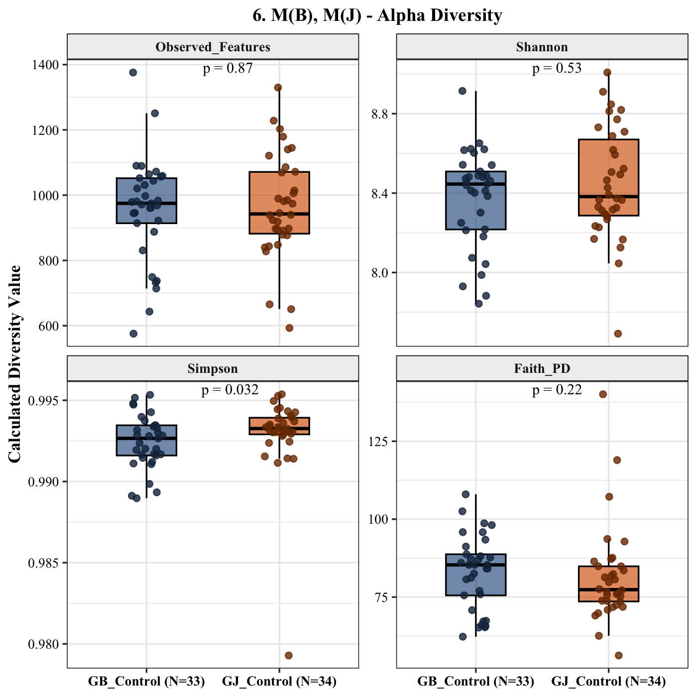

* Wilcoxon rank-sum test (33 vs 34): observed features p = 0.87, Shannon p = 0.53, Faith's PD p = 0.22, Simpson p = 0.032 (`GJ_Control` slightly higher Gini–Simpson values).

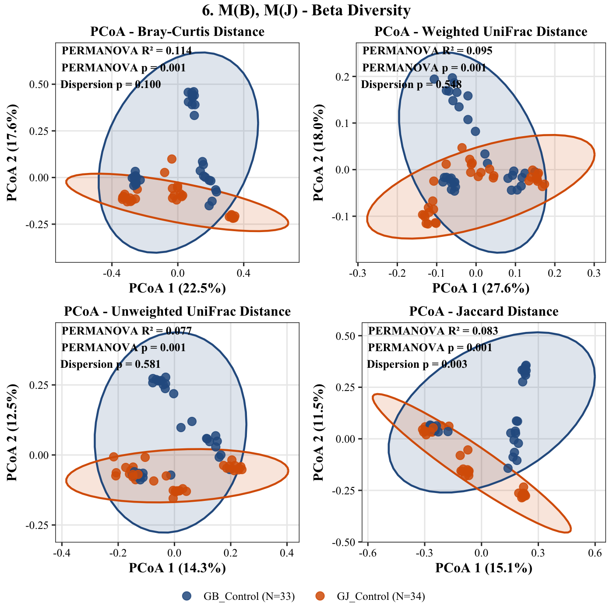

| Distance | PERMANOVA R² | p | Dispersion p |
| :--- | ---: | ---: | ---: |
| Bray–Curtis | 0.114 | 0.001 | 0.100 |
| Weighted UniFrac | 0.095 | 0.001 | 0.548 |
| Unweighted UniFrac | 0.077 | 0.001 | 0.581 |
| Jaccard | 0.083 | 0.001 | 0.003 |

The result is the same as before reassignment (2026-07-24_01): similar alpha diversity, different composition (R² 0.08–0.11), and similar dispersion except for Jaccard.

---

## 2. GB_Treatment vs GJ_Treatment

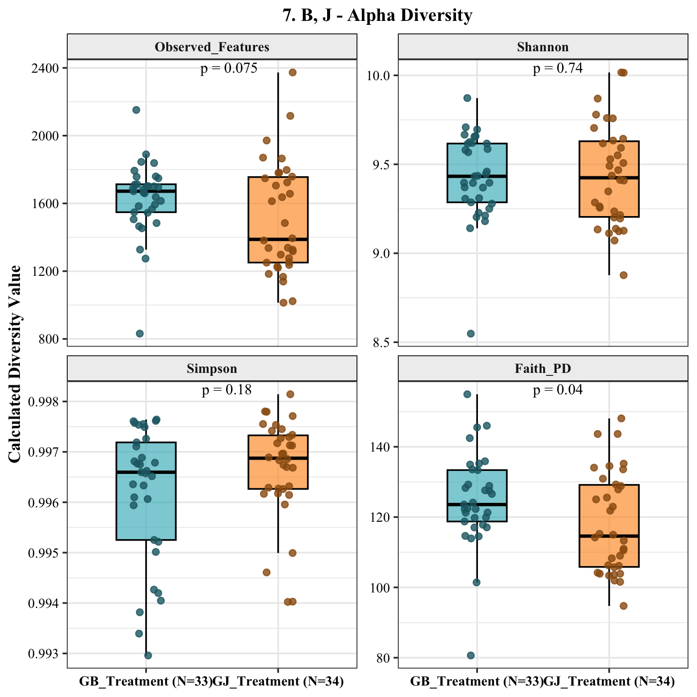

* Wilcoxon rank-sum test (33 vs 34): observed features p = 0.075, Shannon p = 0.74, Simpson p = 0.18, Faith's PD p = 0.04.
* Median observed features were about 1,670 (GB) and 1,390 (GJ). Median Faith's PD was slightly higher in GB (about 123 vs 115).

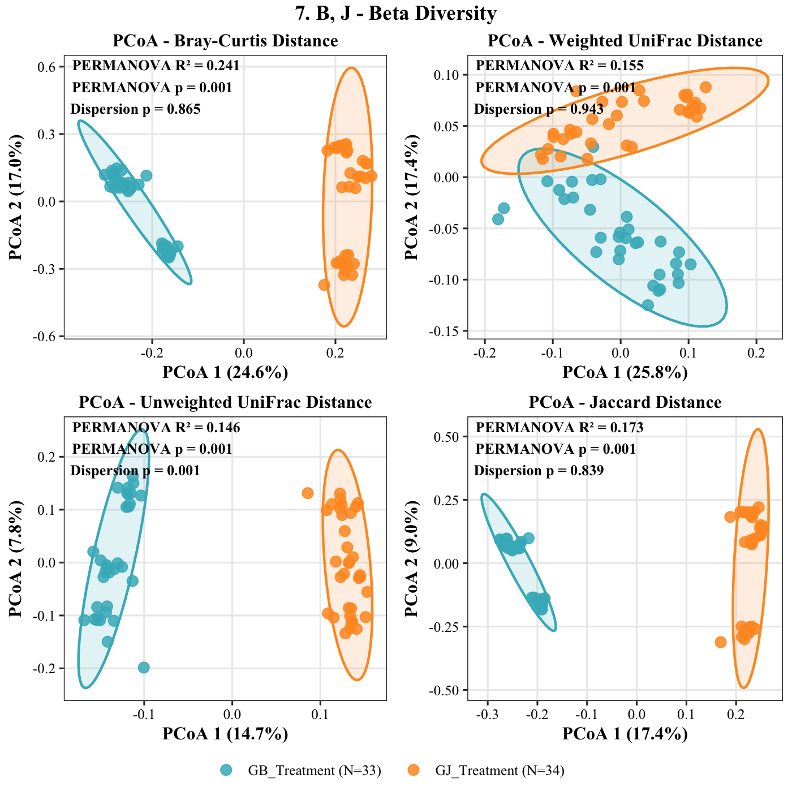

| Distance | PERMANOVA R² | p | Dispersion p |
| :--- | ---: | ---: | ---: |
| Bray–Curtis | 0.241 | 0.001 | 0.865 |
| Weighted UniFrac | 0.155 | 0.001 | 0.943 |
| Unweighted UniFrac | 0.146 | 0.001 | 0.001 |
| Jaccard | 0.173 | 0.001 | 0.839 |

* PCoA 1 explains 14.7–25.8% of the variation.
* The two treatments separate along PCoA 1 in Bray–Curtis, unweighted UniFrac and Jaccard. In weighted UniFrac their ellipses partly overlap.
* Dispersion did not differ, except in unweighted UniFrac (p = 0.001).

---

## 3. Three-group models with one control

To see how the choice of control affects the comparison, each control group was analysed together with both treatments.

**GB_Control, GB_Treatment, GJ_Treatment**

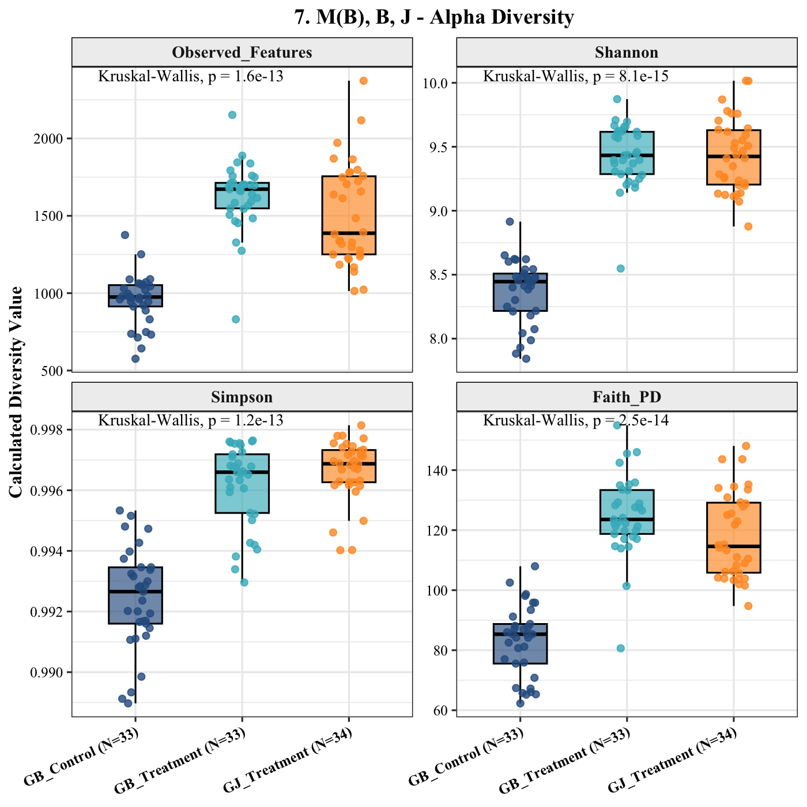

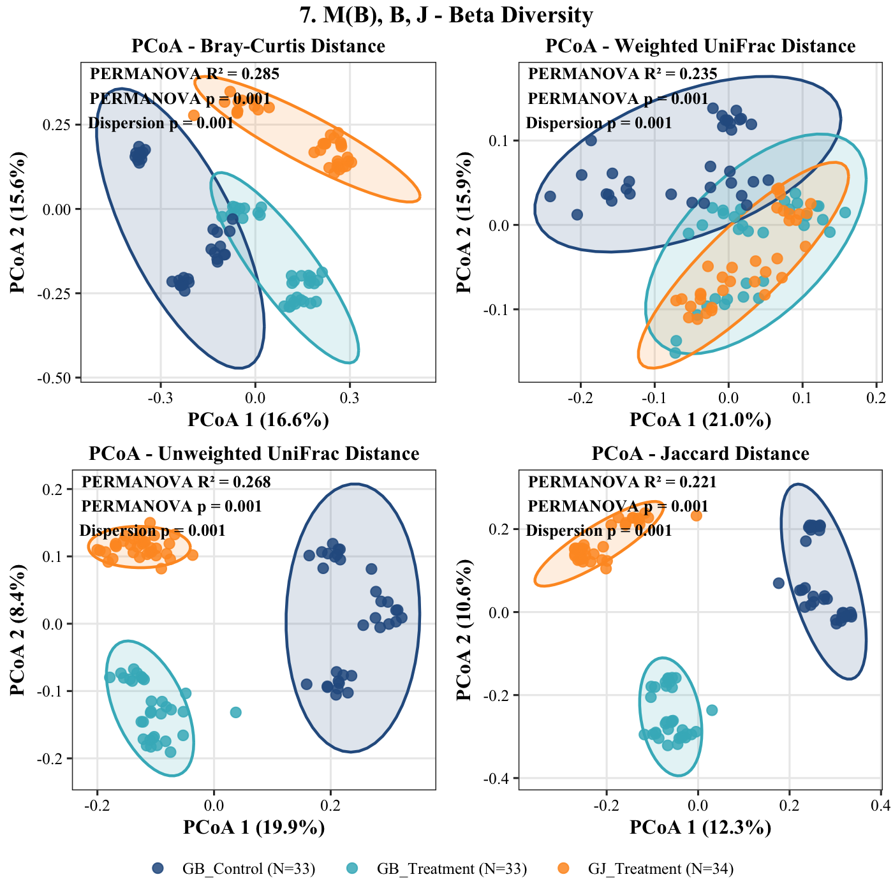

**GJ_Control, GB_Treatment, GJ_Treatment**

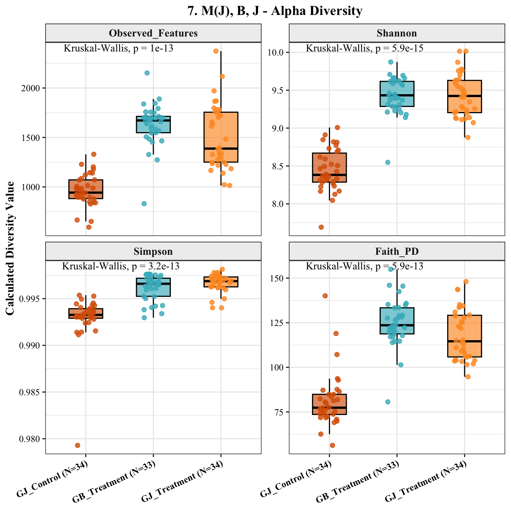

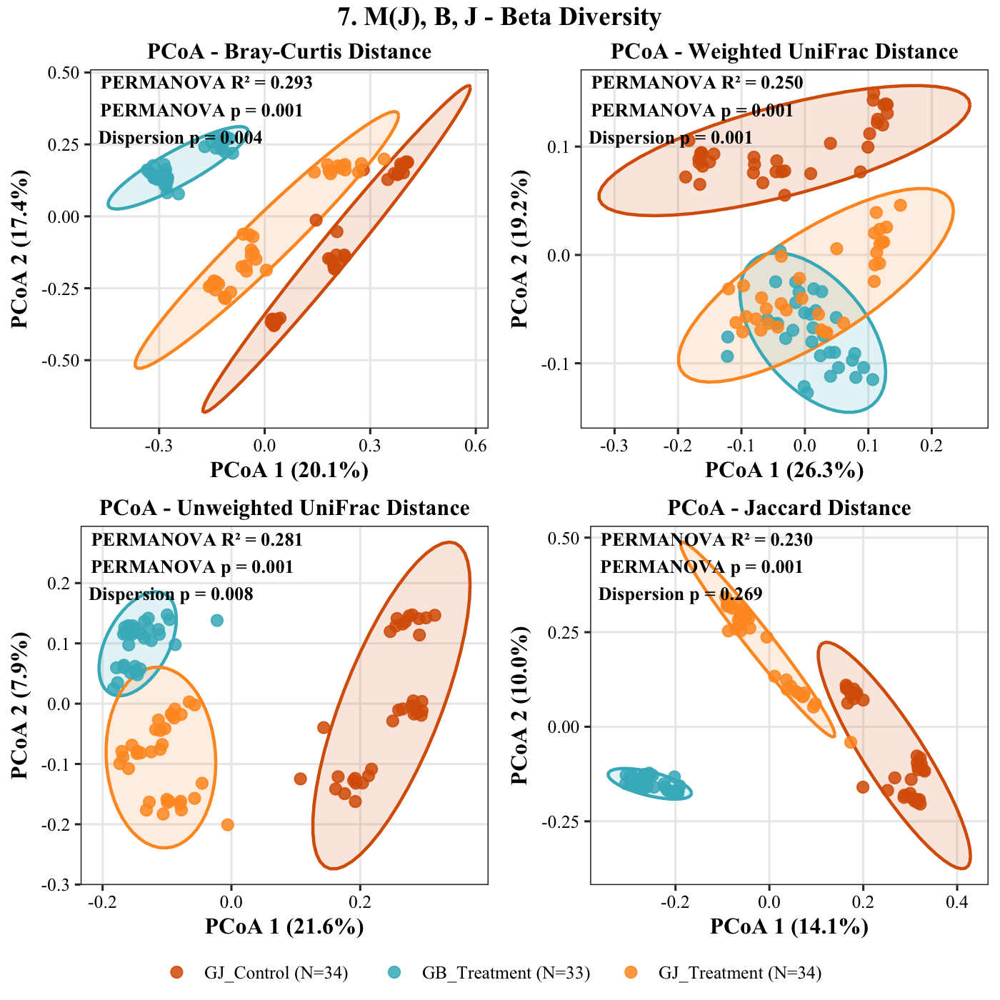

| Model | Distance | PERMANOVA R² | Dispersion p |
| :--- | :--- | ---: | ---: |
| with `GB_Control` | Bray–Curtis | 0.285 | 0.001 |
| | Weighted UniFrac | 0.235 | 0.001 |
| | Unweighted UniFrac | 0.268 | 0.001 |
| | Jaccard | 0.221 | 0.001 |
| with `GJ_Control` | Bray–Curtis | 0.293 | 0.004 |
| | Weighted UniFrac | 0.250 | 0.001 |
| | Unweighted UniFrac | 0.281 | 0.008 |
| | Jaccard | 0.230 | 0.269 |

* All PERMANOVA p = 0.001. Kruskal–Wallis p ≤ 1.6 × 10⁻¹³ (with `GB_Control`) and ≤ 5.9 × 10⁻¹³ (with `GJ_Control`) for all four alpha metrics.
* The relative positions of the groups depend on the metric. In unweighted UniFrac, the two treatments lie together on one side of PCoA 1 and the control on the other, whichever control is used. In Bray–Curtis, the control lies next to the treatment from the same experiment.

Because the two controls differ (Section 1), each treatment was compared with its own control in all later analyses:

* GB contrast: `GB_Treatment` vs `GB_Control`, written "B vs. M(B)".
* GJ contrast: `GJ_Treatment` vs `GJ_Control`, written "J vs. M(J)".

---

## 4. Taxonomic composition

Relative abundances were computed per sample from the rarefied table and averaged per group. The 10 most abundant phyla and 12 most abundant genera (by overall mean, excluding unassigned) are shown; all other taxa were summed per sample into "Other" before averaging. Percentages below were read from the figures (about ±0.2 percentage points).

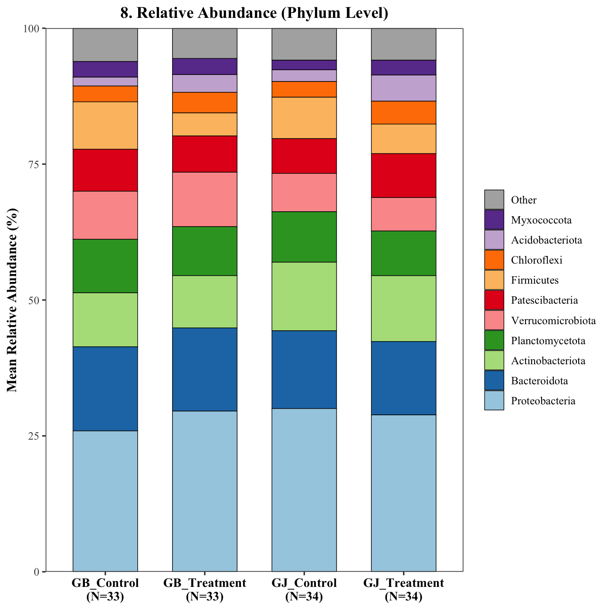

* The 10 phyla account for about 94% of reads in every group.
* Most abundant: Proteobacteria (26.2–30.2%), Bacteroidota (13.4–15.4%), Actinobacteriota (9.6–12.6%), Planctomycetota (8.2–9.8%) and Verrucomicrobiota (6.2–10.0%).
* Firmicutes were lower in treated samples (GB: 8.8% control vs 4.2% treated; GJ: 7.6% vs 5.5%). Acidobacteriota were higher (GB: 1.6% vs 3.3%; GJ: 2.2% vs 4.8%).

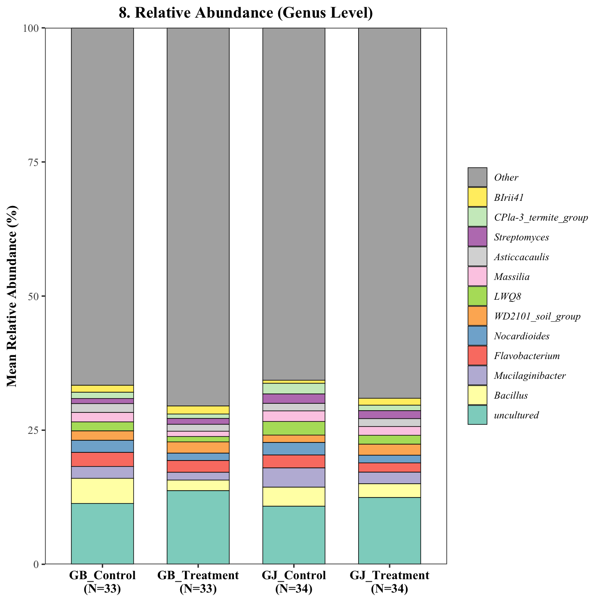

* The largest named fraction is "uncultured" (11.0–14.0%), followed by *Bacillus* (2.0–4.6%) and *Mucilaginibacter* (1.4–3.6%).
* *Bacillus* was lower in treated samples (GB: 4.6% vs 2.0%; GJ: 3.6% vs 2.6%).
* The 12 genera account for 33.6% (`GB_Control`) and 34.5% (`GJ_Control`) of reads, but 29.7% (`GB_Treatment`) and 31.1% (`GJ_Treatment`). Treated samples thus have a larger share of reads outside the most abundant genera, in line with their higher number of observed features.

---

## 5. Differential abundance (LinDA)

LinDA (linear models for differential abundance; `MicrobiomeStat`) was run separately for the two contrasts, with the control as reference level:

```r
linda(feature.dat = counts_gb, meta.dat = meta_linda,
      formula = "~ Treatment_Group", alpha = 0.05,
      prev.filter = 0.10, mean.abund.filter = 0.0001)
```

* Input: the rarefied 16S table (27,000 reads per sample), subset to the samples of each contrast (33 vs 33 for GB; 34 vs 34 for GJ).
* ASVs present in fewer than 10% of the samples of a contrast were removed (`prev.filter = 0.10`).
* No set or batch term was included.
* ASVs with FDR-adjusted p < 0.05 and |log2FC| ≥ 1 were called enriched.

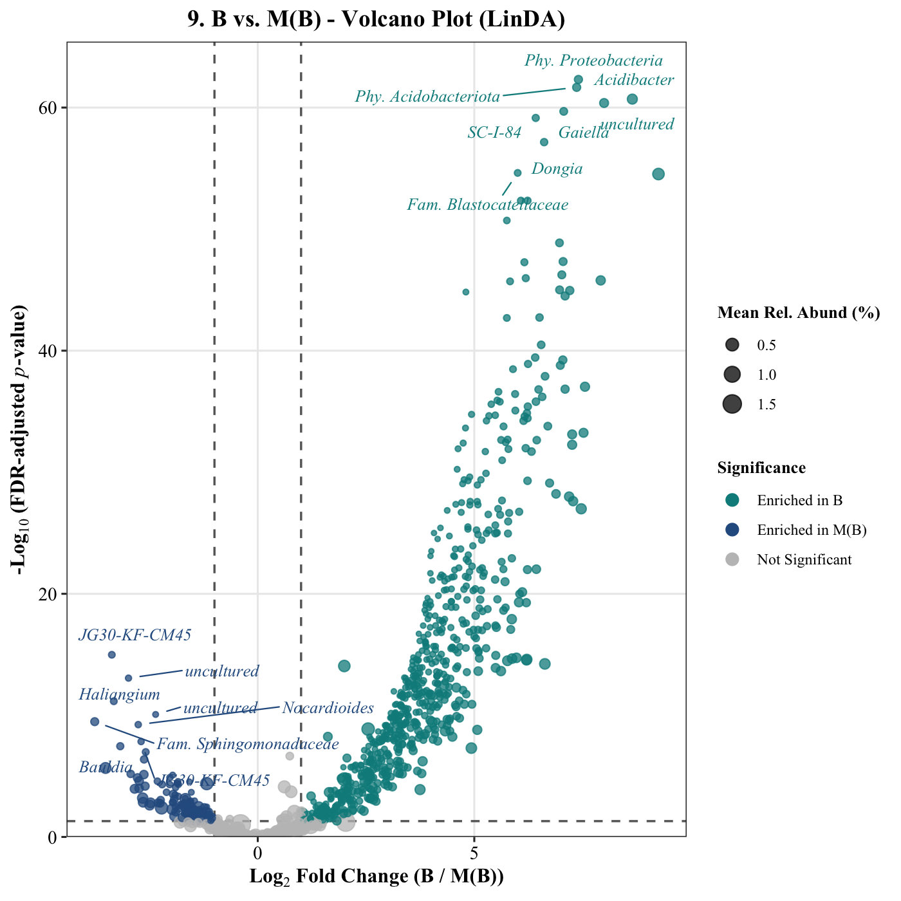

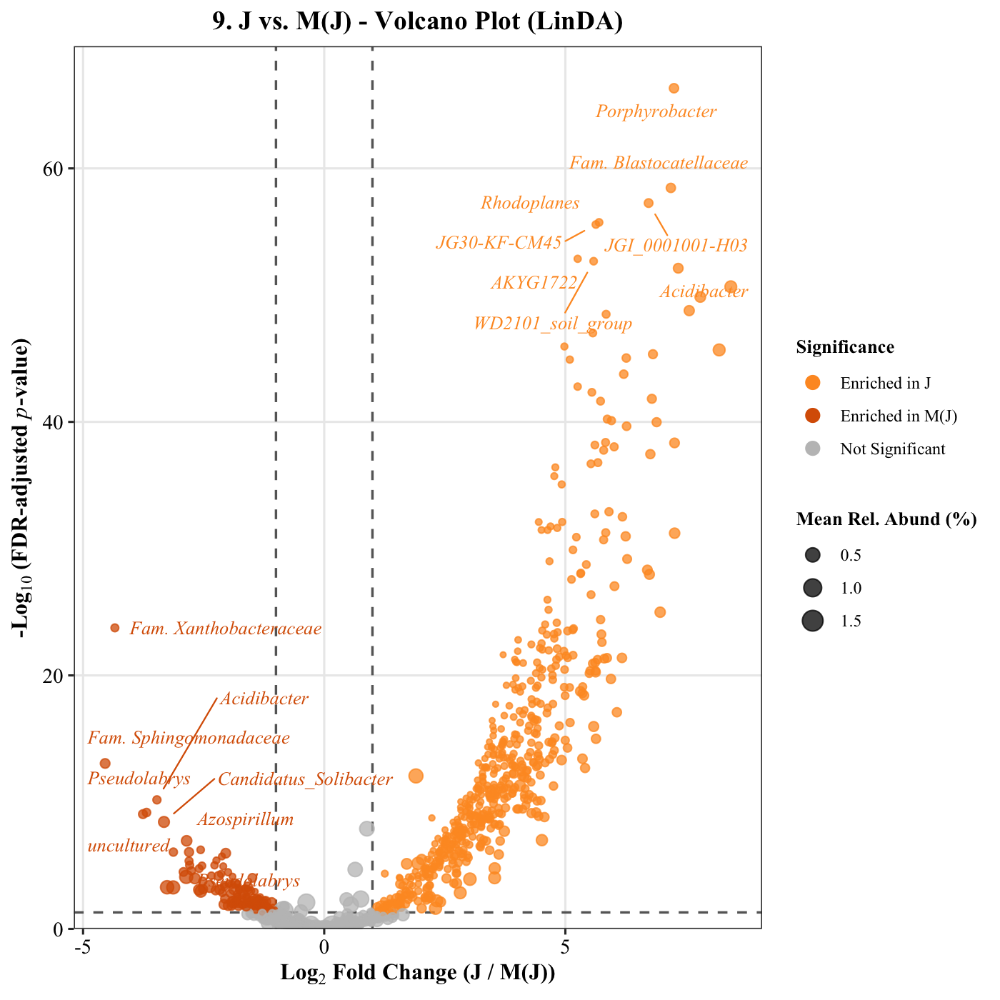

* In both contrasts, many more ASVs were enriched in the treated group than in the control. The strongest effects reached log2FC of about 6–9, with −log10(FDR) up to about 62 (B) and 67 (J).
* **B vs. M(B):** labelled ASVs enriched in B include *Acidibacter*, *Dongia*, *Gaiella*, SC-I-84, a Blastocatellaceae ASV and ASVs classified only to Proteobacteria or Acidobacteriota. ASVs higher in the control include *Haliangium*, *Bauldia*, *Nocardioides*, a Sphingomonadaceae ASV and JG30-KF-CM45.
* **J vs. M(J):** labelled ASVs enriched in J include *Porphyrobacter*, *Rhodoplanes*, AKYG1722, WD2101_soil_group, JGI_0001001-H03, JG30-KF-CM45 and a Blastocatellaceae ASV. ASVs higher in the control include Xanthobacteraceae and Sphingomonadaceae ASVs, *Pseudolabrys*, *Candidatus* Solibacter and *Azospirillum*.

---

## 6. Heatmaps of log2 fold changes

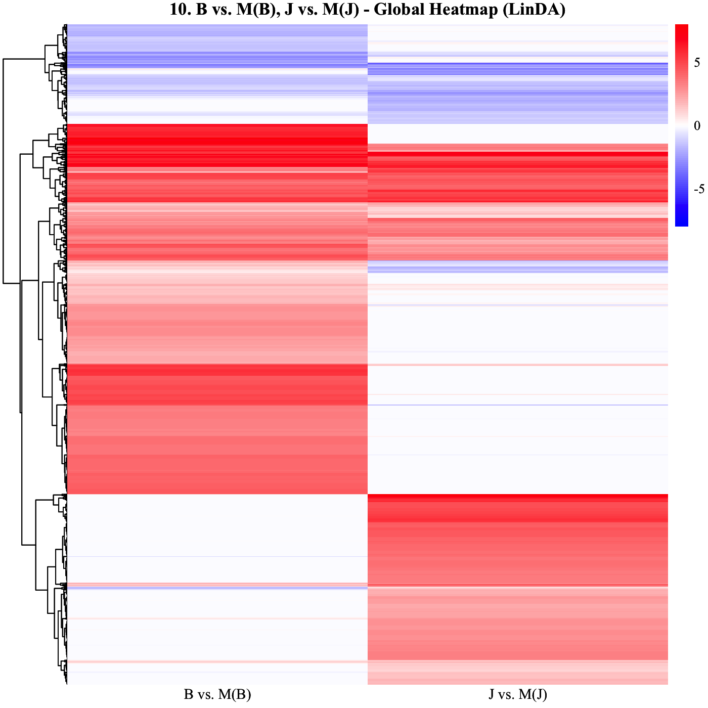

* Rows: all ASVs with FDR < 0.05 and |log2FC| ≥ 1 (either direction) in at least one contrast. Rows are clustered (Euclidean distance, complete linkage). Values are clamped to ±8.
* An ASV missing from one contrast's output (for example because it was removed by the prevalence filter) is shown as 0 (`values_fill = 0`). A white cell can therefore mean "no change" or "not tested".
* The heatmap shows ASVs that are higher in both treatments, ASVs that are higher in only one treatment, and smaller groups of ASVs that are lower in one or both treatments.

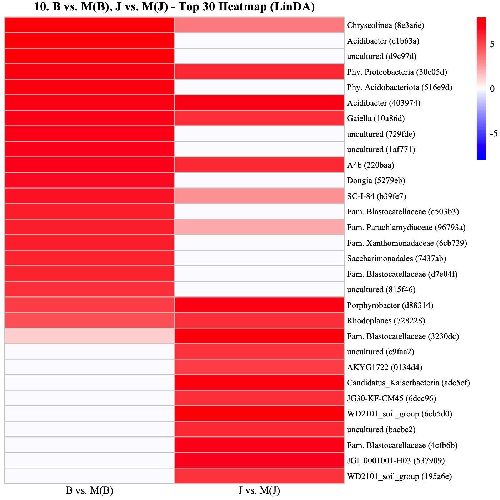

The top 30 ASVs have the smallest FDR (< 0.05) in either contrast; no fold-change cut-off is applied, and ties are broken by mean relative abundance across all 134 bacterial samples. Rows are sorted by the B vs. M(B) log2FC and are not clustered. Selected values, read from the colour scale (about ±0.2; values of 8 or more are clamped):

| ASV | Taxon | log2FC, B vs. M(B) | log2FC, J vs. M(J) |
| :--- | :--- | ---: | ---: |
| `8e3a6e` | *Chryseolinea* | ≥ 7.9 | 4.1 |
| `c1b63a` | *Acidibacter* | ≥ 7.9 | 0 |
| `d9c97d` | uncultured (Micropepsaceae) | ≥ 7.9 | 0 |
| `30c05d` | Proteobacteria (unclassified below phylum) | 7.8 | 6.6 |
| `10a86d` | *Gaiella* | 7.7 | 6.4 |
| `5279eb` | *Dongia* | 7.4 | 0 |
| `d88314` | *Porphyrobacter* | 5.9 | 7.7 |
| `728228` | *Rhodoplanes* | 5.4 | 6.4 |
| `3230dc` | Blastocatellaceae | 1.5 | 7.8 |
| `0134d4` | AKYG1722 | 0 | 5.9 |
| `6dcc96` | JG30-KF-CM45 | 0 | 6.4 |
| `6cb5d0` | WD2101_soil_group | 0 | 7.9 |

A value of 0 means that the ASV was not in that contrast's output or had a fold change near 0.

---

## 7. Group-exclusive ASVs

An ASV was called exclusive to a group if it was detected in at least 2 samples of that group and in no sample of the other three groups (rarefied table). The full list was saved as `Bacteria_16S_Exclusive_Rare_Taxa_Table.tsv`; Figure 045 is a screenshot of this table.


Most abundant ASVs exclusive to `GB_Treatment`:

| ASV | Taxon | Samples detected (of 33) | Mean relative abundance in `GB_Treatment` |
| :--- | :--- | :--- | ---: |
| `c1b63a` | *Acidibacter* | 33 (100%) | 0.433% |
| `938ad4` | Parcubacteria | 29 (87.9%) | 0.351% |
| `939b3c` | *Candidatus* Adlerbacteria | 33 (100%) | 0.316% |
| `d9c97d` | uncultured (Micropepsaceae) | 33 (100%) | 0.271% |
| `285925` | WD2101_soil_group | 32 (97.0%) | 0.182% |

These ASVs were found in most or all GB-treated plants but in no control or GJ-treated sample at a depth of 27,000 reads. This is consistent with their introduction by the GB soil suspension. The soil suspensions themselves are not among the sequenced samples, and whether these taxa relate to the plant phenotypes was not tested.
