# Diversity of the Final Five-Batch Set (N = 110)

**Date:** 2026-08-10
**Stage:** alpha diversity; PCoA and NMDS of the four groups; PCoA and NMDS of the two treated groups
**Cohort:** five batches, original labels; N = 110 (`GB_Control` 33, `GB_Treatment` 33, `GJ_Control` 22, `GJ_Treatment` 22)
**Script:** `modules/11_publication_diversity_figures.R`; the same code is in `pipeline/run_analysis.R` (sections 1-1 to 2-2)
**Platform:** R 4.6.1 (`aarch64-apple-darwin23`)
**Input:** `07_diversity_16S/core_metrics/*`, `metadata_P_generation.tsv`

---

## 1. Methods

* Alpha and beta diversity were computed as in 2026-07-24_01: QIIME 2 vectors and distance matrices read with `qiime2R`; Gini–Simpson index from the rarefied table (`vegan::diversity`); Kruskal–Wallis test with FDR-adjusted pairwise Wilcoxon tests; PCoA with `cmdscale(k = 2)`; PERMANOVA with `adonis2(dist ~ Treatment_Group, permutations = 999)` after `set.seed(42)`; dispersion with `betadisper()` and `permutest()` (999 permutations).
* NMDS: `vegan::metaMDS(dist, k = 2, trymax = 100)` after `set.seed(42)`. PCoA keeps the distances themselves as far as possible in two dimensions; NMDS keeps only their rank order. A stress below 0.2 is usually considered usable. PERMANOVA does not depend on the ordination, so the NMDS panels show the same PERMANOVA values as the PCoA panels.
* Plot style: circles for GB samples and triangles for GJ samples. Lighter colours for controls (`GB_Control` `#4A90E2`, `GJ_Control` `#F87171`), darker colours for treated groups (`GB_Treatment` `#1A365D`, `GJ_Treatment` `#881337`). Ellipses are 95% ellipses from `stat_ellipse()` with its default settings (multivariate t-distribution).

---

## 2. Alpha diversity

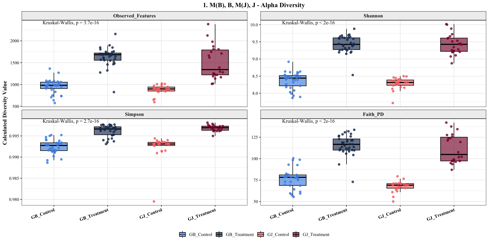

* Kruskal–Wallis: observed features p = 3.7 × 10⁻¹⁶, Shannon p < 2 × 10⁻¹⁶, Simpson p = 2.7 × 10⁻¹⁶, Faith's PD p < 2 × 10⁻¹⁶.
* Median observed features: about 985 (`GB_Control`) and 900 (`GJ_Control`), compared with about 1,690 (`GB_Treatment`) and 1,340 (`GJ_Treatment`).
* `GJ_Treatment` has the widest spread (about 1,000 to 2,400 observed features).

---

## 3. Four groups: PCoA

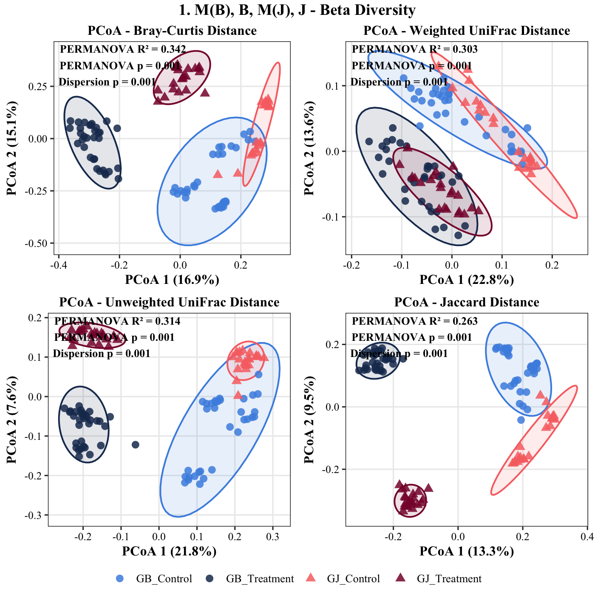

| Distance | PERMANOVA R² | p | Dispersion p | PCoA 1 | PCoA 2 |
| :--- | ---: | ---: | ---: | ---: | ---: |
| Bray–Curtis | 0.342 | 0.001 | 0.001 | 16.9% | 15.1% |
| Weighted UniFrac | 0.303 | 0.001 | 0.001 | 22.8% | 13.6% |
| Unweighted UniFrac | 0.314 | 0.001 | 0.001 | 21.8% | 7.6% |
| Jaccard | 0.263 | 0.001 | 0.001 | 13.3% | 9.5% |

Dispersion differed between groups for all four metrics (p = 0.001), so part of the PERMANOVA signal may reflect differences in spread rather than in group centres. `GB_Control` has the largest spread in Bray–Curtis, unweighted UniFrac and Jaccard.

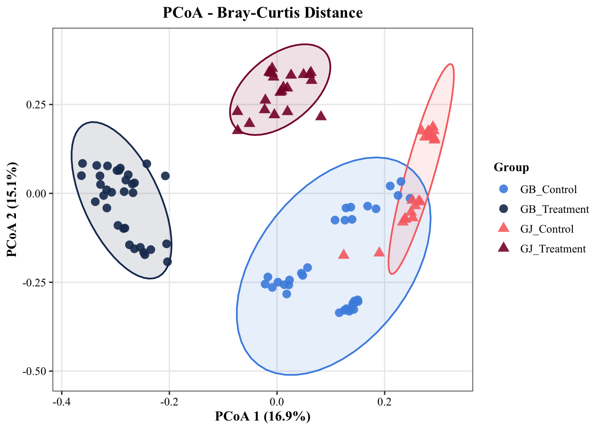

* **Bray–Curtis.** The two treated groups form separate clusters that do not overlap with each other or with the controls. The two control groups partly overlap.

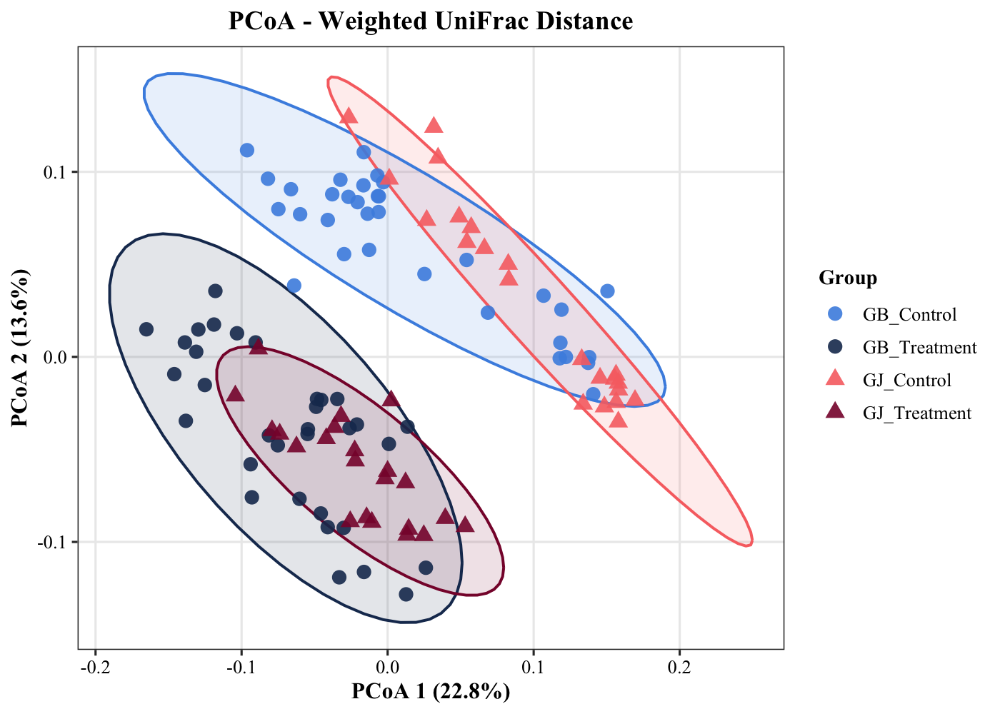

* **Weighted UniFrac.** Treated and control samples separate along a diagonal. Within each pair, the groups overlap: `GB_Treatment` with `GJ_Treatment`, and `GB_Control` with `GJ_Control`.

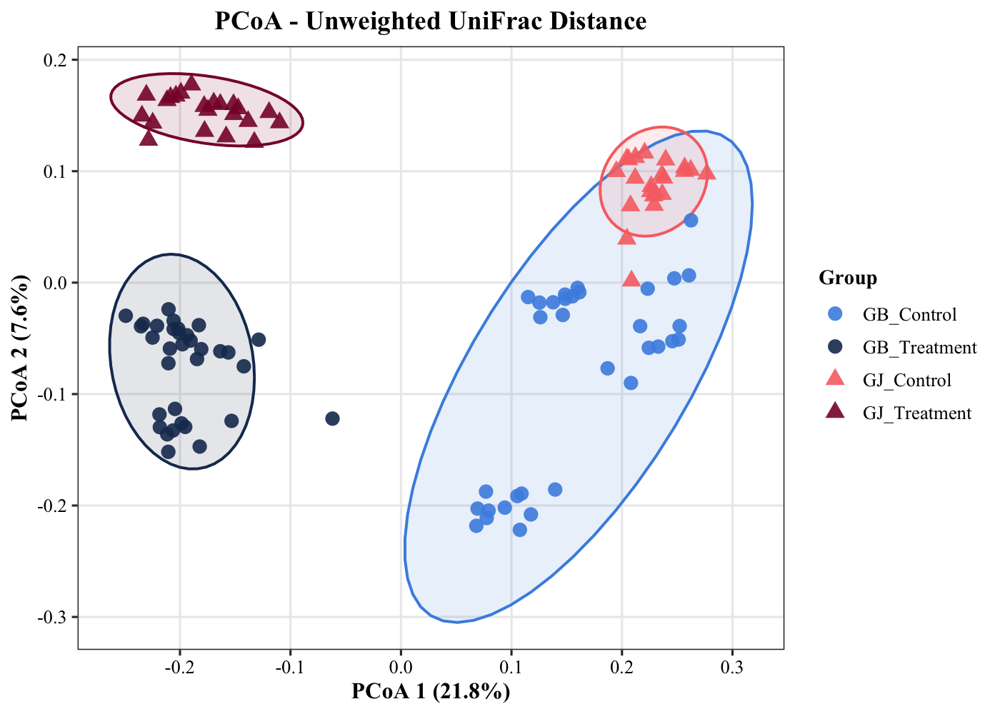

* **Unweighted UniFrac.** PCoA 1 separates treated samples (negative side) from controls (positive side). PCoA 2 separates `GJ_Treatment` (upper) from `GB_Treatment` (lower). `GJ_Control` lies within the `GB_Control` ellipse.

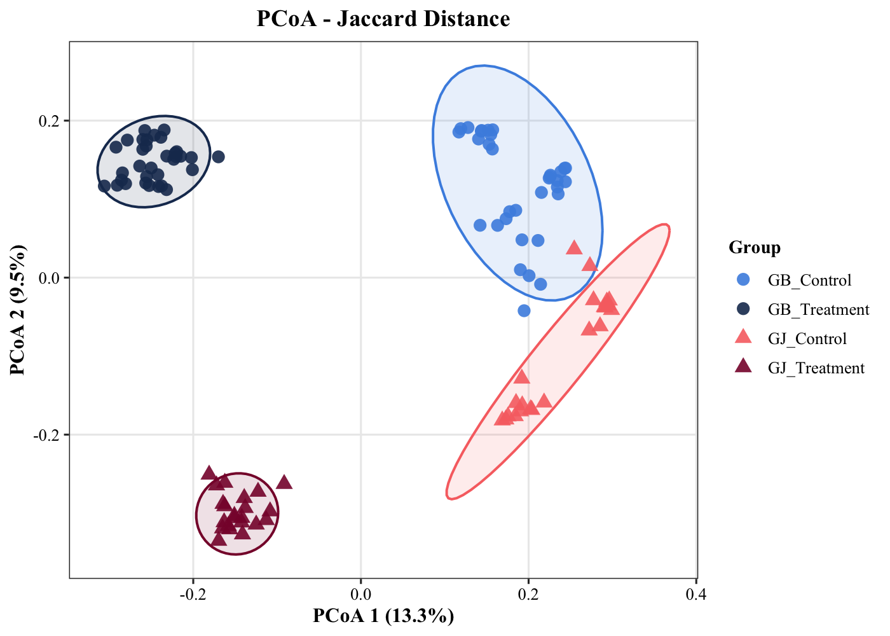

* **Jaccard.** The two treated groups form separate clusters. The two control groups lie close to each other.

---

## 4. Four groups: NMDS

.png)

* Stress: Bray–Curtis 0.197, weighted UniFrac 0.196, unweighted UniFrac 0.121, Jaccard 0.160.
* Group positions are similar to the PCoA plots. As in the PCoA, `GJ_Control` overlaps `GB_Control` in unweighted UniFrac and Jaccard.

_BC.png)

_WUF.png)

_UUF.png)

_JD.png)

---

## 5. Treated groups only: PCoA

`GB_Treatment` (33 samples, three batches) and `GJ_Treatment` (22 samples, two batches).

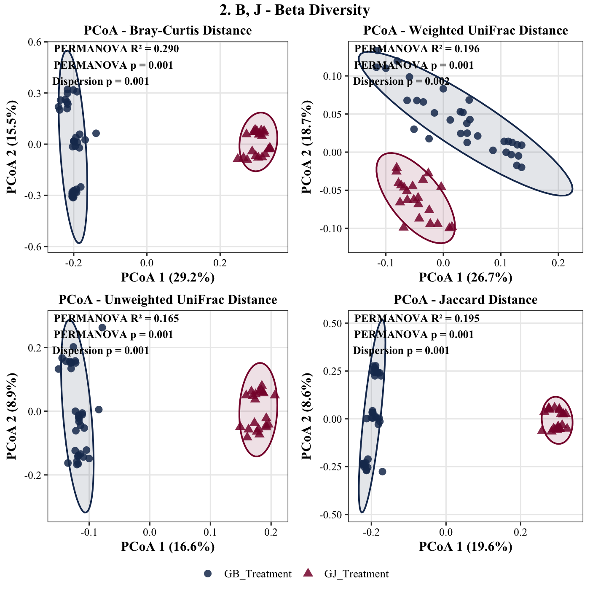

| Distance | PERMANOVA R² | p | Dispersion p | PCoA 1 | PCoA 2 |
| :--- | ---: | ---: | ---: | ---: | ---: |
| Bray–Curtis | 0.290 | 0.001 | 0.001 | 29.2% | 15.5% |
| Weighted UniFrac | 0.196 | 0.001 | 0.002 | 26.7% | 18.7% |
| Unweighted UniFrac | 0.165 | 0.001 | 0.001 | 16.6% | 8.9% |
| Jaccard | 0.195 | 0.001 | 0.001 | 19.6% | 8.6% |

* In Bray–Curtis, unweighted UniFrac and Jaccard, PCoA 1 separates the two treatments without overlap. In weighted UniFrac the 95% ellipses do not overlap, but the separation lies mainly along PCoA 2.
* In Bray–Curtis and Jaccard, the `GB_Treatment` samples form three clusters along PCoA 2. Whether these correspond to the three GB batches was not tested.
* Dispersion differed between the two treatments for all four metrics (p ≤ 0.002).

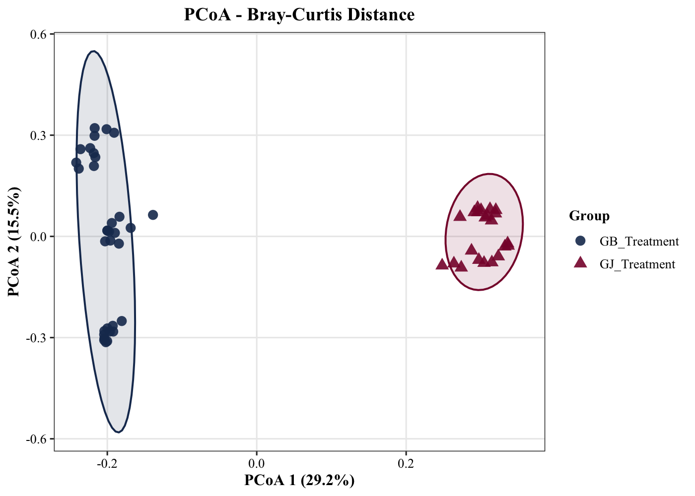

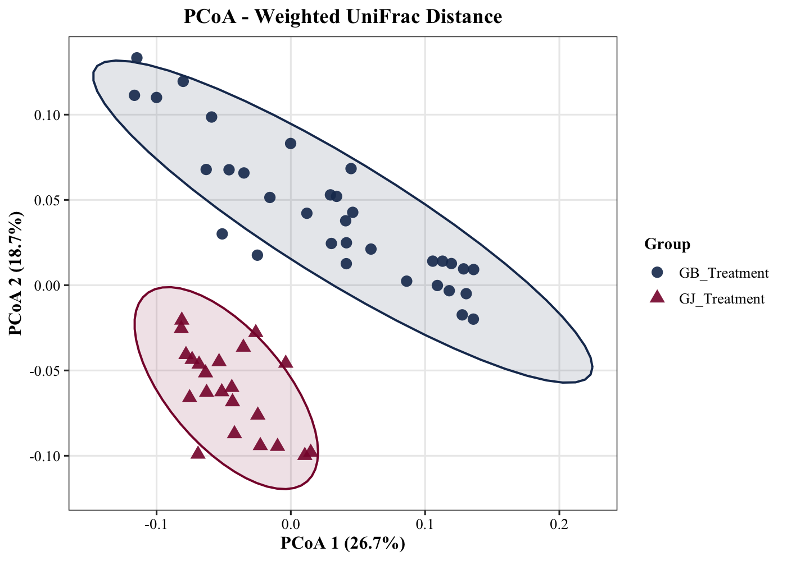

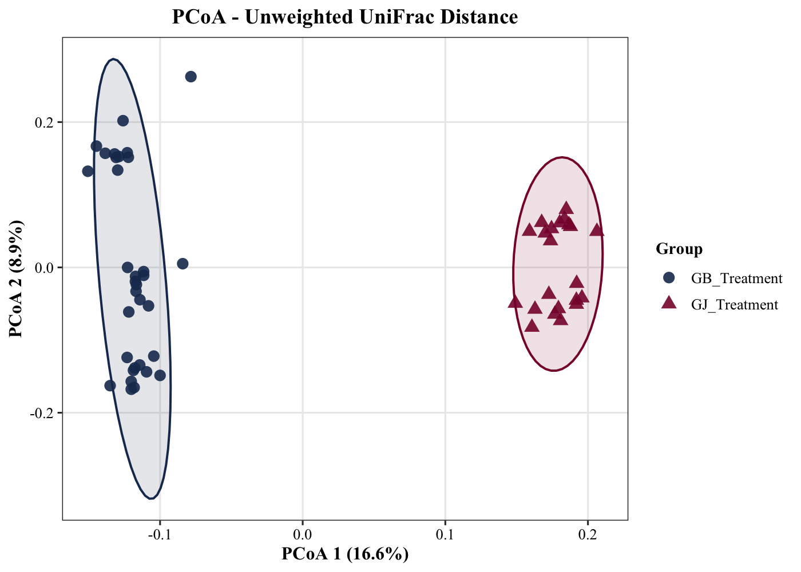

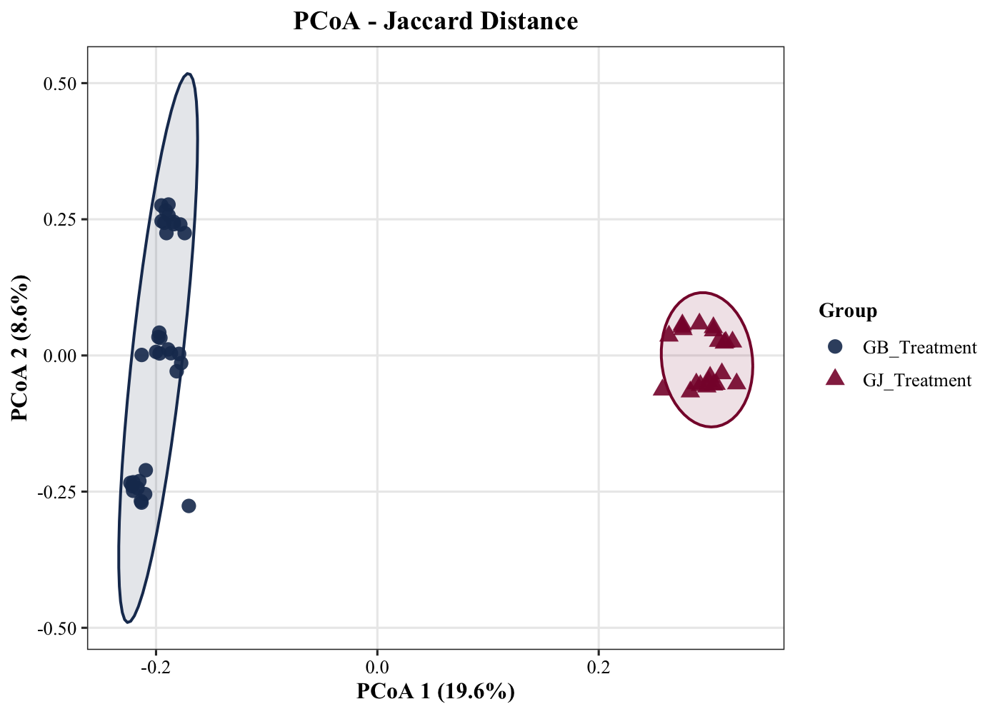

---

## 6. Treated groups only: NMDS

.png)

* Stress: Jaccard 0.054, Bray–Curtis 0.074, unweighted UniFrac 0.134, weighted UniFrac 0.156.
* The two treatments separate along NMDS 1 in Bray–Curtis, unweighted UniFrac and Jaccard, and along NMDS 2 in weighted UniFrac. Their ellipses do not overlap.
* As in the PCoA, `GB_Treatment` is more spread out along the second axis than `GJ_Treatment`.

_BC.png)

_WUF.png)

_UUF.png)

_JD.png)

---

## 7. Summary

Soil-treated rhizospheres had higher alpha diversity than controls. In all four distance metrics, community composition differed between the four groups and between the GB and GJ treated groups. Dispersion also differed between groups, and PERMANOVA does not separate differences in spread from differences in location.
