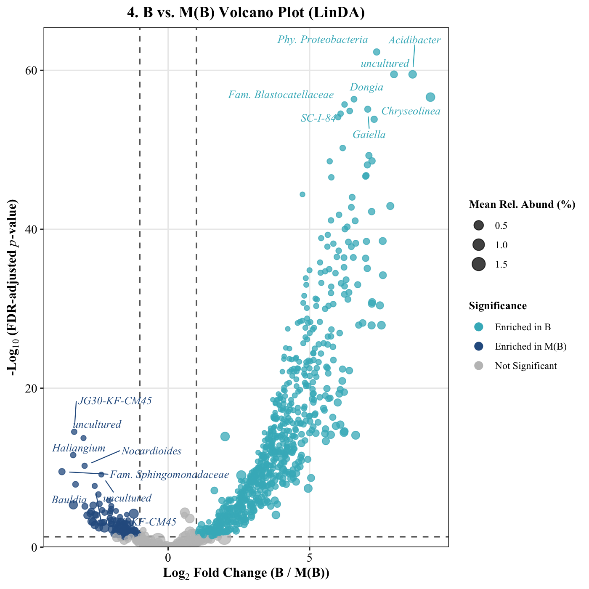
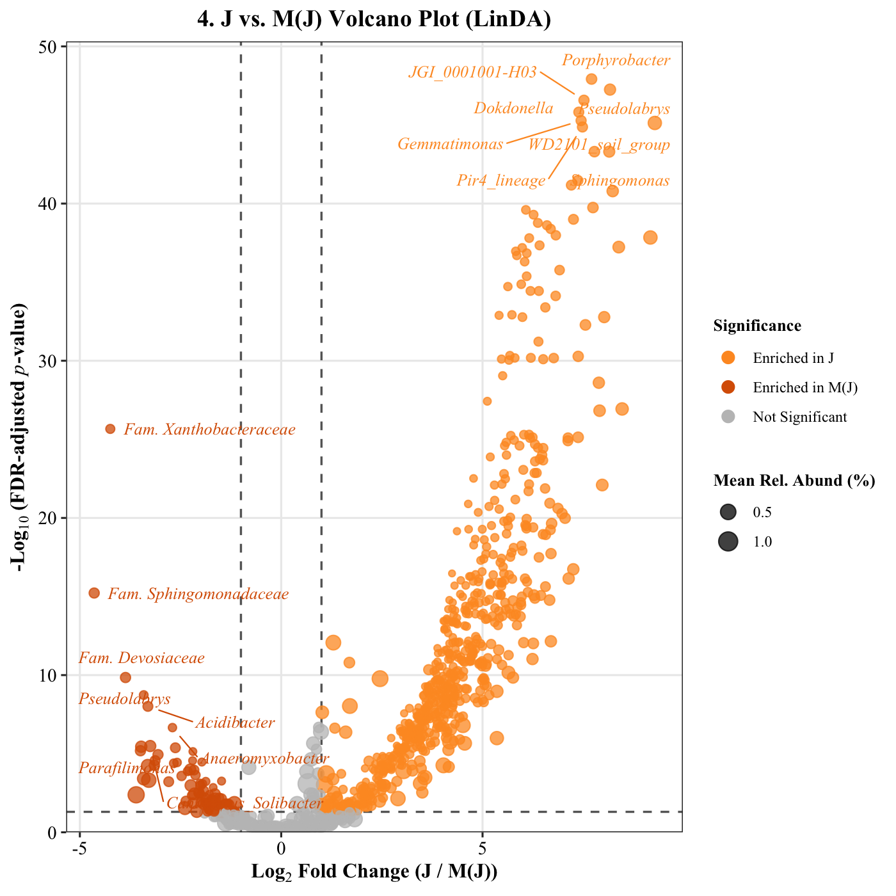
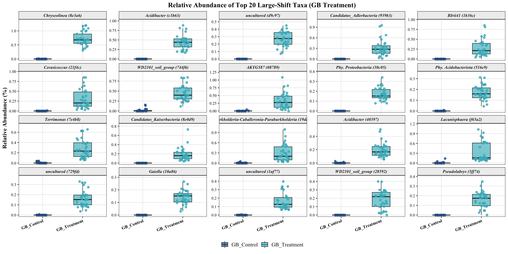
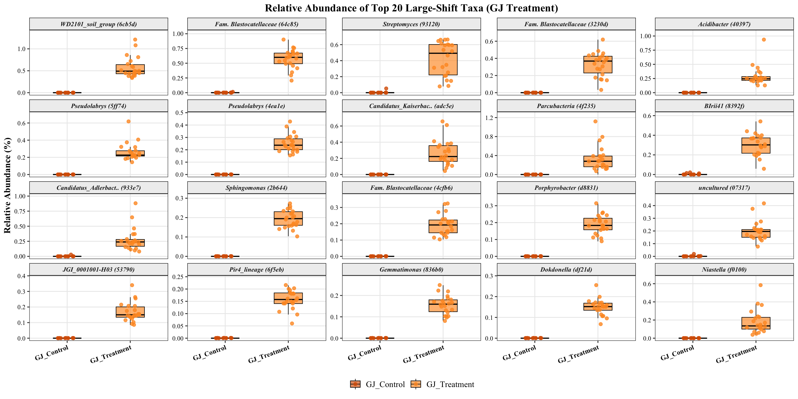
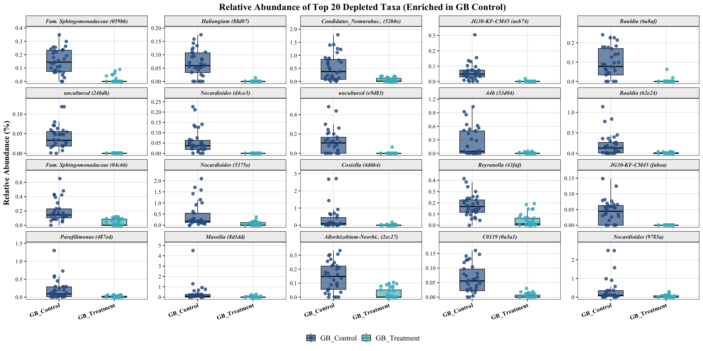
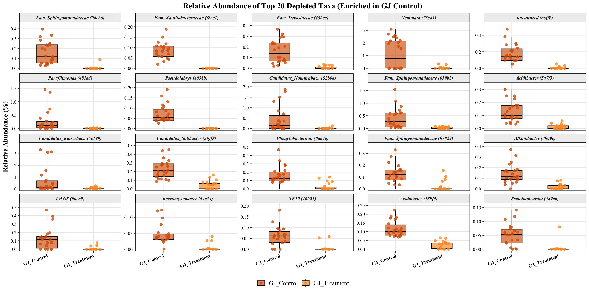
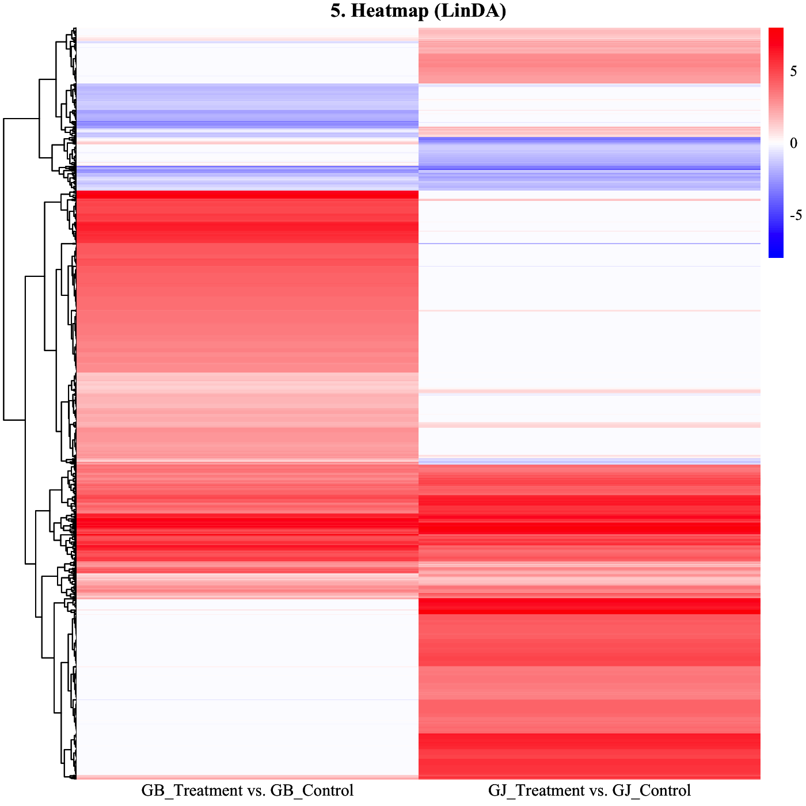
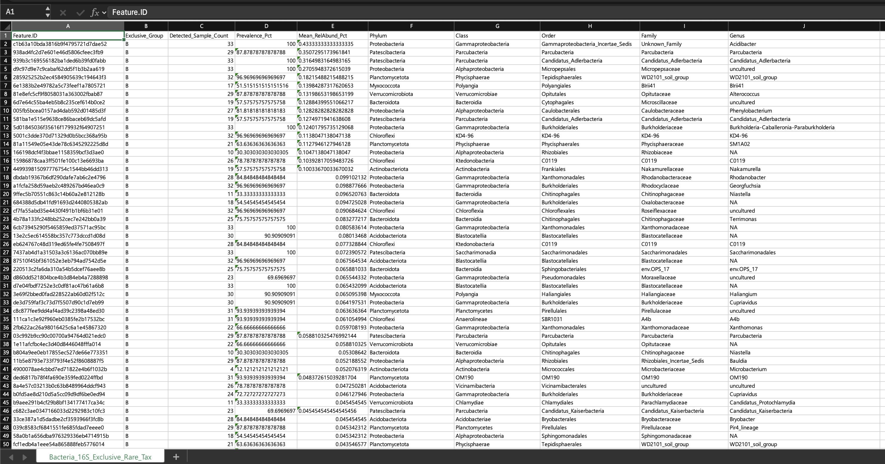
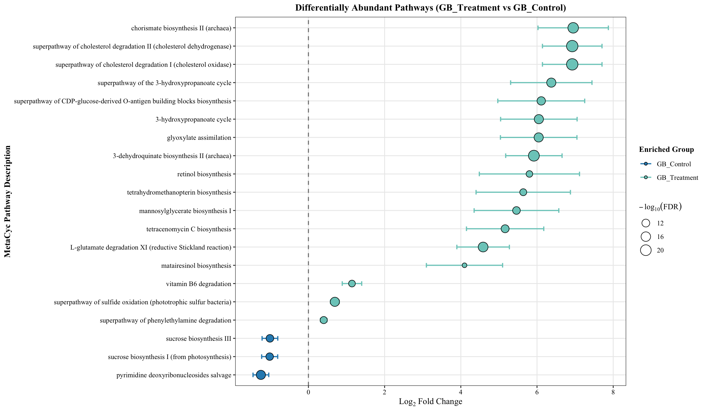
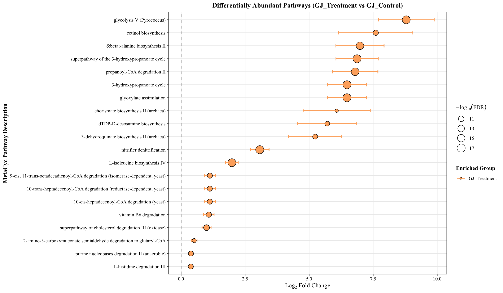

# Differential Abundance (LinDA) and PICRUSt2 Pathways (N = 110)

**Date:** 2026-08-24
**Stage:** LinDA for each contrast; most enriched and depleted ASVs; fold-change heatmap; group-exclusive ASVs; differential abundance of PICRUSt2 pathways; pathway heatmap
**Cohort:** five batches, original labels; N = 110 (`GB_Control` 33, `GB_Treatment` 33, `GJ_Control` 22, `GJ_Treatment` 22). The exclusive-ASV table (Section 4) is from the six-batch set (N = 134).
**Script:** `modules/13_linda_and_picrust2_functional.R`; the same code is in `pipeline/run_analysis.R` (sections 4-1 to "PICRUSt2 Sample-Level Heatmap")
**Platform:** R 4.6.1 (`aarch64-apple-darwin23`)
**Input:** `07_diversity_16S/core_metrics/rarefied_table.qza`, `05_taxonomy_16S/taxonomy_16S.qza`, `picrust2_out_16S/pathways_out/path_abun_unstrat.tsv.gz`, `metadata_P_generation.tsv`

---

## 1. LinDA on ASVs

Each treatment was compared with its own control (GB: 33 vs 33; GJ: 22 vs 22), with the control as reference level:

```r
set.seed(42)
linda_res <- linda(
  feature.dat = counts_gb,      # rarefied counts, GB samples only
  meta.dat = meta_linda,
  formula = "~ Treatment_Group",
  alpha = 0.05,
  prev.filter = 0.10,
  mean.abund.filter = 0.0001
)
```

* Input: the rarefied 16S table (27,000 reads per sample).
* ASVs present in fewer than 10% of the samples of a contrast were removed (`prev.filter = 0.10`).
* No set or batch term was included in the model.
* ASVs with FDR-adjusted p < 0.05 and log2FC ≥ 1 were called enriched in the treatment; those with FDR < 0.05 and log2FC ≤ −1 were called enriched in the control (depleted).





* In both contrasts, many more ASVs were enriched in the treated group than in the control.
* **GB (Figure 078):** −log10(FDR) up to about 62, with log2FC up to about 9. Labelled enriched ASVs: *Acidibacter*, *Dongia*, *Chryseolinea*, *Gaiella*, SC-I-84, a Blastocatellaceae ASV, an "uncultured" ASV and an ASV classified only to Proteobacteria. Labelled depleted ASVs: *Haliangium*, *Bauldia*, *Nocardioides*, a Sphingomonadaceae ASV, JG30-KF-CM45 and "uncultured" ASVs.
* **GJ (Figure 079):** −log10(FDR) up to about 48. Labelled enriched ASVs: *Porphyrobacter*, *Dokdonella*, *Pseudolabrys*, WD2101_soil_group, *Sphingomonas*, *Gemmatimonas*, Pir4_lineage and JGI_0001001-H03. Labelled depleted ASVs: Xanthobacteraceae, Sphingomonadaceae and Devosiaceae ASVs, *Parafilimonas*, *Anaeromyxobacter*, *Candidatus* Solibacter, and other *Pseudolabrys* and *Acidibacter* ASVs.

---

## 2. Most enriched and most depleted ASVs

For each contrast, the 20 enriched ASVs with the largest log2FC and the 20 depleted ASVs with the most negative log2FC are shown as relative abundance per sample. ASV IDs are given as their first five characters.





* **GB (Figure 080):** for example *Chryseolinea* (`8e3a6`), *Acidibacter* (`c1b63`), "uncultured" (`d9c97`), *Candidatus* Adlerbacteria (`939b3`), BIrii41 (`1b36c`), *Cerasicoccus* (`21f4c`) and *Terrimonas* (`7e4b8`). In `GB_Control` these ASVs were absent or present at low levels; the highest control values, about 0.15%, were for WD2101_soil_group (`744f6`) and *Lacunisphaera* (`f65a2`).
* **GJ (Figure 081):** for example WD2101_soil_group (`6cb5d`), Blastocatellaceae (`64c85`, `3230d`), *Streptomyces* (`93120`), *Pseudolabrys* (`4ea1e`), *Candidatus* Kaiserbacteria (`adc5e`), Parcubacteria (`4f235`), *Dokdonella* (`df21d`) and *Porphyrobacter* (`d8831`). In `GJ_Control` these ASVs were absent or present at about 0.05% or less in a few samples.

These ASVs were absent or rare in the controls and present in most treated plants. This is consistent with their introduction by the soil suspensions. The soil suspensions themselves are not among the sequenced samples, so their source is not shown directly.





* **GB (Figure 082):** for example Sphingomonadaceae (`059bb`, `04c66`), *Haliangium* (`88d07`), *Bauldia* (`6a8af`, `62e24`), *Nocardioides* (`d4ce3`, `5375e`, `9785a`), JG30-KF-CM45 (`aeb74`, `fabea`) and *Parafilimonas* (`487ed`).
* **GJ (Figure 083):** for example Sphingomonadaceae (`04c66`, `059bb`, `07822`), Xanthobacteraceae (`f8ce1`), Devosiaceae (`430ec`), *Gemmata* (`73c81`), *Parafilimonas* (`487ed`), *Pseudolabrys* (`e038b`) and *Candidatus* Solibacter (`36ff8`).
* Some depleted ASVs were not detected in any treated sample (for example *Nocardioides* `d4ce3`, JG30-KF-CM45 `fabea` and "uncultured" `24bdb` in GB; Xanthobacteraceae `f8ce1` in GJ). Others remained at low levels in some treated plants (for example Sphingomonadaceae `059bb`, up to about 0.09% in GB).
* Relative abundances cannot distinguish a loss of these taxa from dilution by the taxa added with the soil.

---

## 3. Fold-change heatmap



* Rows: all ASVs enriched or depleted (FDR < 0.05, |log2FC| ≥ 1) in at least one contrast. Rows are clustered (Euclidean distance, complete linkage); values are clamped to ±8.
* An ASV missing from one contrast's output (for example because it was removed by the prevalence filter) is shown as 0 (`values_fill = 0`). A white cell can therefore mean "no change" or "not tested".
* The largest block contains ASVs that are higher in `GB_Treatment` only. Other blocks contain ASVs higher in `GJ_Treatment` only, ASVs higher in both treatments, and smaller groups of ASVs lower in one or both treatments.

---

## 4. Group-exclusive ASVs



> **Note.** Figure 088 is the same file as Figure 045 (identical content). It shows the table from the six-batch set with reassigned labels (N = 134; 2026-07-25_01), not the N = 110 set. `pipeline/run_analysis.R` contains an N = 110 version of this step, but its output has not been added to the repository.

Definition: an ASV detected in at least 2 samples of one group and in no sample of the other three groups.

| ASV | Taxon | Samples detected in `GB_Treatment` (of 33) | Mean relative abundance in `GB_Treatment` |
| :--- | :--- | :--- | ---: |
| `c1b63a` | *Acidibacter* | 33 (100%) | 0.433% |
| `938ad4` | Parcubacteria | 29 (87.9%) | 0.351% |
| `939b3c` | *Candidatus* Adlerbacteria | 33 (100%) | 0.316% |
| `d9c97d` | uncultured (Micropepsaceae) | 33 (100%) | 0.271% |
| `285925` | WD2101_soil_group | 32 (97.0%) | 0.182% |

The GB groups are the same in both sets, and the N = 110 GJ samples are a subset of the N = 134 GJ samples. Similar `GB_Treatment` results are therefore expected for N = 110, but the N = 110 table is a separate rarefaction, so the exact values may differ.

---

## 5. PICRUSt2 pathways

LinDA was applied to the unstratified MetaCyc pathway abundances (`path_abun_unstrat.tsv.gz`), separately for each contrast:

```r
set.seed(42)
linda_res <- linda(
  feature.dat = path_matrix,
  meta.dat = metadata,
  formula = "~ Treatment_Group",
  alpha = 0.05,
  prev.filter = 0.1,
  zero.handling = "pseudo-count"
)
```

* Pathway descriptions were added with `ggpicrust2::pathway_annotation(pathway = "MetaCyc")`. `ggpicrust2` was used only for these descriptions, not for the statistics. Two IDs were labelled by hand: `PWY-8190` in the GB run ("L-glutamate degradation XI (reductive Stickland reaction)") and `PWY-8154` in the GJ run ("superpathway of cholesterol degradation III (oxidase)").
* The forest plots show the 20 pathways with the smallest FDR among those with FDR < 0.05. Points are log2FC; bars are 95% confidence intervals (log2FC ± 1.96 × SE); point size is −log10(FDR). No fold-change threshold was applied.
* Full results were written to `figure/PICRUSt2_LinDA_GB_Control_vs_GB_Treatment.csv` and `figure/PICRUSt2_LinDA_GJ_Control_vs_GJ_Treatment.csv` (not in the repository).





Selected pathways, with approximate log2FC values read from the forest plots ("—" = not among the 20 pathways shown for that contrast):

| Pathway | GB | GJ |
| :--- | ---: | ---: |
| superpathway of the 3-hydroxypropanoate cycle | 6.4 | 6.9 |
| 3-hydroxypropanoate cycle | 6.0 | 6.5 |
| glyoxylate assimilation | 6.0 | 6.5 |
| chorismate biosynthesis II (archaea) | 6.9 | 6.1 |
| 3-dehydroquinate biosynthesis II (archaea) | 5.9 | 5.2 |
| retinol biosynthesis | 5.8 | 7.6 |
| vitamin B6 degradation | 1.1 | 1.1 |
| superpathway of cholesterol degradation I (cholesterol oxidase) | 6.9 | — |
| superpathway of cholesterol degradation II (cholesterol dehydrogenase) | 6.9 | — |
| superpathway of cholesterol degradation III (oxidase) | — | 1.0 |
| tetracenomycin C biosynthesis | 5.2 | — |
| L-glutamate degradation XI (reductive Stickland reaction) | 4.6 | — |
| sucrose biosynthesis I (from photosynthesis) | −1.0 | — |
| sucrose biosynthesis III | −1.0 | — |
| pyrimidine deoxyribonucleosides salvage | −1.3 | — |
| glycolysis V (*Pyrococcus*) | — | 8.8 |
| β-alanine biosynthesis II | — | 7.0 |
| propanoyl-CoA degradation II | — | 6.8 |
| dTDP-D-desosamine biosynthesis | — | 5.7 |
| nitrifier denitrification | — | 3.1 |

* Seven pathways appear in both top-20 lists, all higher in the treated groups: the two 3-hydroxypropanoate cycle entries, glyoxylate assimilation, chorismate biosynthesis II (archaea), 3-dehydroquinate biosynthesis II (archaea), retinol biosynthesis and vitamin B6 degradation.
* Only GB has pathways that are lower in the treated group among its top 20 (sucrose biosynthesis I and III, pyrimidine deoxyribonucleosides salvage). All 20 GJ pathways are higher in `GJ_Treatment`.
* Several top pathways are named after archaeal, yeast or animal pathways (for example chorismate biosynthesis II (archaea), glycolysis V (*Pyrococcus*), retinol biosynthesis and the yeast acyl-CoA degradation pathways). PICRUSt2 infers pathways from predicted enzyme content, so these results need to be checked before any biological interpretation.
* In Figure 086 the label "&beta;-alanine biosynthesis II" contains an unconverted HTML entity (β-alanine). The forest-plot code does not clean these entities; the heatmap code does.

---

## 6. Pathway heatmap (z-scores)

.png)

* Pathway abundances were converted to relative abundances per sample. The 35 pathways with the highest standard deviation across samples were kept, scaled to z-scores by row and clustered by row. Samples are ordered by group and are not clustered. Labels longer than 75 characters were shortened. The code also contains hand-written labels for `PWY-7883` and `PWY-8004`; neither pathway is among the 35 shown.
* Groups differ in which pathways have high z-scores, for example sucrose biosynthesis II and the reductive TCA cycle pathways (high in part of `GB_Control`) and serotonin and aromatic biogenic amine degradation (high in part of `GJ_Control`).
* There is clear variation within groups. Within each group, columns follow the metadata file, which is sorted by sample ID, so neighbouring columns come from the same set. In `GB_Control`, for example, blocks of about 11 columns (one set each) have different profiles. This suggests differences between sets (batches); it was not tested.
