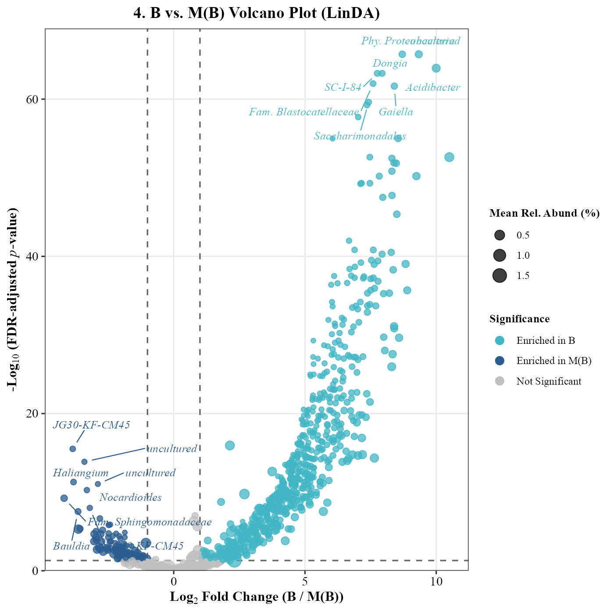
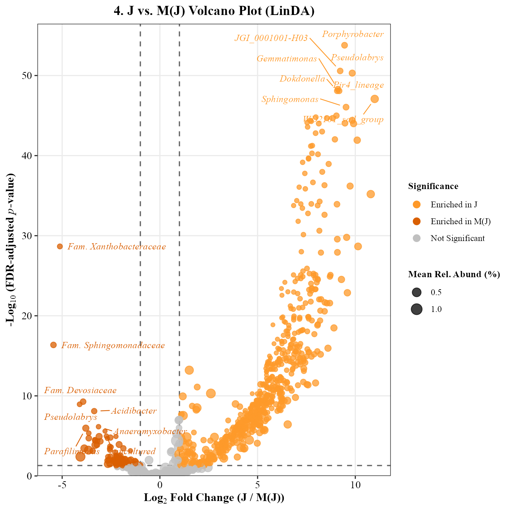
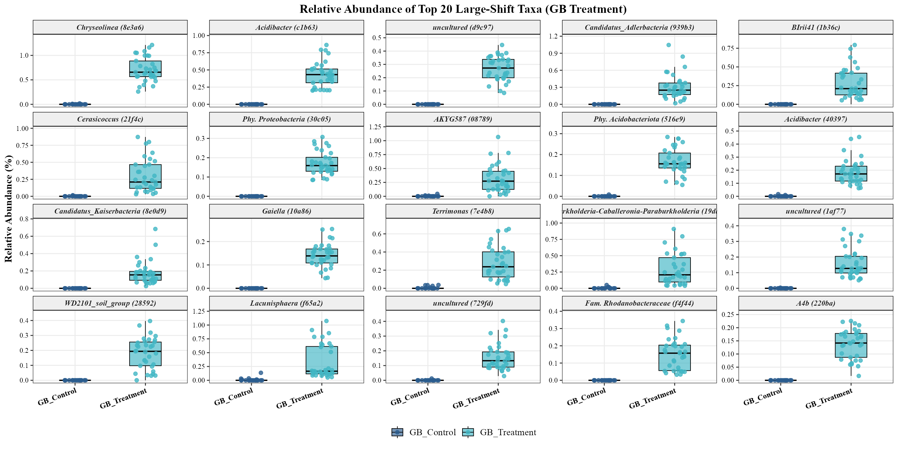
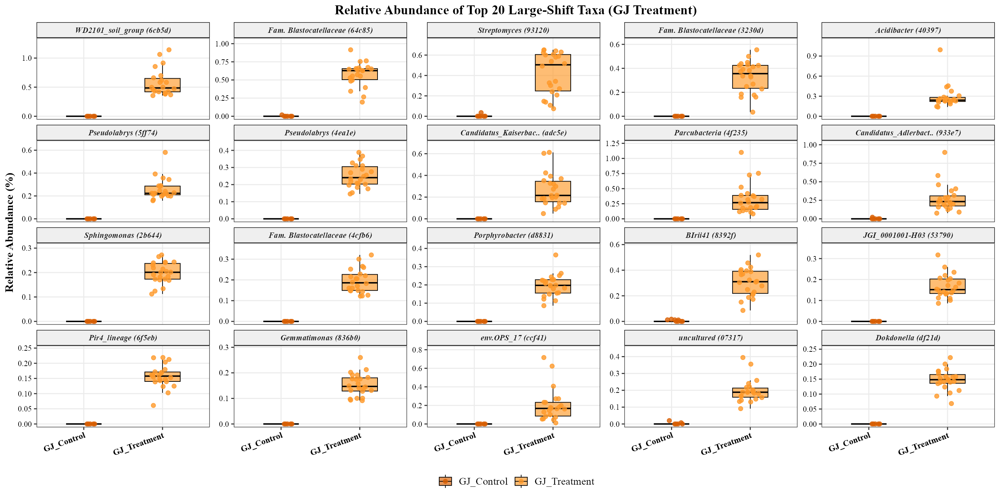
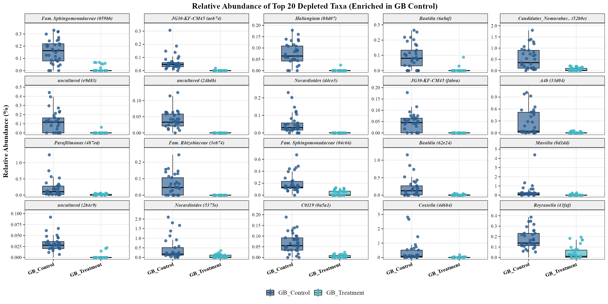
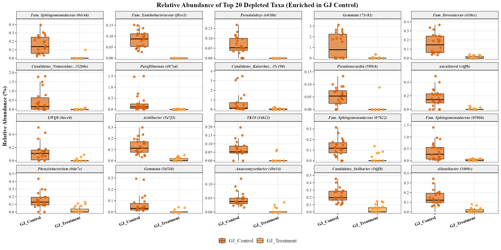
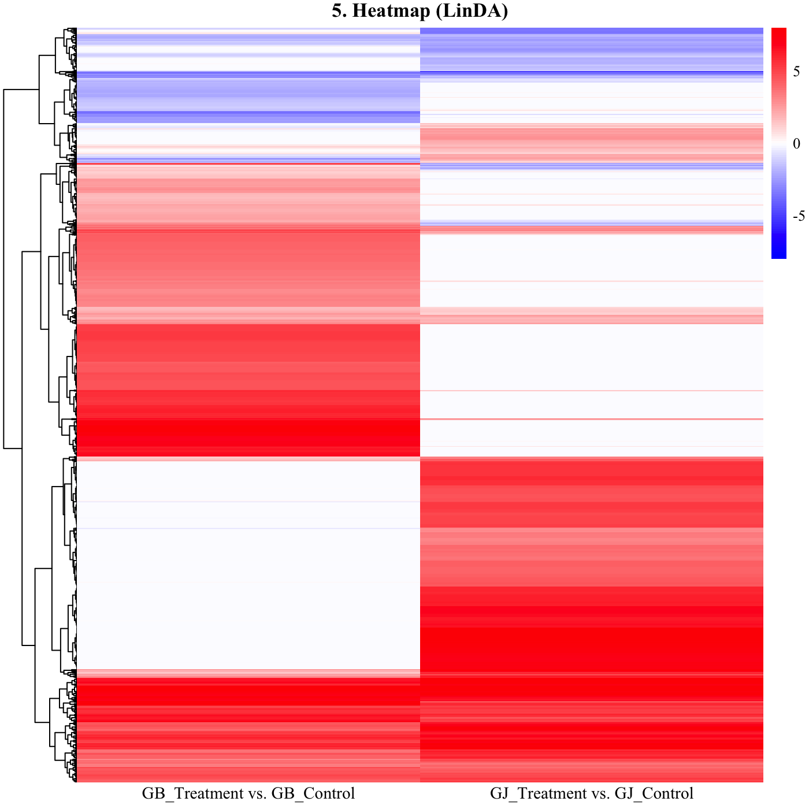
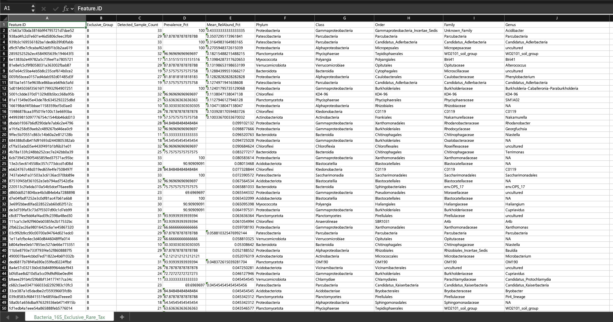
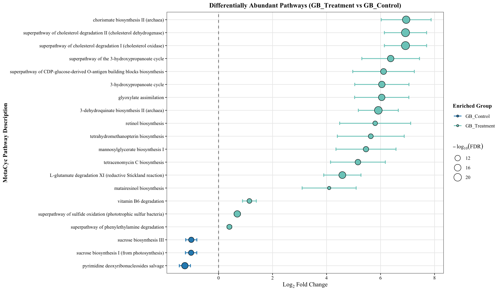
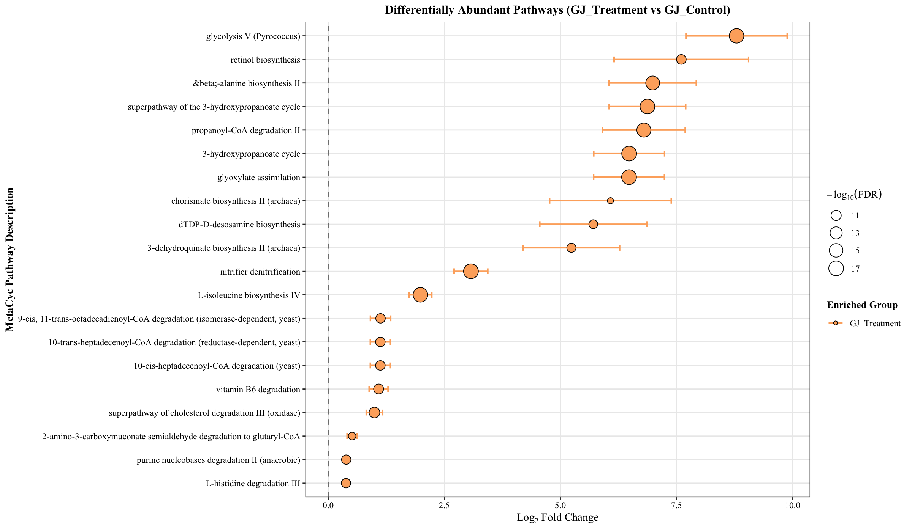

# Differential Abundance (LinDA) and PICRUSt2 Pathways (N = 110)

**Date:** 2026-08-24
**Updated:** 2026-11-16 (Sections 1–3 rerun on the unrarefied table; Figures 078–084 replaced)
**Stage:** LinDA for each contrast; most enriched and depleted ASVs; fold-change heatmap; group-exclusive ASVs; differential abundance of PICRUSt2 pathways; pathway heatmap
**Cohort:** five batches, original labels; N = 110 (`GB_Control` 33, `GB_Treatment` 33, `GJ_Control` 22, `GJ_Treatment` 22).
**Script:** `modules/13_linda_and_picrust2_functional.R`; the same code is in `pipeline/run_analysis.R` (sections 4-1 to "PICRUSt2 Sample-Level Heatmap")
**Platform:** R 4.6.1 (`aarch64-apple-darwin23`)
**Input:** `05_taxonomy_16S/table_16S_clean.qza` (Sections 1–3), `07_diversity_16S/core_metrics/rarefied_table.qza` (Section 4), `05_taxonomy_16S/taxonomy_16S.qza`, `picrust2_out_16S/pathways_out/path_abun_unstrat.tsv.gz`, `metadata_P_generation.tsv`

---

## 1. LinDA on ASVs

Each treatment was compared with its own control (GB: 33 vs 33; GJ: 22 vs 22), with the control as reference level:

```r
set.seed(42)
linda_res <- linda(
  feature.dat = counts_gb,      # unrarefied counts, GB samples only
  meta.dat = meta_linda,
  formula = "~ Treatment_Group",
  alpha = 0.05,
  prev.filter = 0.10,
  mean.abund.filter = 0.0001,
  adaptive = FALSE,
  zero.handling = "imputation"
)
```

* Input: the unrarefied, taxonomy-filtered 16S table (`05_taxonomy_16S/table_16S_clean.qza`; 27,237–156,196 reads per sample). LinDA corrects for read depth itself, so the rarefied table is not needed.
* Zeros were imputed (`zero.handling = "imputation"`). Treated samples had fewer reads than their controls (median 69,404 vs 78,025 in GB; 50,307 vs 79,835 in GJ), and LinDA's own check (the default `adaptive = TRUE`) selected imputation in both contrasts. With `adaptive = TRUE`, MicrobiomeStat 1.4 printed "Imputation approach is used.", but its results differed from a run with imputation set explicitly (21 GB and 57 GJ ASVs changed their call). Imputation was therefore set explicitly (`adaptive = FALSE`).
* ASVs present in fewer than 10% of the samples of a contrast were removed (`prev.filter = 0.10`).
* No set or batch term was included in the model.
* ASVs with FDR-adjusted p < 0.05 and log2FC ≥ 1 were called enriched in the treatment; those with FDR < 0.05 and log2FC ≤ −1 were called enriched in the control (depleted).
* Full results were written to `LinDA_ASV_GB_Treatment_vs_GB_Control.csv` and `LinDA_ASV_GJ_Treatment_vs_GJ_Control.csv` (not in the repository).

| | GB | GJ |
| :--- | ---: | ---: |
| ASVs tested | 1,496 | 1,358 |
| Enriched in the treatment | 735 | 698 |
| Enriched in the control (depleted) | 121 | 99 |





* In both contrasts, many more ASVs were enriched in the treated group than in the control.
* **GB (Figure 078):** −log10(FDR) up to 65.7; log2FC from −4.2 to 10.5. Labelled enriched ASVs: an "uncultured" ASV, an ASV classified only to Proteobacteria, *Acidibacter*, *Dongia*, SC-I-84, a Blastocatellaceae ASV, *Gaiella* and Saccharimonadales. Labelled depleted ASVs: two JG30-KF-CM45 ASVs, *Haliangium*, *Nocardioides*, a Sphingomonadaceae ASV, *Bauldia* and two "uncultured" ASVs.
* **GJ (Figure 079):** −log10(FDR) up to 53.8; log2FC from −5.4 to 11.0. Labelled enriched ASVs: *Porphyrobacter*, JGI_0001001-H03, *Pseudolabrys*, *Gemmatimonas*, Pir4_lineage, *Dokdonella*, WD2101_soil_group and *Sphingomonas*. Labelled depleted ASVs: Xanthobacteraceae, Sphingomonadaceae and Devosiaceae ASVs, *Pseudolabrys*, *Acidibacter*, *Anaeromyxobacter*, *Parafilimonas* and an "uncultured" ASV.

**Earlier version.** Until 2026-11-16, Sections 1–3 used the rarefied table (27,000 reads per sample, about 37% of the clean reads) with LinDA's default zero handling. The overall pattern and most labelled taxa were the same; the numbers of significant ASVs were not recorded.

---

## 2. Most enriched and most depleted ASVs

For each contrast, the 20 enriched ASVs with the largest log2FC and the 20 depleted ASVs with the most negative log2FC are shown as relative abundance per sample (unrarefied table). ASV IDs are given as their first five characters.





* **GB (Figure 080):** for example *Chryseolinea* (`8e3a6`), *Acidibacter* (`c1b63`), "uncultured" (`d9c97`), *Candidatus* Adlerbacteria (`939b3`), BIrii41 (`1b36c`), *Cerasicoccus* (`21f4c`) and *Terrimonas* (`7e4b8`). Ten of the 20 ASVs were not detected in any `GB_Control` sample, and the others were found in at most 5 of 33 controls; the highest control value was 0.14% (*Lacunisphaera*, `f65a2`). All 20 were present in at least 32 of the 33 treated plants.
* **GJ (Figure 081):** for example WD2101_soil_group (`6cb5d`), Blastocatellaceae (`64c85`, `3230d`), *Streptomyces* (`93120`), *Pseudolabrys* (`4ea1e`), *Candidatus* Kaiserbacteria (`adc5e`), Parcubacteria (`4f235`), *Dokdonella* (`df21d`) and *Porphyrobacter* (`d8831`). Fifteen of the 20 ASVs were not detected in any `GJ_Control` sample, and the others were found in at most 4 of 22 controls, at 0.04% or less. All 20 were present in at least 21 of the 22 treated plants.

These ASVs were absent or rare in the controls and present in almost all treated plants. This is consistent with their introduction by the soil suspensions. The soil suspensions themselves are not among the sequenced samples, so their source is not shown directly.





* **GB (Figure 082):** for example Sphingomonadaceae (`059bb`, `04c66`), *Haliangium* (`88d07`), *Bauldia* (`6a8af`, `62e24`), *Nocardioides* (`d4ce3`, `5375e`), JG30-KF-CM45 (`aeb74`, `fabea`) and *Parafilimonas* (`487ed`).
* **GJ (Figure 083):** for example Sphingomonadaceae (`04c66`, `059bb`, `07822`), Xanthobacteraceae (`f8ce1`), Devosiaceae (`430ec`), *Gemmata* (`73c81`), *Parafilimonas* (`487ed`), *Pseudolabrys* (`e038b`) and *Candidatus* Solibacter (`36ff8`).
* Some depleted ASVs were not detected in any treated sample (GB: "uncultured" `24bdb`, *Nocardioides* `d4ce3`, JG30-KF-CM45 `fabea` and Rhizobiaceae `3eb74`; GJ: Xanthobacteraceae `f8ce1` and *Pseudolabrys* `e038b`). Others remained at low levels in some treated plants (for example Sphingomonadaceae `059bb`, in 7 of 33 GB-treated plants at up to 0.07%).
* Relative abundances cannot distinguish a loss of these taxa from dilution by the taxa added with the soil.

---

## 3. Fold-change heatmap



* Rows: the 1,373 ASVs enriched or depleted (FDR < 0.05, |log2FC| ≥ 1) in at least one contrast. Rows are clustered (Euclidean distance, complete linkage); values are clamped to ±8.
* An ASV missing from one contrast's output (for example because it was removed by the prevalence filter) is shown as 0 (`values_fill = 0`). A white cell can therefore mean "no change" or "not tested".
* The largest groups are ASVs enriched only in `GB_Treatment` (484) and only in `GJ_Treatment` (447), followed by ASVs enriched in both treatments (247). Most ASVs in the one-contrast groups were not tested in the other contrast (432 of the 484 and 387 of the 447). Smaller groups are depleted in GB only (92), in GJ only (70) or in both (25); 8 ASVs changed in opposite directions.

---

## 4. Group-exclusive ASVs



Definition: an ASV detected in at least 2 samples of one group and in no sample of the other three groups.

| ASV | Taxon | Samples detected in `GB_Treatment` (of 33) | Mean relative abundance in `GB_Treatment` |
| :--- | :--- | :--- | ---: |
| `c1b63a` | *Acidibacter* | 33 (100%) | 0.429% |
| `938ad4` | Parcubacteria | 29 (87.9%) | 0.351% |
| `939b3c` | *Candidatus* Adlerbacteria | 33 (100%) | 0.308% |
| `1b36c5` | BIrii41 | 32 (97.0%) | 0.279% |
| `d9c97d` | uncultured (Micropepsaceae) | 33 (100%) | 0.267% |

---

## 5. PICRUSt2 pathways

LinDA was applied to the unstratified MetaCyc pathway abundances (`path_abun_unstrat.tsv.gz`), separately for each contrast:

```r
set.seed(42)
linda_res <- linda(
  feature.dat = path_matrix,
  meta.dat = metadata,
  formula = "~ Treatment_Group",
  alpha = 0.05,
  prev.filter = 0.1,
  zero.handling = "pseudo-count"
)
```

* Pathway descriptions were added with `ggpicrust2::pathway_annotation(pathway = "MetaCyc")`. `ggpicrust2` was used only for these descriptions, not for the statistics. Two IDs were labelled by hand: `PWY-8190` in the GB run ("L-glutamate degradation XI (reductive Stickland reaction)") and `PWY-8154` in the GJ run ("superpathway of cholesterol degradation III (oxidase)").
* The forest plots show the 20 pathways with the smallest FDR among those with FDR < 0.05. Points are log2FC; bars are 95% confidence intervals (log2FC ± 1.96 × SE); point size is −log10(FDR). No fold-change threshold was applied.
* Full results were written to `figure/PICRUSt2_LinDA_GB_Control_vs_GB_Treatment.csv` and `figure/PICRUSt2_LinDA_GJ_Control_vs_GJ_Treatment.csv` (not in the repository).





Selected pathways, with approximate log2FC values read from the forest plots ("—" = not among the 20 pathways shown for that contrast):

| Pathway | GB | GJ |
| :--- | ---: | ---: |
| superpathway of the 3-hydroxypropanoate cycle | 6.4 | 6.9 |
| 3-hydroxypropanoate cycle | 6.0 | 6.5 |
| glyoxylate assimilation | 6.0 | 6.5 |
| chorismate biosynthesis II (archaea) | 6.9 | 6.1 |
| 3-dehydroquinate biosynthesis II (archaea) | 5.9 | 5.2 |
| retinol biosynthesis | 5.8 | 7.6 |
| vitamin B6 degradation | 1.1 | 1.1 |
| superpathway of cholesterol degradation I (cholesterol oxidase) | 6.9 | — |
| superpathway of cholesterol degradation II (cholesterol dehydrogenase) | 6.9 | — |
| superpathway of cholesterol degradation III (oxidase) | — | 1.0 |
| tetracenomycin C biosynthesis | 5.2 | — |
| L-glutamate degradation XI (reductive Stickland reaction) | 4.6 | — |
| sucrose biosynthesis I (from photosynthesis) | −1.0 | — |
| sucrose biosynthesis III | −1.0 | — |
| pyrimidine deoxyribonucleosides salvage | −1.3 | — |
| glycolysis V (*Pyrococcus*) | — | 8.8 |
| β-alanine biosynthesis II | — | 7.0 |
| propanoyl-CoA degradation II | — | 6.8 |
| dTDP-D-desosamine biosynthesis | — | 5.7 |
| nitrifier denitrification | — | 3.1 |

* Seven pathways appear in both top-20 lists, all higher in the treated groups: the two 3-hydroxypropanoate cycle entries, glyoxylate assimilation, chorismate biosynthesis II (archaea), 3-dehydroquinate biosynthesis II (archaea), retinol biosynthesis and vitamin B6 degradation.
* Only GB has pathways that are lower in the treated group among its top 20 (sucrose biosynthesis I and III, pyrimidine deoxyribonucleosides salvage). All 20 GJ pathways are higher in `GJ_Treatment`.
* Several top pathways are named after archaeal, yeast or animal pathways (for example chorismate biosynthesis II (archaea), glycolysis V (*Pyrococcus*), retinol biosynthesis and the yeast acyl-CoA degradation pathways). PICRUSt2 infers pathways from predicted enzyme content, so these results need to be checked before any biological interpretation.
* In Figure 086 the label "&beta;-alanine biosynthesis II" contains an unconverted HTML entity (β-alanine). The forest-plot code does not clean these entities; the heatmap code does.

---

## 6. Pathway heatmap (z-scores)

.png)

* Pathway abundances were converted to relative abundances per sample. The 35 pathways with the highest standard deviation across samples were kept, scaled to z-scores by row and clustered by row. Samples are ordered by group and are not clustered. Labels longer than 75 characters were shortened. The code also contains hand-written labels for `PWY-7883` and `PWY-8004`; neither pathway is among the 35 shown.
* Groups differ in which pathways have high z-scores, for example sucrose biosynthesis II and the reductive TCA cycle pathways (high in part of `GB_Control`) and serotonin and aromatic biogenic amine degradation (high in part of `GJ_Control`).
* There is clear variation within groups. Within each group, columns follow the metadata file, which is sorted by sample ID, so neighbouring columns come from the same set. In `GB_Control`, for example, blocks of about 11 columns (one set each) have different profiles. This suggests differences between sets (batches); it was not tested.
