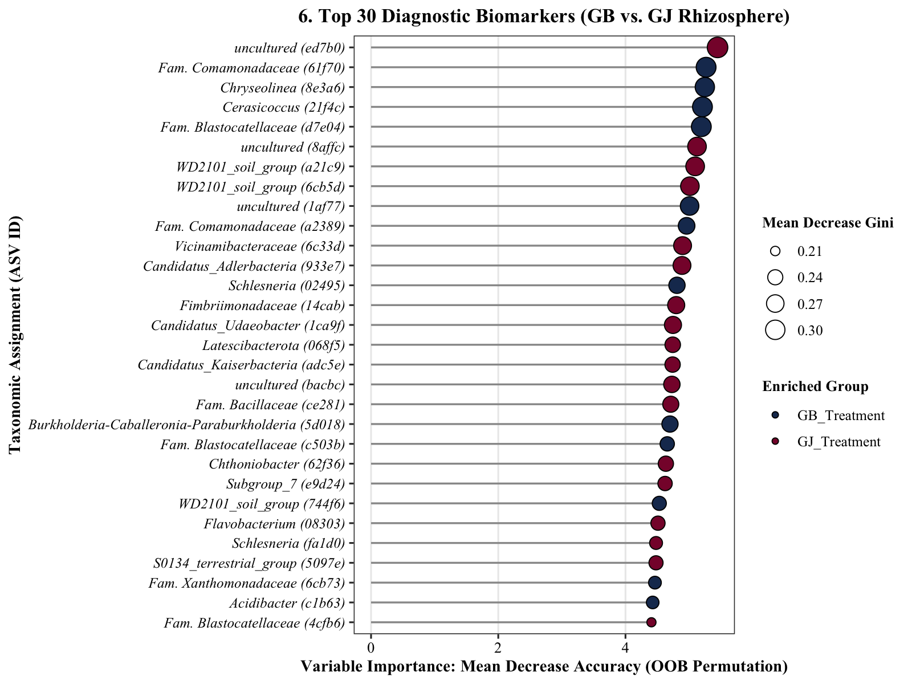
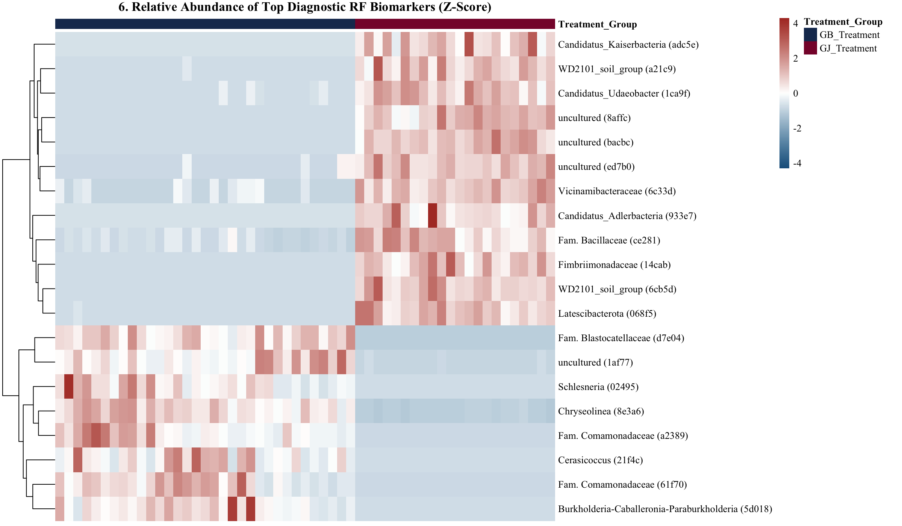
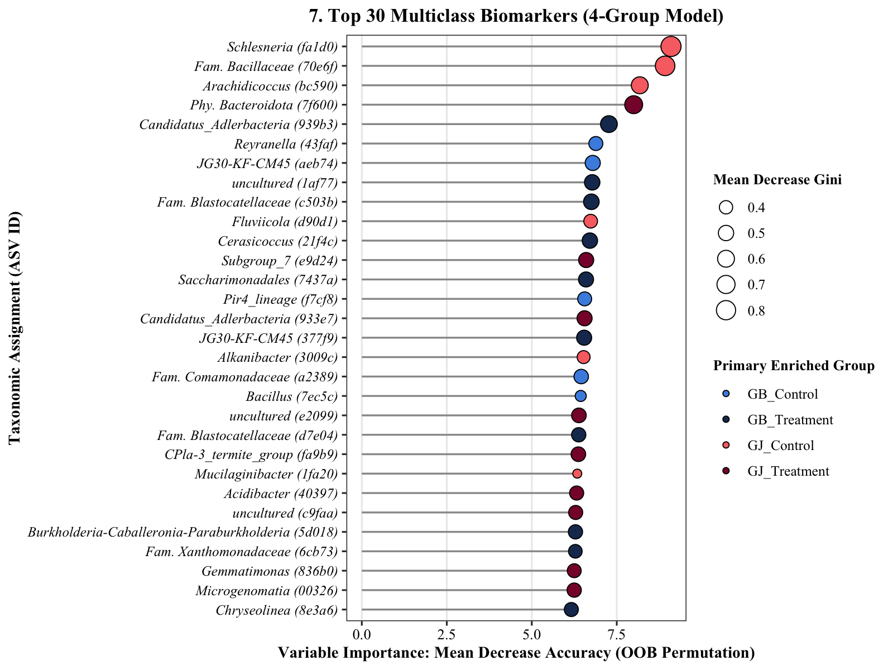
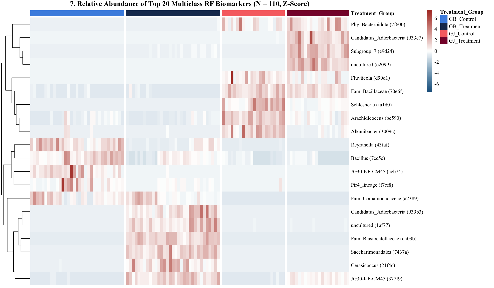
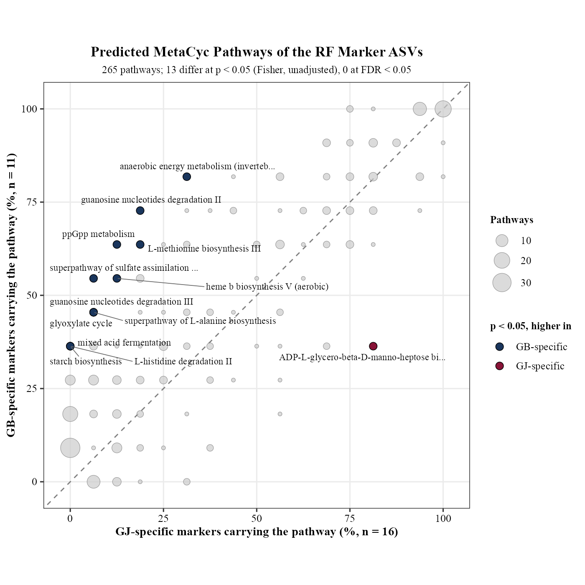
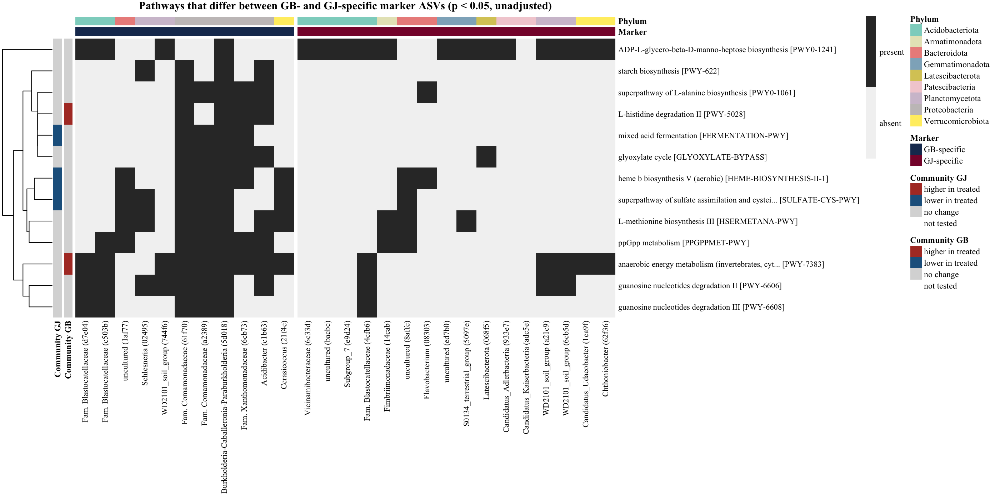

# Random Forest Classification and Predicted Pathways of Marker ASVs (N = 110)

**Date:** 2026-09-28
**Updated:** 2026-11-17 (Sections 3–5 added: marker ASVs specific to one soil, and their predicted PICRUSt2 pathways)
**Stage:** random forest (`GB_Treatment` vs `GJ_Treatment`; four groups); selection of GB- and GJ-specific marker ASVs with LinDA; MetaCyc pathways predicted for each marker ASV; comparison of the two marker sets
**Cohort:** five batches, original labels; N = 110 (`GB_Control` 33, `GB_Treatment` 33, `GJ_Control` 22, `GJ_Treatment` 22).
**Script:** `modules/14_random_forest_markers.R`, `modules/15_marker_pathways_picrust2.sh`, `modules/16_marker_pathway_comparison.R`; the same code is in `pipeline/run_analysis.R` (sections 9-1 to 10-2)
**Platform:** R 4.6.1 (`aarch64-apple-darwin23`), randomForest 4.7-1.2; PICRUSt2 2.6.3 (conda environment `picrust2`)
**Input:** `07_diversity_16S/core_metrics/rarefied_table.qza`, `05_taxonomy_16S/taxonomy_16S.qza`, `metadata_P_generation.tsv` (Sections 1–2); RF top 30 of Section 1 and the LinDA ASV results of 2026-08-24_01, Section 1 (Section 3); `picrust2_out_16S/` from 2026-07-29_01 (Section 4); pathway LinDA results of 2026-08-24_01, Section 5 (Section 5)

---

## 1. Random forest: `GB_Treatment` vs `GJ_Treatment`

The 55 treated samples were classified by soil (33 `GB_Treatment`, 22 `GJ_Treatment`):

```r
set.seed(42)
rf_model <- randomForest(
  x = x_data,                 # relative abundance (%) of the pre-filtered ASVs, samples in rows
  y = y_data,                 # Treatment_Group
  ntree = 2000,
  mtry = best_mtry,           # floor(sqrt(2,261)) = 47
  importance = TRUE,
  proximity = TRUE,
  sampsize = c(22, 22),       # 22 samples per class in each bootstrap sample
  nodesize = 2
)
```

* Input: the rarefied table (27,000 reads per sample), converted to relative abundance (%) per sample.
* ASVs were pre-filtered without using the group labels: present in at least 15% of the 55 samples (at least 9 samples) and mean relative abundance ≥ 0.005%. 2,261 of 23,771 ASVs were kept.
* `sampsize = c(22, 22)` draws the same number of samples from each class for every tree, to balance the 33 vs 22 samples.
* Importance is the mean decrease in accuracy (MDA) when an ASV is permuted in the out-of-bag (OOB) samples, as returned by `importance()` (divided by its standard error, the package default). Point size in the figure is the mean decrease in Gini impurity.
* "Enriched group" is the group with the higher mean relative abundance. It is descriptive, not a test.
* Full results were written to `RF_16S_Top30_Diagnostic_Biomarkers.csv` (not in the repository).

**OOB error: 0%.**

| | Predicted `GB_Treatment` | Predicted `GJ_Treatment` |
| :--- | ---: | ---: |
| `GB_Treatment` (33) | 33 | 0 |
| `GJ_Treatment` (22) | 0 | 22 |



* Of the top 30 ASVs, 12 were more abundant in `GB_Treatment` and 18 in `GJ_Treatment`.
* MDA of the top 30 ranged only from 4.41 to 5.45 (all 2,261 ASVs: −1.00 to 5.45), so the order within the top 30 carries little information.
* The five highest were an uncultured Gemmatimonadota ASV (`ed7b0`), Comamonadaceae (`61f70`), *Chryseolinea* (`8e3a6`), *Cerasicoccus* (`21f4c`) and Blastocatellaceae (`d7e04`).



* Rows: the top 20 of the 30 ASVs, relative abundance scaled to z-scores by row and clustered. Columns: samples ordered by group, not clustered.
* The rows form two blocks: 12 ASVs present in the GJ-treated samples and absent or near zero in the GB-treated samples, and 8 ASVs with the opposite pattern.
* Some ASVs were also detected in the other treated group, most often Bacillaceae (`ce281`, in 30 of 33 GB-treated samples), *Chryseolinea* (`8e3a6`, in 19 of 22 GJ-treated samples) and Vicinamibacteraceae (`6c33d`, in 11 of 33 GB-treated samples).

---

## 2. Random forest: four groups

The same model was trained on all 110 samples with `Treatment_Group` (four classes) as the response. Differences from Section 1:

* Pre-filter: present in at least 10% of the 110 samples (at least 11) and mean relative abundance ≥ 0.005%; 2,249 ASVs kept (`mtry` = 47).
* `sampsize = c(22, 22, 22, 22)`.
* Full results were written to `RF_16S_4Group_Top30_Biomarkers.csv` (not in the repository).

**OOB error: 0%.** All 110 samples were assigned to their own group.

| | `GB_Control` | `GB_Treatment` | `GJ_Control` | `GJ_Treatment` |
| :--- | ---: | ---: | ---: | ---: |
| `GB_Control` (33) | 33 | 0 | 0 | 0 |
| `GB_Treatment` (33) | 0 | 33 | 0 | 0 |
| `GJ_Control` (22) | 0 | 0 | 22 | 0 |
| `GJ_Treatment` (22) | 0 | 0 | 0 | 22 |



* Group with the highest mean relative abundance among the top 30: `GB_Control` 5, `GB_Treatment` 10, `GJ_Control` 6, `GJ_Treatment` 9. MDA ranged from 6.16 to 9.10.
* The four highest were *Schlesneria* (`fa1d0`), Bacillaceae (`70e6f`), *Arachidicoccus* (`bc590`) and an ASV classified only to Bacteroidota (`7f600`). The first three are most abundant in `GJ_Control`.
* 11 of the 30 ASVs are also in the top 30 of Section 1.



* Several of the top 20 are most abundant in a control group: *Schlesneria* (`fa1d0`), *Arachidicoccus* (`bc590`) and *Alkanibacter* (`3009c`) in `GJ_Control`; *Reyranella* (`43faf`), *Bacillus* (`7ec5c`), JG30-KF-CM45 (`aeb74`) and Pir4_lineage (`f7cf8`) in `GB_Control`. Bacillaceae (`70e6f`) and *Fluviicola* (`d90d1`) are found in both GJ groups, and Comamonadaceae (`a2389`) in both GB groups at similar levels.
* Other rows are found almost only in one treated group, for example *Candidatus* Adlerbacteria (`939b3`), Blastocatellaceae (`c503b`) and Saccharimonadales (`7437a`) in `GB_Treatment`, and *Candidatus* Adlerbacteria (`933e7`) and an uncultured ASV (`e2099`) in `GJ_Treatment`.
* The two control groups were also separated without error. A GB vs GJ model therefore also picks up ASVs that differ between the two experiments and are not linked to the soil suspension (README, Section 6). Section 3 removes such ASVs by checking each marker against its own control.
* Accuracy is the OOB estimate only. No samples or sets were held out for testing.

---

## 3. Marker ASVs specific to one soil

*Added 2026-11-17.*

The top 30 ASVs of Section 1 were checked against the LinDA results for each treatment vs its own control (2026-08-24_01, Section 1: unrarefied table, imputed zeros; FDR < 0.05 and |log2FC| ≥ 1):

```r
Marker_Set = case_when(
  Enriched_In == "GB_Treatment" & LinDA_GB == "up" & LinDA_GJ != "up" ~ "GB-specific",
  Enriched_In == "GJ_Treatment" & LinDA_GJ == "up" & LinDA_GB != "up" ~ "GJ-specific",
  TRUE                                                                ~ "excluded"
)
```

* `up` = enriched in the treated group; `down` = enriched in the control; `ns` = neither; `not tested` = removed by LinDA's 10% prevalence filter in that contrast (absent or rare in that soil).
* A GB-specific marker is more abundant in `GB_Treatment` than in `GJ_Treatment` (RF), enriched in `GB_Treatment` vs `GB_Control` (LinDA), and not enriched in `GJ_Treatment` vs `GJ_Control`. GJ-specific markers are defined the same way.
* Result: 11 GB-specific and 16 GJ-specific marker ASVs; 3 ASVs were excluded.

| Excluded ASV | RF: higher in | LinDA GB | LinDA GJ | Mean relative abundance, % (samples detected) |
| :--- | :--- | :--- | :--- | :--- |
| *Chryseolinea* (`8e3a6`) | `GB_Treatment` | up (log2FC 10.50) | up (log2FC 6.02) | `GB_Treatment` 0.716 (33/33); `GJ_Treatment` 0.026 (19/22); both controls ≤ 2 samples |
| Bacillaceae (`ce281`) | `GJ_Treatment` | ns | ns (log2FC 0.89, FDR 3.9 × 10⁻⁵) | `GB_Control` 0.296 (31/33), `GB_Treatment` 0.132 (30/33), `GJ_Control` 1.402 (22/22), `GJ_Treatment` 1.019 (22/22) |
| *Schlesneria* (`fa1d0`) | `GJ_Treatment` | not tested | ns (log2FC −0.94) | `GJ_Control` 0.529 (22/22), `GJ_Treatment` 0.104 (22/22); not detected in GB samples |

*Chryseolinea* was enriched by both soils. The other two are more abundant in GJ samples in general, including the GJ controls; *Schlesneria* (`fa1d0`) is also the top ASV of the four-group model (Section 2).

**Marker ASVs.** Relative abundance from the rarefied table: mean % (samples detected / group size). "Own" = the soil of the marker set; log2FC is from LinDA, treated vs own control.

| Set | ASV | Phylum | log2FC | Own treated | Own control | Other treated | Other control |
| :--- | :--- | :--- | ---: | :--- | :--- | :--- | :--- |
| GB | Comamonadaceae (`61f70`) | Proteobacteria | 6.81 | 0.310 (33/33) | 0.040 (12/33) | 0 (0/22) | 0 (0/22) |
| GB | *Cerasicoccus* (`21f4c`) | Verrucomicrobiota | 8.83 | 0.296 (33/33) | <0.001 (2/33) | 0 (0/22) | 0 (0/22) |
| GB | Blastocatellaceae (`d7e04`) | Acidobacteriota | 7.36 | 0.066 (33/33) | 0 (0/33) | 0 (0/22) | 0 (0/22) |
| GB | uncultured (`1af77`) | Bacteroidota | 8.39 | 0.158 (33/33) | <0.001 (1/33) | 0.002 (3/22) | <0.001 (1/22) |
| GB | Comamonadaceae (`a2389`) | Proteobacteria | 1.70 | 0.129 (33/33) | 0.139 (29/33) | 0 (0/22) | 0 (0/22) |
| GB | *Schlesneria* (`02495`) | Planctomycetota | 7.60 | 0.114 (33/33) | <0.001 (1/33) | 0 (0/22) | 0 (0/22) |
| GB | *Burkholderia-Caballeronia-Paraburkholderia* (`5d018`) | Proteobacteria | 7.97 | 0.129 (33/33) | 0 (0/33) | 0 (0/22) | 0 (0/22) |
| GB | Blastocatellaceae (`c503b`) | Acidobacteriota | 7.60 | 0.077 (33/33) | 0 (0/33) | 0 (0/22) | 0 (0/22) |
| GB | WD2101_soil_group (`744f6`) | Planctomycetota | 8.30 | 0.442 (33/33) | 0.014 (9/33) | 0 (0/22) | 0.002 (1/22) |
| GB | Xanthomonadaceae (`6cb73`) | Proteobacteria | 7.47 | 0.078 (33/33) | 0 (0/33) | 0 (0/22) | 0 (0/22) |
| GB | *Acidibacter* (`c1b63`) | Proteobacteria | 10.00 | 0.429 (33/33) | 0 (0/33) | 0 (0/22) | 0 (0/22) |
| GJ | uncultured (`ed7b0`) | Gemmatimonadota | 7.98 | 0.068 (22/22) | 0 (0/22) | 0.003 (4/33) | 0 (0/33) |
| GJ | uncultured (`8affc`) | Bacteroidota | 6.18 | 0.153 (22/22) | 0.025 (11/22) | 0 (0/33) | 0 (0/33) |
| GJ | WD2101_soil_group (`a21c9`) | Planctomycetota | 7.61 | 0.057 (22/22) | 0 (0/22) | <0.001 (1/33) | 0 (0/33) |
| GJ | WD2101_soil_group (`6cb5d`) | Planctomycetota | 10.99 | 0.573 (22/22) | 0 (0/22) | 0 (0/33) | 0 (0/33) |
| GJ | Vicinamibacteraceae (`6c33d`) | Acidobacteriota | 5.26 | 0.141 (22/22) | 0.036 (13/22) | 0.014 (11/33) | 0.016 (10/33) |
| GJ | *Candidatus* Adlerbacteria (`933e7`) | Patescibacteria | 9.56 | 0.277 (22/22) | 0.001 (1/22) | 0 (0/33) | 0 (0/33) |
| GJ | Fimbriimonadaceae (`14cab`) | Armatimonadota | 7.42 | 0.049 (22/22) | 0 (0/22) | 0 (0/33) | 0 (0/33) |
| GJ | *Candidatus* Udaeobacter (`1ca9f`) | Verrucomicrobiota | 8.13 | 0.078 (22/22) | 0 (0/22) | 0.002 (5/33) | 0 (0/33) |
| GJ | Latescibacterota (`068f5`) | Latescibacterota | 8.31 | 0.093 (22/22) | 0 (0/22) | <0.001 (1/33) | 0 (0/33) |
| GJ | *Candidatus* Kaiserbacteria (`adc5e`) | Patescibacteria | 9.73 | 0.268 (22/22) | 0 (0/22) | 0 (0/33) | 0 (0/33) |
| GJ | uncultured (`bacbc`) | Acidobacteriota | 7.72 | 0.056 (22/22) | 0 (0/22) | 0 (0/33) | 0 (0/33) |
| GJ | *Chthoniobacter* (`62f36`) | Verrucomicrobiota | 7.75 | 0.079 (22/22) | 0.002 (2/22) | 0 (0/33) | 0 (0/33) |
| GJ | Subgroup_7 (`e9d24`) | Acidobacteriota | 8.64 | 0.113 (22/22) | 0 (0/22) | 0.004 (11/33) | 0 (0/33) |
| GJ | *Flavobacterium* (`08303`) | Bacteroidota | 8.44 | 0.171 (22/22) | <0.001 (1/22) | 0 (0/33) | 0 (0/33) |
| GJ | S0134_terrestrial_group (`5097e`) | Gemmatimonadota | 7.53 | 0.052 (22/22) | 0 (0/22) | 0 (0/33) | 0 (0/33) |
| GJ | Blastocatellaceae (`4cfb6`) | Acidobacteriota | 9.47 | 0.193 (22/22) | 0 (0/22) | 0 (0/33) | 0 (0/33) |

* All 27 markers were detected in every sample of their own treated group. 26 of 27 were "not tested" in the other soil's LinDA run; Vicinamibacteraceae (`6c33d`) was tested in GB and was not significant (log2FC 1.31, FDR 0.07).
* Comamonadaceae (`a2389`) differs from the other markers: it was found in 29 of 33 GB controls at a mean relative abundance similar to that in `GB_Treatment` (0.139% vs 0.129%). LinDA, which uses the unrarefied counts and corrects its fold changes for compositional effects, still called it enriched (log2FC 1.70, FDR 9.9 × 10⁻⁴), so it meets the rule.
* **Phyla.** GB-specific: Proteobacteria 5, Acidobacteriota 2, Planctomycetota 2, Bacteroidota 1, Verrucomicrobiota 1. GJ-specific: Acidobacteriota 4; Bacteroidota, Gemmatimonadota, Patescibacteria, Planctomycetota and Verrucomicrobiota 2 each; Armatimonadota and Latescibacterota 1 each. None of the GJ-specific markers is a proteobacterium.
* Output: `rf_picrust2/rf_markers.tsv` (not in the repository).

---

## 4. Predicted pathways of each marker ASV (PICRUSt2)

*Added 2026-11-17.*

The marker rows of two tables from the PICRUSt2 run of 2026-07-29_01 were copied unchanged into new files (`seqtab_norm.tsv.gz`: abundance per sample divided by the predicted 16S copy number; `combined_EC_predicted.tsv.gz`: predicted EC numbers per ASV). Pathways were then inferred separately for each marker ASV:

```bash
pathway_pipeline.py \
  -i picrust2_out_16S/EC_metagenome_out/pred_metagenome_unstrat.tsv.gz \
  -o rf_picrust2/pathways_markers \
  --per_sequence_contrib \
  --per_sequence_abun rf_picrust2/seqtab_norm_markers.tsv.gz \
  --per_sequence_function rf_picrust2/EC_predicted_markers.tsv.gz \
  --coverage \
  -p 4

add_descriptions.py \
  -i rf_picrust2/pathways_markers/path_abun_unstrat_per_seq.tsv.gz \
  -m METACYC \
  -o rf_picrust2/pathways_markers/path_abun_unstrat_per_seq_descrip.tsv.gz
```

* `--per_sequence_contrib` runs MinPath on the predicted EC content of each ASV separately. `path_abun_predictions.tsv.gz` has one row per marker ASV and one column per pathway; a value > 0 was counted as "pathway predicted present".
* HTML entities in the pathway names (for example `&beta;`) were replaced in R.
* These are predictions from the closest reference genomes, not measured functions. Nearest sequenced taxon index (NSTI) of the markers: GB-specific median 0.060 (0.006–0.251); GJ-specific median 0.135 (0.017–0.236). GJ-specific markers are on average less closely related to a reference genome.
* Closely related ASVs can receive the same prediction. The three WD2101_soil_group ASVs (`744f6` GB-specific; `a21c9` and `6cb5d` GJ-specific) have the same closest reference genome (GCF_015169395.1) and identical pathway profiles. The uncultured Bacteroidota ASVs `1af77` (GB) and `8affc` (GJ) also have identical pathway profiles. The 27 markers have 24 distinct profiles.
* Pathways per marker ASV: GB-specific median 113 (93–191); GJ-specific median 99.5 (73–127). The highest numbers were in *Burkholderia-Caballeronia-Paraburkholderia* (`5d018`, 191) and Comamonadaceae (`61f70`, 166).

---

## 5. GB-specific vs GJ-specific marker ASVs

*Added 2026-11-17.*

For each pathway, the number of markers in each set carrying it was compared with Fisher's exact test (2 × 2: carriers and non-carriers × set), and p-values were adjusted with the Benjamini–Hochberg method across all pathways. The community-level result of each pathway (pathway LinDA, treated vs own control, FDR < 0.05; 2026-08-24_01, Section 5) was added for comparison.

* 265 pathways were predicted in at least one marker ASV: 22 in all 27, 59 in at least 75% of both sets, 61 only in GB-specific markers and 19 only in GJ-specific markers.
* **No pathway differed between the sets after FDR correction** (smallest FDR 0.70). 13 pathways had an unadjusted p < 0.05.
* Outputs: `pathway_comparison_GB_vs_GJ.tsv`, `marker_pathway_presence.tsv` and `marker_pathway_counts.tsv` in `rf_picrust2/` (not in the repository).



* Each grey bubble is a set of pathways with the same pair of percentages; its size is the number of pathways. The dashed line marks equal shares. Coloured points are the 13 pathways with p < 0.05 (unadjusted).

| Pathway | GB-specific (of 11) | GJ-specific (of 16) | p (Fisher) | Community GB | Community GJ |
| :--- | ---: | ---: | ---: | :--- | :--- |
| superpathway of sulfate assimilation and cysteine biosynthesis (`SULFATE-CYS-PWY`) | 6 | 1 | 0.0087 | no change | lower in treated |
| ppGpp metabolism (`PPGPPMET-PWY`) | 7 | 2 | 0.011 | no change | no change |
| guanosine nucleotides degradation II (`PWY-6606`) | 8 | 3 | 0.015 | no change | no change |
| anaerobic energy metabolism (invertebrates, cytosol) (`PWY-7383`) | 9 | 5 | 0.018 | higher in treated | no change |
| mixed acid fermentation (`FERMENTATION-PWY`) | 4 | 0 | 0.019 | no change | lower in treated |
| L-histidine degradation II (`PWY-5028`) | 4 | 0 | 0.019 | higher in treated | no change |
| starch biosynthesis (`PWY-622`) | 4 | 0 | 0.019 | no change | no change |
| glyoxylate cycle (`GLYOXYLATE-BYPASS`) | 5 | 1 | 0.027 | no change | no change |
| guanosine nucleotides degradation III (`PWY-6608`) | 5 | 1 | 0.027 | no change | no change |
| superpathway of L-alanine biosynthesis (`PWY0-1061`) | 5 | 1 | 0.027 | no change | no change |
| heme b biosynthesis V (aerobic) (`HEME-BIOSYNTHESIS-II-1`) | 6 | 2 | 0.033 | no change | lower in treated |
| L-methionine biosynthesis III (`HSERMETANA-PWY`) | 7 | 3 | 0.040 | no change | no change |
| ADP-L-glycero-β-D-manno-heptose biosynthesis (`PWY0-1241`) | 4 | 13 | 0.040 | no change | no change |



* Rows: the 13 pathways (clustered); columns: marker ASVs, grouped by set and phylum. The two left-hand columns show the community-level pathway LinDA result.
* 12 of the 13 pathways were more common among GB-specific markers. Comamonadaceae (`61f70`) and *Burkholderia-Caballeronia-Paraburkholderia* (`5d018`) carry all 12.
* In the GB set, four of these pathways are carried only by Proteobacteria: mixed acid fermentation (4 of the 5 proteobacterial markers), L-histidine degradation II (4 of 5), glyoxylate cycle (5 of 5) and superpathway of L-alanine biosynthesis (5 of 5). Because the GJ set contains no Proteobacteria, these differences follow the phylum composition of the two sets.
* ADP-L-glycero-β-D-manno-heptose biosynthesis was the only pathway more common among GJ-specific markers (13 of 16 vs 4 of 11).
* At the community level, `PWY-7383` and `PWY-5028` were higher in `GB_Treatment` than in `GB_Control`, and `SULFATE-CYS-PWY`, `FERMENTATION-PWY` and `HEME-BIOSYNTHESIS-II-1` were lower in `GJ_Treatment` than in `GJ_Control`. The other eight pathways did not differ in either contrast.
* As in 2026-08-24_01, some pathway names refer to other organisms (for example "anaerobic energy metabolism (invertebrates, cytosol)"); they describe enzyme sets in MetaCyc, not the organisms present.
